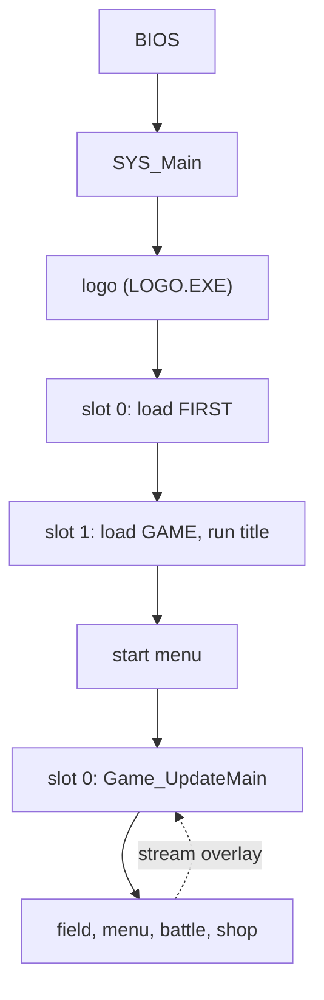

Breath of Fire III (NTSC-U) runs as one resident executable, one resident game program and a set of overlays that the loader streams from the disc into fixed RAM windows. This page tells the whole run once, from power-on to a running frame, and names the page that holds the detail of each step. A claim with no tag was read directly in the game; [notation](../notation/#evidence-tags) defines the two tags that mark the exceptions.

## From power-on to a running frame

The PlayStation BIOS loads `SLUS_004.22` and jumps to its first instruction. A short C runtime stub clears the BSS, sets the stack and calls `SYS_Main`. `SYS_Main` starts the hardware, builds two display buffers and plays the Capcom logo. The logo is a second program, `LOGO.EXE`, which the executable loads into RAM and runs with `Exec`. When it returns, `SYS_Main` registers a first callback and enters a loop that never ends. [Boot](../../systems/boot/) covers this part.

Every pass of that loop does the same thing. It waits for the display, swaps the two buffers, draws what the last pass built, runs the game logic and builds the next set of primitives. The loop runs 30 passes per second. The game logic is not called directly. It lives in four cooperative callback slots that the loop runs in turn, and a slot's code runs until it yields or exits. The [frame loop](../frame-loop/) page explains one pass and the [scheduler](../scheduler/) explains the slots.

The first callback loads the first archive, `FIRST.EMI`, with the EMI loader, and then registers a second callback in the next slot. That callback loads `GAME.EMI`, which holds the resident game program and the title overlay, and runs the title. The loader reads the disc in the background of the frame loop, so a callback waits for it with a yield and never blocks a frame. [Loading](../loading/) describes how a request flows through the loader, and [disc and files](../../formats/disc/) lists what the disc holds.

From the title, a choice leads to the start menu, which offers a new game or a saved one. Either choice installs `Game_UpdateMain` in slot 0. That function runs a 12-entry state table once per pass. The field is one state in that table, and menus, battles and shops are the others. Within the field, the area code runs each frame and a story controller (a scenario overlay) drives events. When the game needs more code, such as a battle or a scenario, it asks the loader to stream an overlay into its window, and then calls into it. [Phases](../../systems/phases/) follows the transitions, and [memory](../memory/) shows which images share which RAM.

## Sources and confidence

- **Confidence:** high. The sequence is the one that the linked system pages establish.
- **Evidence:** each step cites its own page; this page adds no fact that a linked page lacks.

## Related

- [Boot](../../systems/boot/): the steps from the BIOS handoff to the first title frame.
- [Frame loop](../frame-loop/) and [scheduler](../scheduler/): one pass of the loop and the four callback slots.
- [Memory map](../memory/) and [loading](../loading/): which image owns which RAM, and how data reaches it.
- [Game phases](../../systems/phases/): every phase from power-on to the end credits.
- [Edit the game](../../guides/): how to change each kind of data.
