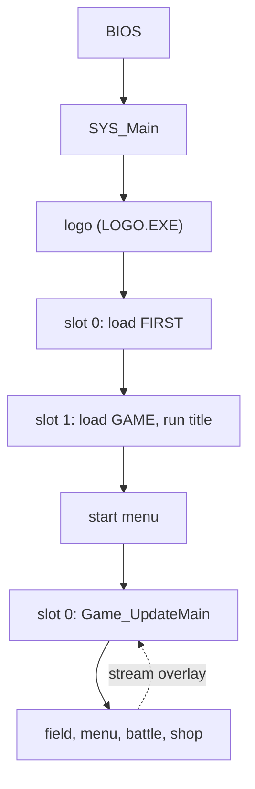

Breath of Fire III (NTSC-U) runs as one resident executable, one resident game program and a set of overlays that the loader streams from the disc into fixed RAM windows. This page traces the run from power-on to a running frame and links the page that owns each step. Untagged claims were read in the game; [notation](../notation/#evidence-tags) defines the two exception tags.

## From power-on to a running frame

The PlayStation BIOS loads `SLUS_004.22` and jumps to its first instruction. A C runtime stub clears the BSS, sets the stack and calls `SYS_Main`. `SYS_Main` initializes the hardware, builds two display buffers and plays the Capcom logo, a separate program (`LOGO.EXE`) that it loads and starts with `Exec`. When the logo returns, `SYS_Main` registers a first callback and enters the permanent main loop. [Boot](../../systems/boot/) covers this part.

Each pass of the loop waits for the display, swaps the two buffers, draws the previous pass's primitives, runs the game logic and builds the next primitives. The loop runs at 30 passes per second. Game logic runs in four cooperative callback slots that the loop runs in turn; a slot runs until it yields or exits. The [frame loop](../frame-loop/) describes one pass and the [scheduler](../scheduler/) describes the slots.

The first callback loads `FIRST.EMI` with the EMI loader and registers a second callback in the next slot. That callback loads `GAME.EMI` (the resident game program and the title overlay) and runs the title. The loader reads the disc in the background, so a callback waits with a yield and never blocks a frame. [Loading](../loading/) describes how a request flows through the loader, and [disc and files](../../formats/disc/) lists what the disc holds.

The title leads to the start menu (new or saved game). Either choice installs `Game_UpdateMain` in slot 0, which runs a 12-entry state table once per pass. The field is one state; menus, battles and shops are others. In the field, the area code runs each frame and a scenario overlay drives story events. Code for a battle or scenario is streamed by the loader into its overlay window, then called. [Phases](../../systems/phases/) follows the transitions, and [memory](../memory/) shows which images share which RAM.

## Sources and confidence

- **Confidence:** high. The sequence is the one that the linked system pages establish.
- **Evidence:** each step cites its own page.

## Related

- [Boot](../../systems/boot/): the steps from the BIOS handoff to the first title frame.
- [Frame loop](../frame-loop/) and [scheduler](../scheduler/): one pass of the loop and the four callback slots.
- [Memory map](../memory/) and [loading](../loading/): which image owns which RAM, and how data reaches it.
- [Game phases](../../systems/phases/): every phase from power-on to the end credits.
- [Edit the game](../../guides/): how to change each kind of data.
