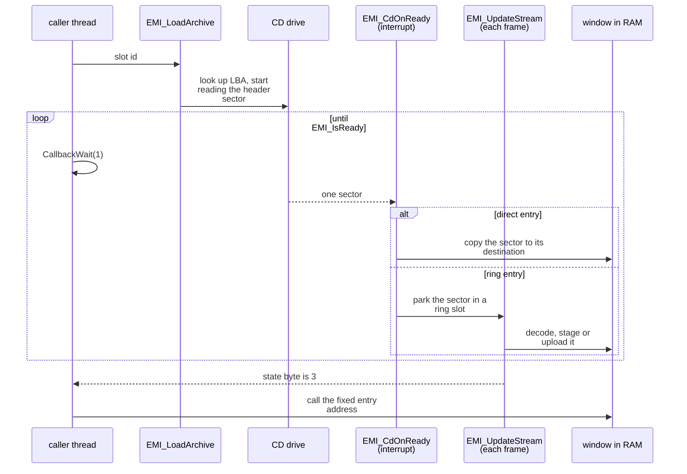

The game streams almost everything it runs or draws from the disc during play: overlay code, area maps, battle data, character graphics, sound banks and story scenes. Only the main executable and the resident game program stay in RAM. A load request names one archive by its slot id, and `EMI_LoadArchive` starts a CD stream that writes each entry of the archive to its destination in a fixed [memory](../memory/) window. This page follows one request from the call to the first byte in RAM and then covers the load path of each kind of data. The archive layout is in the [EMI container](../../formats/emi/).

## Load request flow

Seven steps take a request from the slot id to usable data.

1. **Request.** Game code calls `EMI_LoadArchive (exe/slus_004_22@0x80161FDC)` with a slot id. The slot id is the index of the archive in the disc file list. The call looks up the archive's disc address in the table `g_EmiSlotLbas (exe/slus_004_22@0x80182444)`, installs two CD callbacks, and starts the drive. It returns at once.
2. **Wait.** The calling thread polls with `CallbackWait(1)` until `EMI_IsReady` returns nonzero. The other callback threads keep running, so a load blocks only its caller. In battle, a step machine polls instead of a loop.
3. **Table of contents.** The first sector of every EMI archive is its table of contents. `EMI_ReadToc` checks the `MATH_TBL` tag and computes the first sector of each entry.
4. **Entries.** The loader reads the entries in order. Each has a type that says where its bytes go: copied to a RAM address, decompressed to a RAM address, uploaded to VRAM, or sent to the SPU. The entry's load argument holds the address.
5. **Sectors.** Each sector raises a CD-ready interrupt. `EMI_CdOnReady (exe/slus_004_22@0x80162230)` either copies the sector straight to its destination, or parks it in a ring slot for the main loop to process.
6. **Tick.** Once per frame, step 11 of the [frame loop](../frame-loop/) calls `EMI_Update`. In mode 1 it runs `EMI_UpdateStream`, which advances the CD steps and drains the ring slots: it decodes, stages or uploads each parked sector.
7. **Ready.** After the last entry, the loader pauses the CD. One frame with no ring slot left to drain later, the stream state byte becomes 3. `EMI_IsReady` returns true, the waiting thread wakes and calls into the new code at its fixed address.

Two properties follow. Only one stream owns the CD at a time: a new request overrides the old one, and nothing queues. `[inferred]` The loader also does not know what the window held before. A later load at the same address overwrites the overlay, and no guard stops a load into a window whose previous overlay is still running. `[unknown]` for any guard in code not read.

### A worked example

The first area, `AREA001`, is the archive for slot `0x2AB + 1`. Its table of contents lists 14 entries:

| Entries |    Type | Load argument                                          | What the loader does                                                         |
| ------- | ------: | ------------------------------------------------------ | ---------------------------------------------------------------------------- |
| 0, 1, 2 | 6, 8, 7 | `0x2` (bank index)                                     | sound bank header, cue table and sample body, to the bank record and SPU RAM |
| 3, 4    |       0 | `0x800E3800`, `0x800D3800`                             | copy the scene table and the script bank                                     |
| 5, 7    |       3 | `0x0E001000`, `0x0A081000`                             | upload two graphics blocks to VRAM                                           |
| 6, 8    |       0 | `0x80035800`, `0x80033E00`                             | copy two palette slices to the palette arena                                 |
| 9 to 12 |       0 | `0x80032000`, `0x800E4000`, `0x80010000`, `0x80104000` | copy the area table, encounter table, text bank and map bundle               |
| 13      |       0 | `0x801F2C00`                                           | copy the area program, last                                                  |

The program is last, so the stream is ready only after the program is in place, and the caller can call into it the moment the wait ends. `[inferred]` The type-3 load arguments are packed: for `0x0E001000` the top byte holds the start column (14), the next byte the row (0) and the third byte the number of columns before the upload wraps (16). Each column is 32 pixels wide, so this block starts at VRAM x = 448.

## Slot ids

A slot id is the archive's index in the disc file list, in ascending disc order. Fixed archives have fixed ids. Numbered series start at a base slot, and archive n of a series sits at base + n. The base slot of each series and the caller that picks it are in the [EMI container](../../formats/emi/#disc-slot-ids).

:::note
A slot id names an archive. The entry slot is a different number: the index of one entry inside an archive's table of contents.
:::

The fixed archives have these ids:

| Slot id            | Archive                                                                                                                                                                                                                    |
| ------------------ | -------------------------------------------------------------------------------------------------------------------------------------------------------------------------------------------------------------------------- |
| `0` to `8`         | `BATL_DRA`, `BATL_END`, `BATL_OVR`, `BATL_RE2`, `BATL_RET`, `BATL_SE`, `BATTLE`, `BATTLE2`, `COMN_SE`                                                                                                                      |
| `0x254` to `0x269` | `A085SE2`, `A108SE2`, `AFLDKWA`, `BATE`, `COMMU00`, `COMMU01`, `COMMU02`, `COMMU02B`, `COMMU03`, `COMMU04`, `COMMU05`, `DEMO`, `ENDKANJI`, `FIRST`, `GAME`, `MTEST`, `RTEST`, `SHISU`, `SHOP`, `SISYOU`, `START`, `STATUS` |

`FIRST` is `0x261`, `GAME` is `0x262`, `DEMO` is `0x25F`, `START` is `0x268`, `STATUS` is `0x269` and `SHOP` is `0x266`.

The table `g_EmiSlotLbas` has 887 entries, one per disc file, so the slot ids run from 0 to `0x376`. The XA files and the movie have slots too, but they are not read through the EMI stream. `EMI_GetArchiveId (exe/slus_004_22@0x8016728C)` turns a character family and an index into a slot id: family 0 is `PL`, 1 is `BPLD`, 2 is `BPLU` and 3 is `PLP`.

## Entry types

The table of contents gives each entry a type from 0 to 10. The type selects a handler from `g_EmiEntryHandlers (exe/slus_004_22@0x80183248)`. The type names below are the handler names, because the loader does not name the types. `[inferred]`

|  Type | Handler              | Path                 | Effect                                            |
| ----: | -------------------- | -------------------- | ------------------------------------------------- |
|     0 | `EMI_LoadToRam`      | direct               | copy the sectors to the load address              |
|  1, 2 | `EMI_LoadCompressed` | ring, states 1 and 2 | LZ77 decode to the load address                   |
|     3 | `EMI_LoadToVram`     | ring, state 3        | upload each sector to VRAM                        |
|     4 | `EMI_ReadToc`        | direct               | second table-of-contents state; no caller traced  |
|     5 | `EMI_ReadToc`        | ring                 | the header sector, the first read of every stream |
|     6 | `EMI_LoadVabHeader`  | direct               | sound bank header to the bank record              |
|     7 | `EMI_LoadVabBody`    | ring, state 4        | sound bank body to SPU RAM                        |
|     8 | `EMI_LoadSoundCues`  | direct               | cue table to the bank record                      |
| 9, 10 | `EMI_LoadSequence`   | direct               | music sequence to the bank's sequence buffer      |

Direct types (0, 4, 6, 8, 9, 10) are copied at interrupt time by `EMI_CopySectorData`. Ring types (1, 2, 3, 5, 7) go through 23 ring slots of 2,048 bytes at `g_EmiRingBase + (slot << 11)`, where `g_EmiRingBase` is `0x800E4800`. The ring keeps the order. If the target ring slot is still occupied, or the first word of a sector differs from the first word that the table of contents recorded, the loader flags the read for a retry. If a stream makes no progress for about 300 frames, the loader rearms the read. The drain functions, one per ring state, are in `g_EmiRingSlotHandlers (exe/slus_004_22@0x80149C60)`: 1 `EMI_CopySectorToScratchpad`, 2 `EMI_DecompressSector`, 3 `EMI_UploadSectorImage`, 4 `EMI_UploadVabBody`.

### Decode

A compressed entry (types 1 and 2) is decoded as it arrives. `EMI_DecompressSector` calls `LZ77_DecodeBegin (exe/slus_004_22@0x80164028)` with the destination. `EMI_CopySectorToScratchpad` then copies each sector to the scratchpad as two 1,024-byte halves and calls `LZ77_DecodeStep (exe/slus_004_22@0x80164064)` for each half. The decoder context sits at `0x800327A0`, its source pointer starts at scratchpad offset 6 and its limit is offset `0x400`. The format is in [LZ77](../../formats/lz77/).

### The CD steps

The CD itself runs as a small state machine, `g_EmiCdSteps (exe/slus_004_22@0x80149C3C)`. Its steps are, in order: idle, set speed, seek, finish seek, start read, finish read, pause, finish pause, idle. `EMI_StartArchive (exe/slus_004_22@0x80162178)` converts an LBA to a CD position and arms the first step.

### The end of a stream

After the last entry, `EMI_EndArchive` sets the pause step. `EMI_CdOnPause` then sets the state byte to 2 and removes the ready callback. `EMI_UpdateStream` moves the byte from 2 to 3 on a frame with no ring slot to drain. The stream is therefore ready one frame after the pause, not at the last sector.

### One stream at a time

`g_EmiServiceMode (exe/slus_004_22@0x80146840)` holds the CD owner: 0 idle, 1 EMI stream, 2 XA audio. `EMI_Update` runs `EMI_UpdateStream` in mode 1 and `SND_ServiceXA` in mode 2. When an EMI stream starts while XA is playing, `EMI_LoadArchive` makes one non-blocking `CdSync(1)` check. If the status has any of the bits `0xE0` set, the read starts at the pause step instead of the speed step. The new stream takes over at once. Nothing waits for the XA stream to end.

Bit `0x20` of `g_EmiStreamFlags (exe/slus_004_22@0x80146854)` shortens a load. `EMI_NextEntry` then ends the stream at the first entry with a type below 6, so only the leading sound bank entries load. The loader clears the flag when the stream reaches state 3. Several overlay functions set it, for example the battle return path `Battle_ReloadAreaAudio (emi/battle/battle/03@0x801D7108)`, which reloads the area's audio without reloading its data.

## Overlay swaps

A swap overwrites the old overlay's code and its own variables. Only the persistent block and the executable's variables outlive it ([memory](../memory/#overlay-windows)). Every swap starts with one `EMI_LoadArchive` call. Code outside battle mostly waits in a `CallbackWait` loop. Battle code polls `EMI_IsReady` from a step machine and advances `g_BattleSubStep` when the stream is ready. The table lists the call sites read. Functions not read are not covered.

| Trigger                | Caller                                                                                                             | Slot                                                                                                                                 | Waits for                                      |
| ---------------------- | ------------------------------------------------------------------------------------------------------------------ | ------------------------------------------------------------------------------------------------------------------------------------ | ---------------------------------------------- |
| First start, reset     | `SYS_StartFrontend`                                                                                                | `FIRST` (`0x261`)                                                                                                                    | the `CallbackWait` loop                        |
| Title                  | `SYS_EnterFrontend`                                                                                                | `GAME` (`0x262`)                                                                                                                     | the same loop                                  |
| Title demo             | `Game_BeginTitle (emi/etc/game/01@0x801D0C90)`                                                                     | `DEMO` (`0x25F`)                                                                                                                     | the same loop                                  |
| Start menu, menus      | `Game_LoadCampMenu`, `Game_LoadMenuOverlay`, `Game_LoadShopOverlay`, `Game_LoadAbilityMenu`, `Game_LoadStatusMenu` | `START` `0x268`, `STATUS` `0x269`, `SHOP` `0x266`, `BATE` `0x257`, `SHISU` `0x265`; `SISYOU` `0x267` from `Master_RunSceneEvent`     | the same loop; `Master_RunSceneEvent` polls    |
| Dialogue               | `Game_ReturnFromMenu`, `Game_ReturnFromShop`; `emi/etc/commu00/00`                                                 | `COMMU00` (`0x258`); `COMMU01` to `COMMU05` (`0x259` to `0x25E`)                                                                     | `COMMU00`: the loop; the rest: the event step  |
| Scenario               | `Scene_Start` to `Scene_RequestOverlay`                                                                            | `SCENA` + scenario id (`0x295 + id`)                                                                                                 | the same loop                                  |
| Area change            | `func_8019FAA0 (emi/etc/game/00@0x8019FAA0)`                                                                       | `AREA` + area seed (`0x2AB + seed`)                                                                                                  | the same loop                                  |
| Audio-only area reload | `Battle_ReloadAreaAudio`                                                                                           | `AREA` + `g_GameAreaId`, with flag bit `0x20`                                                                                        | battle step machine                            |
| Inside battle          | `battle/03`, `battle/15`                                                                                           | `BATL_SE`, `BATL_RET`, `BATL_END`, `BATL_OVR`, `BATL_DRA`, `BATL_RE2`, `COMN_SE`, `ENEMY` + area, `AFLDKWA`, `BPLD`, `BPLU`, `MAGIC` | battle step machines                           |
| Battle entry           | `Battle_LoadPartySprites`, `Battle_LoadBattleArchive`                                                              | `BPLD` or `BPLU` by scroll direction, then `BATTLE` (6), `BATTLE2` (7) or a `BOSS` archive from `g_BossArchiveSlots`                 | the same loop                                  |
| Music                  | `SND_RequestBGM (exe/slus_004_22@0x80161BBC)`                                                                      | the slot in `g_BGMTracks[request]` (`BGM`, `0xD1` to `0x121`)                                                                        | the caller                                     |
| Character graphics     | `EMI_GetArchiveId`                                                                                                 | `PL` `0x26A`, `BPLD` `0x1DB`, `BPLU` `0x1EE`, `PLP` `0x27D`, plus the party combination                                              | `EMI_LoadPartyArchives` waits; the others poll |

## Load paths

Each kind of data has its own request function. The table lists every request site that the code shows, and the subsections give the trigger, the archive, the destinations and the code that reads the result.

| Path                                        | Request function                                                                                                   | Archive                                         | Lands                                                                   | Read by                                  |
| ------------------------------------------- | ------------------------------------------------------------------------------------------------------------------ | ----------------------------------------------- | ----------------------------------------------------------------------- | ---------------------------------------- |
| [Boot](#title-and-boot)                     | `SYS_StartFrontend`, `SYS_EnterFrontend`, `Game_BeginTitle`                                                        | `FIRST`, `GAME`, `DEMO`                         | SPU banks 0 and 1, VRAM, RAM                                            | `func_801D0C04`, the title states        |
| [Area](#area)                               | `func_8019FAA0`                                                                                                    | `AREA` + area id                                | SPU bank 2, RAM, VRAM, the area program at `0x801F2C00`                 | `g_AreaLoads`, the area program          |
| [Scenario](#scenario)                       | `Scene_RequestOverlay`                                                                                             | `SCENA` + scenario id                           | RAM `0x801F6C00`                                                        | `Game_RunScenarioEntry`                  |
| [Party](#characters-and-the-party)          | `EMI_LoadPartyArchives`, `EMI_GetArchiveId`                                                                        | `PLP`, `PL`, `BPLD`, `BPLU` + combination       | RAM `0x801CE400`, `0x8003B800`, SPU bank 1, 3, 4 or 5                   | `func_801C1254`, `Actor_BeginScript`     |
| [Menus](#menus-shop-and-save)               | `Game_LoadCampMenu`, `Game_LoadMenuOverlay`, `Game_LoadAbilityMenu`, `Game_LoadStatusMenu`, `Game_LoadShopOverlay` | `START`, `STATUS`, `BATE`, `SHISU`, `SHOP`      | RAM `0x801D0C00` and `0x801EEC00`, VRAM, SPU bank 1                     | the state handlers in `g_GameStates`     |
| [Master](#menus-shop-and-save)              | `Master_RunSceneEvent`                                                                                             | `SISYOU`                                        | RAM `0x801D0C00`, VRAM, SPU bank 1                                      | `func_801D0C18`, `func_801D25D8`         |
| [Fairy Village](#fairy-village)             | `Game_ReturnFromMenu`, `Game_ReturnFromShop`, `emi/etc/commu00/00` event steps                                     | `COMMU00` to `COMMU05`                          | RAM `0x801EEC00` (`COMMU00`), `0x801D0C00` (the rest), VRAM, SPU bank 1 | `func_801F03D0`, the village event steps |
| [Battle](#battle)                           | `Battle_LoadPartySprites`, `Battle_LoadBattleArchive`, `func_801D1228`                                             | `BATTLE`/`BATTLE2`, `BOSS`, `ENEMY` + area      | RAM `0x801D0C00`, `0x80096800`, `0x800F0800`, SPU banks 1, 2 and 6      | `Battle_Update`                          |
| [Battle effects](#battle-magic-and-effects) | `Battle_LoadSelectionEffect`, `func_800AE2D4`                                                                      | `MAGIC`, `BMAGIC` + selection id                | RAM `0x801EEC00`, `0x80036C00`, `0x800C3800`, VRAM, SPU bank 1          | the selection's handler word             |
| [Battle end](#after-a-battle)               | `Battle_StreamEndOverlay`, `Battle_ReloadFieldText`, `Battle_ReloadAreaAudio`, `Battle_ReloadPartyBank`            | `BATL_END`, `BATL_OVR`, `AFLDKWA`, `AREA`, `PL` | RAM `0x801EEC00`, `0x8001A000`, SPU banks 1 and 2                       | the battle step machine                  |
| [Music](#music)                             | `SND_RequestBGM`, `SND_StartBGM`                                                                                   | `BGM` + track                                   | SPU bank 0                                                              | `SND_PlayBGM`                            |
| [XA audio](#xa-audio)                       | `SND_StartXAStream`                                                                                                | `BMAG_XA`, `SCE_XA`                             | SPU, straight from the disc                                             | `SND_ServiceXA`                          |
| [Executable](#executable-load)              | `SYS_LoadExec`                                                                                                     | `LOGO.EXE`                                      | RAM                                                                     | the BIOS jump in `SYS_RunLogo`           |

### Title and boot

`SYS_StartFrontend` clears the screen, calls `SND_Init`, sets sound bank layout 0 and streams `FIRST` (`0x261`). The archive holds the sound bank for SPU bank 1, six VRAM blocks (fonts and window graphics), and RAM blocks at `0x80033800`, `0x80033A00`, `0x80033C00`, `0x80036C00` and the message table at `0x8001A000`. It sets `g_EmiLoadedCharacterIndex` to `0xFF`, so no party archive counts as loaded, and registers `SYS_EnterFrontend` as the next callback. `SYS_EnterFrontend` streams `GAME` (`0x262`): entry 0 is the resident game program at `0x80195800`, entry 1 is the title overlay at `0x801D0C00`. It then calls the overlay's entry, `func_801D0C04`.

The title overlay streams `DEMO` (`0x25F`) from `Game_BeginTitle (emi/etc/game/01@0x801D0C90)` after `SND_SetBankLayout(2)`. `DEMO` holds a sound bank and sequence for SPU bank 0 (the title music), another sound bank for SPU bank 1, graphics blocks in VRAM and one RAM block at `0x80034000`. `Game_BeginTitle` then calls `SND_PlayBGM(BGM_TITLE)`. When the player picks a game, `Game_StartSelectedGame` and `Game_LeaveTitle` set layout 0 again, and `Game_LeaveTitle` registers `Game_RunCampMenuLoop`, which streams `START` (see [menus](#menus-shop-and-save)).

### Area

`func_8019FAA0` is the area loader. It clears the actors and the palette fades, restarts the music with `SND_StartBGM`, and, only when the area id differs from the loaded one and `g_GameStateIndex` is 5, calls `EMI_LoadArchive(area_id + 0x2AB)` and waits. The conditions that choose an area change are in [area](../../systems/areas/). The entries of an area archive follow the worked example above. Some areas add a code block at `0x801EEC00` or `0x80117000`, and `area030` has 23 entries, with code at `0x801D0C00` and a companion at `0x800F5000`. The function reads the new area's `g_AreaLoads` record, sets the colour matrix and starts the area program.

The functions `Resource_RequestArea`, `Resource_GetText`, `Area_RequestCellRows` and `Area_LoadPaletteBank` do not read the disc. `Resource_GetText (exe/slus_004_22@0x801502D0)` looks up a message in the table at `0x8001A000`. `Area_RequestCellRows` queues cell row ids. `Area_LoadPaletteBank` copies palette records in RAM. See [area](../../systems/areas/).

### Scenario

`Scene_Start (emi/etc/game/00@0x801A7704)` sets the scenario state and calls `Scene_RequestOverlay (emi/etc/game/00@0x801A7804)`, which calls `EMI_LoadArchive(scenario_id + 0x295)`. It waits with `CallbackWait`, then calls `Game_RunScenarioEntry`, which calls `entry_00` of `g_SceneScenes[scenario_id]` and then `Game_RunSceneUpdate`. Each `SCENA` archive is one type-0 entry at `0x801F6C00`. The five archives below it (`0x290` to `0x294`: `SCE10EFF` and `SCE15EF0` to `SCE15EF3`) are scenario effect programs; `SCE10EFF` is one type-0 entry at `0x801D0C00`.

Scenario programs change the party with `EMI_LoadPartyArchives` (about 50 sites in `scena01` to `scena14`, through `SCENE_SET_PARTY` and the `Scene_Join*` helpers). Every call passes family 0. See [characters](#characters-and-the-party).

### Characters and the party

A character archive set is named for the three characters it holds: `PL012` holds characters 0, 1 and 2 (young Ryu, young Nina, Garr). The set of 19 combinations is the table `D_80181B34 (exe/slus_004_22@0x80181B34)`, one row of three character ids per combination, in archive order. The row number is the **party combination** that every family uses as its index. `g_EmiLoadedCharacterIndex (exe/slus_004_22@0x80145024)` holds the combination that is loaded; `0xFF` means none.

| Row | Characters | Archive suffix | Row | Characters | Archive suffix |
| --: | ---------- | -------------- | --: | ---------- | -------------- |
|   0 | 0, 1, 2    | `012`          |  10 | 2, 7, 8    | `278`          |
|   1 | 0, 1, 5    | `015`          |  11 | 2, 7, 10   | `27A`          |
|   2 | 0, 1, 6    | `016`          |  12 | 3, 4, 9    | `349`          |
|   3 | 0, 2, 5    | `025`          |  13 | 4, 5, 7    | `457`          |
|   4 | 0, 2, 6    | `026`          |  14 | 4, 6, 7    | `467`          |
|   5 | 0, 3, 4    | `034`          |  15 | 4, 7, 8    | `478`          |
|   6 | 0, 5, 6    | `056`          |  16 | 5, 6, 7    | `567`          |
|   7 | 2, 4, 7    | `247`          |  17 | 5, 7, 8    | `578`          |
|   8 | 2, 5, 7    | `257`          |  18 | 6, 7, 8    | `678`          |
|   9 | 2, 6, 7    | `267`          |  19 | 0, 0, 0    | end marker     |

The character ids are `CHAR_ID_*`: 0 young Ryu, 1 young Nina, 2 Garr, 3 Teepo, 4 Rei, 5 Momo, 6 Peco, 7 adult Ryu, 8 adult Nina, 9 Ryu in pajamas, 10 Whelp.

**Field party.** `EMI_LoadPartyArchives(a, b, c, 0)` is the party change. It runs `EMI_LoadPartyCode` (family `PLP`, slot `0x27D` + combination) and waits, then `EMI_LoadPartyData` (family `PL`, slot `0x26A` + combination) and waits. Both call `EMI_FindPartyArchive (exe/slus_004_22@0x80166FF8)`, which turns the three ids into a combination: it keeps the loaded combination when it already holds every given character, and otherwise sorts the ids, finds the row that holds them and calls `SYS_ShowFileNotFound` when none does. `[inferred]` from the unmatched body.

- **Skip rule.** `EMI_LoadPartyCode` skips the load when the combination equals the low seven bits of `g_EmiLoadedCharacterIndex`. `EMI_LoadPartyData` skips it when the index equals `combination | 0x80`. Bit 7 (`EMI_LOADED_PL`) marks that the field bank `PL` is the one in RAM. `EMI_GetArchiveId` sets the bit for family 0 and stores the plain index for families 1 and 2, so a battle sprite load makes the next `PL` request load again. Family 3 leaves the index alone.
- **`PLP` (`0x801CE400`).** One type-0 entry, the character program: 6,616 bytes and 27 functions for `PLP012`.
- **`PL` (`0x8003B800`).** The sound bank for SPU bank 1 (types 6, 8, 7) and the LZ77 sprite container.
- **Readers.** `func_801C1254 (emi/etc/game/00@0x801C1254)` finds the actor's character in the loaded row, so the position in the row is its section number. It reads the section offset at `0x8003B800 + section * 4` and stores the section pointer in the actor. `Actor_BeginScript` reads the same row to pick the character id of an actor's party slot. This settles which section belongs to which character; the pixel format is still open ([character bank](../../formats/character/)).

**Menus, shops and the Fairy Village rebuild the bank, not the program.** Each of those overlays overwrites the sound bank in SPU bank 1. The close handler therefore sets `g_EmiStreamFlags` to `0x20` and calls `EMI_GetArchiveId(loaded & 0x7F, EMI_FAMILY_PL)`. The flag stops the stream after the leading sound entries (types 6, 8, 7), so only the bank returns and the sprites stay. The callers are `Game_ReturnFromMenu`, `Game_ReturnFromShop`, `func_801985C8` (fishing), `GameRunMapLoadHandshake`, `Master_RunSceneEvent` and `Fairy_ReloadPartyBank (commu00)`. `SAVE_RunLoadRestore (emi/etc/start/08)` loads a saved game's party the full way: `PLP`, then `PL`, without the flag.

**Battle sprites.** `Battle_LoadPartySprites` (battle entry) streams one `BPLD` or `BPLU` archive (slot `0x1DB` or `0x1EE` + combination), `BPLU` when `g_BattleScrollDir & 2`. The archive carries a sound bank each for SPU banks 3, 4 and 5 and the sprite container or one section of it at `0x8003B800` (see [EMI archive shapes](../../formats/emi/#character-archives)). `func_801E7948 (emi/battle/battle/03)` reloads the sprites during a battle when a form changes. For combinations 7, 13, 14 and 15 (`247`, `457`, `467`, `478`) it streams `BRTD`/`BRTU` at `0x201 + k` (down) or `0x205 + k` (up) by facing. For the others it streams `BPLD`/`BPLU`, or the slot read from the pointers `D_800B4A64` and `D_800B4A68`. `func_801E75B0` streams the Rei form pair `REID00`/`REID01`/`REIU00`/`REIU01` (`0x23C` to `0x23F`). The other forms are in the same range: `PAPY` (`0x232` to `0x23B`), `RT` (`0x240` to `0x243`), `RYU` (`0x244` to `0x253`), `DRG` (`0x211` to `0x231`) and `CRYU` (`0x209` to `0x20C`). Which pointer table picks which, and what each form is, is `[unknown]`.

**After a battle.** `Battle_ReloadPartyBank` sets layout 0 and requests the `PL` bank again, and `func_801EECD0` (`batl_end`) does the same after the rewards. See [after a battle](#after-a-battle).

### Menus, shop and save

The game state table `g_GameStates` has one handler per state. A menu state has three sub-handlers: open (stream the overlay), run (the overlay's own code) and close (restore what the overlay overwrote).

| State handler              | Open                   | Archive            | Close                        |
| -------------------------- | ---------------------- | ------------------ | ---------------------------- |
| `Game_RunMenuState`        | `Game_LoadMenuOverlay` | `STATUS` (`0x269`) | `Game_ReturnFromMenu`        |
| `Game_RunShopState`        | `Game_LoadShopOverlay` | `SHOP` (`0x266`)   | `Game_ReturnFromShop`        |
| `Game_RunAbilityMenuState` | `Game_LoadAbilityMenu` | `BATE` (`0x257`)   | `Game_ReturnFromAbilityMenu` |
| `Game_RunStatusMenuState`  | `Game_LoadStatusMenu`  | `SHISU` (`0x265`)  | `Game_ReturnFromStatusMenu`  |
| `Game_RunCampMenuLoop`     | `Game_LoadCampMenu`    | `START` (`0x268`)  | `func_801E1680` `[inferred]` |

Every open handler streams the archive, waits for the loader, copies the palette (`GFX_CopyPalette`), raises `g_GfxPalettePending` and moves the entry substate on. Each archive writes its code to `0x801D0C00`, graphics to two VRAM blocks, and a sound bank to SPU bank 1 (`START` also has an LZ77 bank at `0x8003B800` and `SHOP` more code at `0x801EEC00`).

- **Close handlers.** `Game_ReturnFromMenu` first reloads the party with `EMI_LoadPartyArchives` on `g_PartyFieldOrder` when the menu changed the party (`D_80148661`), then restores the `PL` bank (flag `0x20`), then loads `COMMU00` when the area has the Fairy Village flag. `Game_ReturnFromShop` does the last two for the shop. `Game_ReturnFromAbilityMenu` and `Game_ReturnFromStatusMenu` restore the `PL` bank through `GameRunMapLoadHandshake`. The shop overlay also reloads the party after it changes it: `func_801DE944 (emi/etc/shop/00)` calls `EMI_LoadPartyArchives` on the field order.
- **`SISYOU`.** `Master_RunSceneEvent` (`g_SceneEventStep` 0 to 4) streams `SISYOU` (`0x267`), runs `func_801D0C18` and `func_801D25D8` from it, and restores the `PL` bank in step 3. It polls `EMI_IsReady` instead of waiting.
- **Save and load.** The save screen in `emi/etc/start/08` does not stream an archive to write a save. `SAVE_RunLoadRestore` loads a saved game: it rebuilds the party with `PLP` then `PL` for the saved combination, copies the saved scenario state and calls `Scene_RequestOverlay`. See [saving](../../systems/saving/).
- **Reader.** The open handler advances `g_GameEntrySubstate`, and the next frame calls the run handler from the same table. The run handler is resident (`func_80199368` runs `Game_RunScenarioEntry`, `Menu_DispatchStep` and `Menu_RunPanelTasks`); it reaches the overlay's step functions at their fixed addresses. `[inferred]`

### Fairy Village

`COMMU00` (`0x258`) is one type-0 entry at `0x801EEC00`, the village program. The two menu close handlers load it when `g_GameRequestFlags` has `AREA_LOAD_FLAG_FAIRY_VILLAGE` and then call `func_801F03D0`, because a menu overwrites the window. Where the village program first loads on entry to the village is `[unknown]`; the area archives do not call a loader for it.

The village events stream `COMMU01` to `COMMU05` from `emi/etc/commu00/00`, one event step each, and every one blocks the walk (`AREA_WALK_BUSY_ALL`):

| Function            | Archive                                     | Condition                                    |
| ------------------- | ------------------------------------------- | -------------------------------------------- |
| `Fairy_LoadCommu01` | `COMMU01` (`0x259`)                         | none                                         |
| `Fairy_LoadCommu02` | `COMMU02B` (`0x25B`) or `COMMU02` (`0x25A`) | `COMMU02B` when `g_SceneEventSelection` is 3 |
| `Fairy_LoadCommu03` | `COMMU03` (`0x25C`)                         | none                                         |
| `Fairy_LoadCommu04` | `COMMU04` (`0x25D`)                         | the game is not showing a message            |
| `Fairy_LoadCommu05` | `COMMU05` (`0x25E`)                         | fairies are pending or being updated         |

Each archive writes the event code to `0x801D0C00`, graphics to VRAM, two RAM blocks at `0x80033A00` and `0x80033C00` and a sound bank to SPU bank 1. `Fairy_ReloadPartyBank` restores the `PL` bank when the event ends. What each of the five events is in the village is `[unknown]`.

### Battle

`g_GameBattleSubstates` runs eight functions in order: `func_80197A60`, `Battle_LoadPartySprites`, `func_80197C1C`, `Battle_LoadBattleArchive`, `func_80197E54`, `Battle_Update`, `func_80197EFC`, `func_80197F48`. The loads happen in two of them:

1. `Battle_LoadPartySprites` sets sound bank layout 1 and streams the party's `BPLD` or `BPLU` archive ([characters](#characters-and-the-party)).
2. `Battle_LoadBattleArchive` pauses the music and saves the sequence state (1,376 bytes from `D_80148A50` to `D_8018E268`) unless the battle keeps its music, and sets `g_EmiStreamFlags` bit `0x40`. It then picks the battle archive. For an encounter it streams `g_BossArchiveSlots[D_801CD78F[encounter * 4]]`, a table of 42 slots whose first value is `6` (`BATTLE`) and whose other 40 values are the `BOSS` archives `0x1B3` to `0x1DA`. Otherwise it streams slot 6 when `scenario_id` is below 8, and slot 7 if not.
3. A `BATTLE` archive writes `battle/03` to `0x801D0C00`, `battle/15` to `0x80096800` and the script bank to `0x800F0800`. A `BOSS` archive has the same entries plus the boss's own code at `0x800C1800`, text at `0x8001A000`, two RAM blocks at `0x800357E0` and `0x80036E00`, and sound banks for SPU banks 1, 2 and 6. `Battle_Update` then runs each frame.
4. `func_801D1228` (the battle reset) streams the enemy sound bank `ENEMY` + `g_GameAreaId` (`g_GameAreaId + 9`) for SPU bank 6, one bank per area.
5. `func_80197F48` restores the music and returns `g_GameEntryState` to 2.

`BATTLE.EMI` and `BATTLE2.EMI` are byte-identical. `boss034/16` is one boss program that streams slot 4 (`BATL_RET`) from `func_800C1C44`. [Battle](../../systems/battle/) covers the flow.

### Battle magic and effects

A spell or summon effect is a `MAGIC` or `BMAGIC` archive. `Battle_LoadSelectionEffect (emi/battle/battle/15@0x800AE1F8)` and `func_800AE2D4` read the selection id from `g_BattleSelections[...].id` (the table at `0x800B65F8`) and call `EMI_LoadArchive(id)`, unless the id is `0xFFFF`. They then raise `BATTLE_STATE_EFFECT_LOADING`. The ids cover slots `0x122` to `0x1B1`.

- **Entries.** 64 archives are one type-0 entry at `0x801EEC00`, the effect program. 38 add a block at `0x80036C00`, 26 add `0x80036C00` and `0x800C3800`, and 11 more add `0x80033C00`. Some carry their own sound bank in SPU bank 1 (`MAGIC162`). The three `KAIZAR` archives are character-size blocks at `0x8003B800` and `0x80033C00` (see [character bank](../../formats/character/)).
- **Reader.** The selection record's handler word, `BattleSelectionAction`, runs the effect program from `0x801EEC00` once the state bit clears. `[inferred]`
- **Other callers.** Magic archives are also requested by `BMagic_Effect (emi/bmagic/magic064/03)` and its twins, which stream the `RTD`/`RTU` forms (`0x240` to `0x243`) by facing.

### After a battle

The battle overwrites the area's message table, the sound banks and the `PL` bank, so the end of a battle reloads them in this order:

1. `Battle_StreamEndOverlay` sets layout 0 and streams `BATL_END` (`0x1`, victory) or `BATL_OVR` (`0x2`, the other outcome, probably game over `[inferred]`); both write the end program to `0x801EEC00`.
2. `Battle_ReloadMusicBank` stops the sequences and, when the battle did not keep its music, streams the `BGM` bank of the track that was playing with `g_EmiStreamFlags` bit `0x20` (`0x60` when the battle result has bit `0x10`).
3. `Battle_ReloadFieldText` streams `AFLDKWA` (`0x256`), one type-0 entry at `0x8001A000`: the field message table.
4. `Battle_ReloadAreaAudio` streams the area archive (`g_GameAreaId + 0x2AB`) with flag `0x20`, so only its sound bank returns.
5. `Battle_ReloadPartyBank` sets layout 0, restages each party actor's script record and requests the `PL` bank.

The rest of the area's data stays in RAM because battle writes other windows. The battle windows `0x801D0C00`, `0x80096800` and `0x800F0800` hold the program. The one exception is `0x8001A000`, which is why `AFLDKWA` exists. `[inferred]`

### Graphics to VRAM

Three paths reach VRAM:

- **Archive graphics (type 3).** `EMI_LoadToVram` unpacks the load argument into a start column, a row and a column count before wrap. `EMI_UploadSectorImage` then calls `LoadImage` for each 2,048-byte sector as a 32 by 32 block, bounded to x below 1001 and y below 501.
- **The palette.** `GFX_UploadPalette` runs each frame. When `g_GfxPalettePending` is set it uploads the rectangle (0, 0x1E0, 0x100, 0x20) from `0x80037800`.
- **The transfer queue.** `GFX_RunTransferQueue` runs each frame and walks `D_80145A00`. Kind 1 expands RGB555, kind 2 decodes LZSS, anything else is a `LoadImage`.

No wait for `LoadImage` to finish was found in the loader. Whether a `DrawSync` elsewhere covers it is `[unknown]`. The image formats are in [graphics](../../formats/graphics/).

### Audio banks

`SND_SetBankLayout(layout)` runs before a bank stream. Layout 0 is set by `SYS_StartFrontend` and `Game_StartSelectedGame`, layout 2 by `Game_BeginTitle` and layout 1 by the battle entry. The tables are in [memory](../memory/#sound-memory). A bank archive then carries three entries:

- Type 6 copies the header into the bank record and closes the old sequence with `SsSepClose`.
- Type 7 sets SPU DMA mode, calls `SsVabClose` and `SsVabOpenHeadSticky` with the bank record. In ring state 4, `EMI_UploadVabBody` moves the body with `SsVabTransBodyPartly` and `SsVabTransCompleted`, opens the sequence with `SsSepOpenJ`, and may call `SND_PlaySequence`.
- Type 8 copies the cue table. Types 9 and 10 copy the sequence and set flag bit 2.

`BGM` archives hold only types 6, 10 and 7, and no code. [Audio](../../systems/audio/) covers the banks.

### Music

`SND_StartBGM (exe/slus_004_22@0x80161B24)` takes a track id (`0xFF` means none), a cue level and a cue shape. It calls `SND_RequestBGM (exe/slus_004_22@0x80161BBC)`, which reads `bank_slot` from `g_BGMTracks[id]` and calls `EMI_LoadArchive(bank_slot)` only when it differs from the bank of the track now playing, or when none plays. A return of 1 makes `SND_StartBGM` wait for `EMI_IsReady`; then `SND_PlayBGM` starts the sequence unless that track is already active. The 165 tracks share the 81 `BGM` archives (`0xD1` to `0x121`): tracks 0 and 1 are two sequences of `0xD1`, for example, so switching between them loads nothing.

Scenario code calls `SND_RequestBGM` alone (`scena00`, `scena16`, `scena17`, `commu02`, `commu03`), so the load runs while the scene continues. `SND_StartBGM` is called by `func_8019FAA0` on every area load and by the area script op in `func_801A96E4`. A `BGM` archive is a type-6 header, a type-10 sequence and a type-7 body for SPU bank 0 and has no code. The battle path that reloads a bank is in [after a battle](#after-a-battle).

### XA audio

XA audio plays straight from the disc to the SPU and never passes through main RAM. `SND_StartXAStream (exe/slus_004_22@0x801636A0)` sets `g_EmiServiceMode` to 2 and `g_EmiServiceState` to 1. It resolves the start and end of the stream with `SND_ResolveXAStream` from the three files' slot ids (`0x2A9`, `0x1B2`, `0x2AA`) and installs `SND_StoreXASyncResult` as the CD-sync callback.

`SND_ServiceXA (exe/slus_004_22@0x801638B0)` runs one state per frame from `g_XaStateFuncs (exe/slus_004_22@0x80183274)`: 0 idle, 1 seek, 2 seek result, 3 set filter and start reading, 4 progress, 5 read the position until it reaches the end bound, 6 pause with a CD volume fade, 7 pause result, 8 wait for sync. A timeout of 181 ticks allows up to 6 retries. `SND_StartXAStream` clears the state byte, so `EMI_IsReady` is false until state 7. The callers are:

| Caller                                                                   | Key                       | When                               |
| ------------------------------------------------------------------------ | ------------------------- | ---------------------------------- |
| `Scene_RunShopSaveEvent`, `func_801D43A4`, `func_801D65A0` (`menu/shop`) | `0`                       | shop and save events               |
| `func_801A83DC` (`emi/etc/game/00`)                                      | `9`                       | a field event                      |
| `func_801AB458` (`emi/etc/game/00`)                                      | the `u16` in the script   | actor script op `0x89`             |
| `func_801F23A4` (`commu00`)                                              | `8` or `10`               | a Fairy Village event              |
| `func_801DDF50` (`battle/03`)                                            | `0x1000 +` an entry value | a battle cue; the `BMAG_XA` stream |
| `scena03` (`278.c`), `scena17` (`B1C.c`)                                 | `2`, `8`                  | scenario events                    |

None of these callers polls `EMI_IsReady`.

### Movie

The only movie code is in `LOGO.EXE`, which [boot](../../systems/boot/#the-logo-program) describes. `Logo_Main` calls `CdInit`, `Logo_Init` and a loop of `PadRead` and `Logo_DrawFrame`. `Logo_StartStream` sets a stream ring and starts a CD stream read. Frames come from `StGetNext`, `DecDCTvlc`, `DecDCTin` and `DecDCTout`, and the `DecDCTout` callback `Logo_DecodeSlice` uploads 24-wide slices with `LoadImage`. The main executable has no `DecDCT` or `StSetStream` call, so the game has no other movie. `[inferred]` The movie format is in [STR](../../formats/str/).

### Executable load

`SYS_LoadExec (exe/slus_004_22@0x8014E0FC)` is the only direct disc read outside the stream. It is blocking: `SYS_ReadCd` calls `CdRead`, then loops on `CdReadSync(1)` and `VSync(0)`, with up to 10 attempts. No thread runs and no frame is drawn while it reads. It loads `LOGO.EXE` once, at boot ([boot](../../systems/boot/)).

## Data and limits

The table lists the loader's data and where each item sits.

| Data                        | Type                  | Address                      | Role                                                             |
| --------------------------- | --------------------- | ---------------------------- | ---------------------------------------------------------------- |
| `g_EmiSlotLbas`             | `u32[]`               | `exe/slus_004_22@0x80182444` | slot id to LBA                                                   |
| `g_EmiEntryHandlers`        | `u32[11]`             | `exe/slus_004_22@0x80183248` | entry type to handler                                            |
| `g_EmiCdSteps`              | `u32[]`               | `exe/slus_004_22@0x80149C3C` | CD step functions                                                |
| `g_EmiRingSlotHandlers`     | `SystemDispatchFuncs` | `exe/slus_004_22@0x80149C60` | ring slot state to drain function                                |
| `g_EmiServiceMode`          | `u8`                  | `exe/slus_004_22@0x80146840` | CD owner: 0 idle, 1 EMI, 2 XA                                    |
| `g_EmiStreamState`          | `u8`                  | `exe/slus_004_22@0x80146494` | stream state byte; 3 means ready                                 |
| `g_EmiLoadedCharacterIndex` | `u8`                  | `exe/slus_004_22@0x80145024` | loaded party combination; bit 7 marks the `PL` bank; `0xFF` none |
| `D_80181B34`                | `u8[20][3]`           | `exe/slus_004_22@0x80181B34` | characters of each party combination                             |
| `g_BGMTracks`               | `BGMTrack[165]`       | `exe/slus_004_22@0x80181EB8` | track to `BGM` slot, SEP package, sequence                       |
| `g_BossArchiveSlots`        | `u16[42]`             | `emi/etc/game/00@0x801CD86C` | battle archive: `BATTLE` (6) or a `BOSS` slot                    |
| `g_EmiStreamFlags`          | `u8`                  | `exe/slus_004_22@0x80146854` | stream flags; bit `0x20` loads only leading audio entries        |
| `g_EmiRingBase`             | `u32`                 | `exe/slus_004_22@0x80146464` | ring base, `0x800E4800`                                          |
| `g_XaStateFuncs`            | `u32[55]`             | `exe/slus_004_22@0x80183274` | XA state table                                                   |
| `g_GameBattleSubstates`     | `Callback[8]`         | `emi/etc/game/00@0x801C7B54` | battle entry functions                                           |
| `g_SceneScenes`             | `void*[20]`           | `emi/etc/game/00@0x801C8454` | the 20 scenario controller pointers                              |

## Open questions

| Question                                                                                               | What would settle it                                                                                    |
| ------------------------------------------------------------------------------------------------------ | ------------------------------------------------------------------------------------------------------- |
| Whether anything awaits the completion of a `LoadImage`                                                | Read the draw and loader code for a `DrawSync` after the upload                                         |
| Whether a wider game state keeps `SND_StartXAStream` from starting during an EMI stream                | No check exists in its callers; trace a run that plays XA during a load                                 |
| Callers of `0x263` (`MTEST`) and `0x264` (`RTEST`)                                                     | No constant or table holds them; they may be unused test archives                                       |
| Where `COMMU00` first loads on entry to the Fairy Village                                              | The menu close handlers reload it; the first load is in no caller read                                  |
| What `COMMU01` to `COMMU05` are in the village                                                         | Read the event code at `0x801D0C00` in each archive                                                     |
| Which pointer table picks each battle form archive (`D_800B4A64`, `D_800B4A68`) and what the forms are | Find where the two pointers are set, and read the `BRT`, `CRYU`, `DRG`, `PAPY`, `RT` and `RYU` archives |
| The conditions in `func_8019FAA0` that choose a world or area change                                   | The function branches on state values not yet traced                                                    |

Settled by the code: `BOSS` (`0x1B3` to `0x1DA`) is requested through `g_BossArchiveSlots` in `Battle_LoadBattleArchive`; `ENDKANJI` (`0x260`) is requested by the ending scene in `scena17`; `AFLDKWA` restores the message table after a battle ([after a battle](#after-a-battle)).

## Sources and confidence

- **Confidence:** medium to high. The request flow, the entry types and every call site of `EMI_LoadArchive`, `EMI_GetArchiveId`, `EMI_LoadPartyArchives`, `SND_RequestBGM`, `SND_StartBGM`, `SND_SetBankLayout`, `SND_StartXAStream` and `SYS_LoadExec` are read in the code. The guards against a window overwrite, the party search in `EMI_FindPartyArchive` (unmatched) and the runtime callers of the loaded overlays are `[inferred]` or `[unknown]`.
- **Evidence:** the code of `EMI_LoadArchive`, `EMI_CdOnReady`, `EMI_UpdateStream`, the entry handlers in `g_EmiEntryHandlers`, `SND_ServiceXA` and `SYS_LoadExec`; the table of contents of `AREA001`; the table of contents of every archive that a constant slot names; the call sites of the request functions in the executable and the overlays; the party combination table and its readers `func_801C1254` and `Actor_BeginScript`.

## Related

- [EMI container](../../formats/emi/): the archive layout, entry types and slot ids that the loader reads.
- [Memory map](../memory/): the windows that each load writes.
- [Frame loop](../frame-loop/): the per-frame tick that drains the ring.
- [Audio system](../../systems/audio/): sound banks, sequences and XA streams after they load.
- [Disc and files](../../formats/disc/): where each archive sits on the disc.
