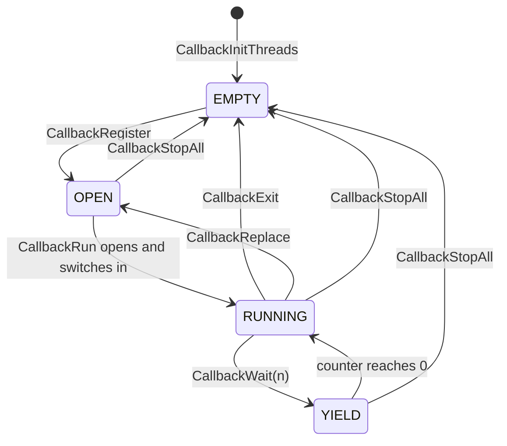

The game runs as four callback slots, and each slot holds a cooperative kernel thread that `CallbackRun (exe/slus_004_22@0x8014B73C)` switches into once per frame. Most game modes are a thread that loops forever, reads a state byte, runs the handler that the byte selects, and yields. Fixed-size record tables hold the actors, panels and battlers that the handlers step. This page does not cover which mode owns which slot at which moment ([game phases](../../systems/phases/)) or how the first two callbacks start the game ([boot](../../systems/boot/)).

## Callback slots

The [frame loop](../frame-loop/) gives game code one turn per frame through `CallbackRun`. A slot is a 128-byte record in the table at `D_80143B40 (exe/slus_004_22@0x80143B40)`. It holds a state, a yield counter, the callback function, a thread id and the two values that start the thread. A callback is a function that runs as a PsyQ kernel thread (`OpenTh`, `ChangeTh`, `CloseTh`). The kernel does not pre-empt it. The thread runs until it calls one of three functions, which return control to `CallbackRun`:

| Function                                       | Effect on the slot                                                                              |
| ---------------------------------------------- | ----------------------------------------------------------------------------------------------- |
| `CallbackWait (exe/slus_004_22@0x8014B87C)`    | resume after n more passes of `CallbackRun`; `CallbackWait(1)` runs the thread again next frame |
| `CallbackExit (exe/slus_004_22@0x8014B8B0)`    | empty the slot and close the thread                                                             |
| `CallbackReplace (exe/slus_004_22@0x8014B954)` | close the thread and reopen the slot with another callback on the next pass                     |

`CallbackRegister (exe/slus_004_22@0x8014B854)` puts a callback in a slot and marks the slot open. `CallbackStopAll (exe/slus_004_22@0x8014B33C)` empties every occupied slot and closes its thread. A callback that waits for a disc read polls with `CallbackWait(1)` until `EMI_IsReady` returns nonzero. Every overlay swap blocks its own thread this way and no other.

The state values are `EMPTY` 0, `YIELD` 1, `OPEN` 2, `SWITCH` 4 and `IDLE` 0x7F.

:::note
`RUNNING` in the diagram is the `IDLE` value: `CallbackRun` writes it just before it switches into the thread. No function writes `SWITCH`.
:::

### One pass of `CallbackRun`

`CallbackRun` points the cursor `g_CallbackSlot` at slot 0 and walks slots 0 to 3 once. The cursor is the current slot that `CallbackWait`, `CallbackExit` and `CallbackReplace` act on.

| Slot state | Action                                                                                            |
| ---------- | ------------------------------------------------------------------------------------------------- |
| `OPEN`     | `OpenTh(callback, stack word, gp word)` inside a critical section, store the thread id, switch in |
| `YIELD`    | decrement the counter; at zero, switch in                                                         |
| `SWITCH`   | switch in                                                                                         |
| other      | skip                                                                                              |

"Switch in" sets the state to `IDLE` and calls `ChangeTh` with the thread id. The yielding functions return with `ChangeTh(0xFF000000)`, which returns to the thread that called `CallbackRun` (PsyQ kernel behavior). `[inferred]`

Because the walk goes from slot 0 to slot 3, a callback in slot 0 that registers slot 1 starts slot 1 in the same pass ([boot](../../systems/boot/)).

`CallbackInitThreads (exe/slus_004_22@0x8014B6B4)` prepares the slots at boot. For slot i it clears the state, links the kernel work block i + 1 (block size 192, based on the word at `0x80000110`) and sets the thread stack top to `0x801FF400 + (i + 1) * 0x200`. The four stack tops are `0x801FF600`, `0x801FF800`, `0x801FFA00` and `0x801FFC00`. Each stack is 512 bytes and the four are adjacent, so a call chain deeper than 512 bytes overruns the next slot's stack. Whether any chain does is `[unknown]`.

## Slot assignments

| Slot | Callback                                                             | Registered by                                                                                                         |
| ---: | -------------------------------------------------------------------- | --------------------------------------------------------------------------------------------------------------------- |
|    0 | `SYS_StartFrontend (exe/slus_004_22@0x8014EA80)`                     | `SYS_Main`, at boot and on a soft reset; `CallbackReplace` from game over, from `scena15` and from `scena17`          |
|    0 | `Game_UpdateCampMenu (emi/etc/game/00@0x80196F78)`, the start menu   | `Game_LeaveTitle (emi/etc/game/01@0x801D1000)`                                                                        |
|    0 | `Game_UpdateMain (emi/etc/game/00@0x80197068)`, the game proper      | `Game_StartSelectedGame (emi/etc/game/01@0x801D0E54)`; `CallbackReplace` from `Menu_ExitCamp` and `Menu_StartNewGame` |
|    1 | `SYS_EnterFrontend (exe/slus_004_22@0x8014EC64)`, then the title     | `SYS_StartFrontend`                                                                                                   |
|    2 | `UI_DispatchLocalMode (exe/slus_004_22@0x8014ED6C)`, a screen effect | `UI_SetMode (exe/slus_004_22@0x8014ECAC)`, `UI_SetModeWait (exe/slus_004_22@0x8014ECEC)`                              |
|    3 | none                                                                 | no `CallbackRegister` call anywhere in the exported assembly names slot 3                                             |

`SYS_EnterFrontend` calls `Game_UpdateTitle (emi/etc/game/01@0x801D0C04)`, which never returns, so the title runs on slot 1's thread. `Game_StartSelectedGame` and `Game_LeaveTitle` run inside that thread. They register slot 0 and the title thread continues until `Game_LeaveTitle` calls `CallbackExit`. The title reads slot 0's state to know that the game program has ended and the title may restart.

Only the executable and the title overlay `emi/etc/game/01` call `CallbackRegister`. Every other overlay changes a slot through `CallbackReplace`. The sites in the exported assembly are:

- `Menu_ExitCamp (emi/etc/start/08@0x801E62A8)` and `Menu_StartNewGame (emi/etc/start/08@0x801E2584)` install `Game_UpdateMain`.
- `Battle_UpdateGameOver (emi/battle/batl_ovr/00@0x801EF0A8)` installs `SYS_StartFrontend`. So do `func_801FC1D8` in `emi/scenario/scena15/00`, and `Scene_ExitToTitle` and `func_801F87D0` in `emi/scenario/scena17/00`.
- `func_801F8844` in `scena17` installs `Scene_RunSaveMenu`.

These sites run on the slot that is current, which is slot 0 for the main loop. `[inferred]`

## State-byte dispatch

Almost every mode loop has one shape: loop, read a state byte, call `table[state]()`, yield. A handler changes state by writing the byte. If it leaves the byte alone, the same handler runs next frame. The byte, table and entry count differ per loop.

| Loop                                                    | State byte                                      | Handler table                                      | Entries |
| ------------------------------------------------------- | ----------------------------------------------- | -------------------------------------------------- | ------: |
| `Game_UpdateTitle (emi/etc/game/01@0x801D0C04)`         | `g_UiTitleState (exe/slus_004_22@0x80143C10)`   | `s_TitleStates`, static in `emi/etc/game/01`       |       8 |
| `Game_UpdateMain (emi/etc/game/00@0x80197068)`          | `g_GameEntryState (exe/slus_004_22@0x80143B90)` | `g_GameStates (emi/etc/game/00@0x801C7B14)`        |      12 |
| `Game_UpdateCampMenu (emi/etc/game/00@0x80196F78)`      | `g_GameEntryState`                              | `g_GameCampMenuLoad (emi/etc/game/00@0x801C7B08)`  |       3 |
| `UI_DispatchLocalMode`                                  | `g_UiLocalMode`                                 | `g_UiLocalModeFuncs (exe/slus_004_22@0x801499AC)`  |      21 |
| `Battle_DispatchMode (emi/battle/battle/03@0x801D112C)` | `g_BattleMode (exe/slus_004_22@0x801462E0)`     | `g_BattlePhases (emi/battle/battle/03@0x801D0C04)` |       6 |

The two game loops differ in order. `Game_UpdateMain` calls the handler, then `Game_UpdateClock` (the play clock and timers), then `CallbackWait(1)`. `Game_UpdateCampMenu` waits first, then calls the handler, then `Menu_UpdatePanelTasks`. Both zero `g_GameEntryState` and `g_GameEntrySubstate` when they start, and call `Menu_ResetPanelTasks`. The meaning of each entry state is in [game phases](../../systems/phases/).

Overlays also index the handler table by a byte of a work record instead of a global byte. The pointer cell `g_SpadWork (exe/slus_004_22@0x1F800044)` in the scratchpad points at the record that the running handler steps. Its type depends on the overlay: a party battler in battle, an actor in the field, a band effect in a scenario. Handlers read its step bytes at offsets `+0x01`, `+0x02` and `+0x04`.

## Work-record tables

Handlers step fixed-size records in RAM tables. Each table has a free-slot search, so its row count is the hard limit on live records.

| Table              | Address                         | Type                | Stride x count | Allocator and walker                                                                                                                     |
| ------------------ | ------------------------------- | ------------------- | -------------- | ---------------------------------------------------------------------------------------------------------------------------------------- |
| `g_ActorSlots`     | `exe/slus_004_22@0x80143FC8`    | `ActorSlot[20]`     | 116 x 20       | `Actor_FindFreeSlot (emi/etc/game/00@0x8019601C)` takes the first slot with `flags_00 == 0`, else `0xFF`; `Actor_Free`, `Actor_ClearAll` |
| `g_Actors`         | `exe/slus_004_22@0x80146888`    | `Actor[30]`         | 152 x 30       | `Actor_FindFree (exe/slus_004_22@0x8015CA48)` takes the first record whose first byte is 0, else `0xFF`                                  |
| `g_MenuPanelTasks` | `exe/slus_004_22@0x80148330`    | `MenuPanelTask[22]` | 36 x 22        | `Menu_OpenPanelTask (exe/slus_004_22@0x80158DB8)`, `Menu_ResetPanelTasks`, `Menu_UpdatePanelTasks`                                       |
| battlers           | [battle](../../systems/battle/) | -                   | per overlay    | `Battle_UpdateParty`, `Battle_UpdateEnemies` in `emi/battle/battle/03`                                                                   |

A menu panel is a task, so at most 22 panels are live. `Menu_UpdatePanelTasks (exe/slus_004_22@0x80158C80)` makes one pass for each mode value from `g_MenuPanelMode` up to 2. It does nothing when the mode is 3 or more. In a pass it walks the 22 records. For each record whose first byte is nonzero and whose mode byte (offset `0x0F`) equals the pass, it calls the handler `g_MenuPanels[record[1]]`, one of nine. Panel contents and drawing are in [UI and text drawing](../../systems/ui/). Field actors are in [areas and the field](../../systems/areas/).

## Local UI modes

`UI_SetMode(m)` starts a screen effect such as a fade, wipe or zoom. It does nothing while `g_UiWindowEffectBusy (exe/slus_004_22@0x80143C40)` is nonzero. Otherwise it stores `m & 0xFF` in `g_UiLocalMode (exe/slus_004_22@0x80143C90)` and registers `UI_DispatchLocalMode` in slot 2. That callback copies the 21-entry table to the stack and calls the entry `g_UiLocalMode` selects, once. Several entries are one-line wrappers around the fade routine `GFX_RunBlackFade`, which loops with `CallbackWait(1)` and ends the thread with `CallbackExit`. The other entries end through their own `CallbackWait` and `CallbackExit` calls. `UI_SetModeWait` is the same call, followed by a `CallbackWait(1)` loop until the effect ends.

The effect table holds screen transitions, not game phases. Phase code calls `UI_SetMode` at a boundary: the field handler for an area change calls `UI_SetMode(g_GameEntryMode)` ([game phases](../../systems/phases/)). The effect catalog is in [UI and text drawing](../../systems/ui/).

## Data and limits

| Limit          | Value                                             | Source                                          |
| -------------- | ------------------------------------------------- | ----------------------------------------------- |
| Callback slots | 4                                                 | `CallbackInitThreads`, `CallbackStopAll`        |
| Thread stack   | 512 bytes per slot, tops `0x801FF600..0x801FFC00` | `CallbackInitThreads`                           |
| Title states   | 8                                                 | `s_TitleStates`                                 |
| UI local modes | 21                                                | `UI_DispatchLocalMode`                          |
| Panel tasks    | 22 tasks, 9 handlers                              | `Menu_ResetPanelTasks`, `Menu_UpdatePanelTasks` |
| Actor rows     | 30 rows of 152 bytes                              | `Actor_FindFree`                                |
| Field slots    | 20 rows of 116 bytes                              | `Actor_FindFreeSlot`                            |

## Open questions

| Question                                                 | What would settle it                                                                                               |
| -------------------------------------------------------- | ------------------------------------------------------------------------------------------------------------------ |
| Whether 512 bytes of stack suffice for the deepest chain | Worst-case stack analysis, or a run with stack watermarks                                                          |
| Any writer of the `SWITCH` state, and any use of slot 3  | Search the overlays for stores of 4 to a slot state halfword, and for stores into the slot at `D_80143B40 + 0x180` |

## Sources and confidence

- **Confidence:** medium. The slot mechanism, the dispatch tables and the record tables are read in the code, but the stack depth, the `SWITCH` state, slot 3 and the slot of each `CallbackReplace` site are `[inferred]` or `[unknown]`.
- **Evidence:** the code of `CallbackRun`, `CallbackWait`, `CallbackExit`, `CallbackReplace`, `CallbackRegister`, `CallbackStopAll` and `CallbackInitThreads`; every `CallbackRegister` and `CallbackReplace` call site in the executable and the overlays; the mode loops and their handler tables.

## Related

- [Frame loop](../frame-loop/): the pass that gives each thread its turn.
- [Game phases](../../systems/phases/): which mode owns which slot, and how control passes.
- [Boot](../../systems/boot/): how the first two callbacks start the game.
- [UI and text drawing](../../systems/ui/): panel tasks and screen effects.
- [Memory map](../memory/): the thread stacks and the work variables.
