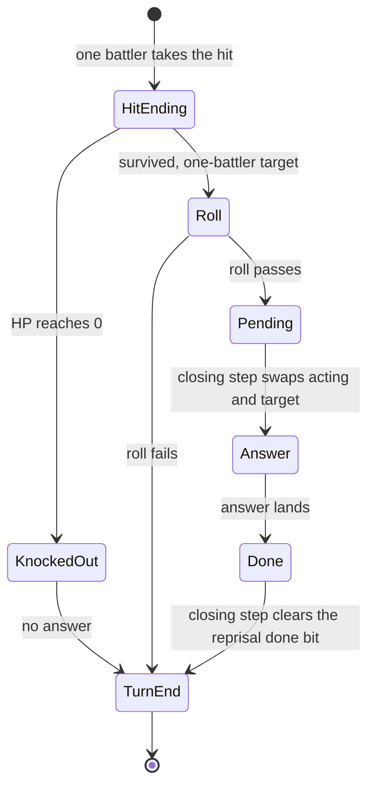

A battle runs from two overlays that share work tables in fixed RAM. `emi/battle/battle/03` (loaded at `0x801D0C00`) holds the mode machines, the damage rules and the effect scheduler. `emi/battle/battle/15` (loaded at `0x80096800`) holds the entrance, the panels and the drawing. This page maps their working set: the work rows built at run time, the state words that tie them together and the tables that pick a handler. The static enemy, encounter and ability tables are in [game records](../records/#gameemi-fixed-tables), and the order of a battle is in [battle flow](../../systems/battle/).

A bare `func_XXXXXXXX` in an evidence cell lives in `emi/battle/battle/03` when its address is `0x801D0C00` or above, in `emi/battle/battle/15` when it is in `0x80096800`-`0x800BFFFF`, and in `emi/etc/game/00` for `0x801C6AEC` and `0x801C6BB4`. Terms such as work row and slot are in the [glossary](../../appendix/glossary/).

## Dispatch model

One mode byte selects a mode machine. Each mode owns a step table, and a step advances itself and may call the sub-step dispatcher. Effects run on a second track: the game queues an action slot, the slot's mode selects a stage, and the slot's handler index selects the function. Every row of the mode and entrance tables is a function pointer with no arguments and no result. The [dispatch tables](#dispatch-tables) section lists the addresses and sizes, and [battle flow](../../systems/battle/) gives the order of the calls.

## Where the records are

All addresses are fixed RAM. The table gives the address, row size and row count of each object, and a function that reads it. Several objects are one byte wide: the mode, the step and the sub-step are three bytes in a row.

| Object                     |      Address | Size | Count | Readers                                                     |
| -------------------------- | -----------: | ---: | ----: | ----------------------------------------------------------- |
| mode byte                  | `0x801462E0` |    1 |     1 | `Battle_DispatchMode (emi/battle/battle/03@0x801D112C)`     |
| main step                  | `0x801462E1` |    1 |     1 | the mode's step tables                                      |
| sub-step                   | `0x801462E2` |    1 |     1 | `Battle_DispatchEntrance (emi/battle/battle/03@0x801D17C4)` |
| state word `g_BattleState` | `0x801462E8` |    2 |     1 | both overlays, boss and bmagic handlers                     |
| acting battler             | `0x80146374` |    1 |     1 | both overlays                                               |
| command state              | `0x80146375` |    1 |     1 | `func_801DD448`, `func_801E020C`                            |
| target selector            | `0x80146384` |    1 |     1 | both hit endings (`func_800A9820` takes it as an argument)  |
| result byte                | `0x80146328` |    1 |     1 | `func_801D43EC`, boss endings                               |
| spoils                     | `0x80146326` |   62 |     1 | `func_801E531C`, `func_801E54EC`                            |
| candidate entries          | `0x801463DC` |   12 |     8 | `emi/etc/game/00`, `emi/battle/battle/15`                   |
| player work rows           | `0x80145E90` |  320 |     3 | both overlays                                               |
| enemy work rows            | `0x801EB630` |  280 |     8 | both overlays                                               |
| queued action slots        | `0x801EC330` |  120 |    48 | `Battle_RunEffects (emi/battle/battle/03@0x801E5824)`       |
| panel tasks                | `0x80148330` |   36 |    22 | `func_801E9074`, `func_801EA1E0`, `func_801DA69C`           |
| event slots                | `0x801EB4F0` |   12 |     - | `Battle_RunEvents (emi/battle/battle/03@0x801DE43C)`        |

### Battler slots

The row count is not the battler index space. Player slots are 0 to 2 and enemy slots are 3 to 10,
so a battle has 11 battlers at most. An enemy work row stores its slot at `+0x05` as `slot + 3`
(`func_800ABCE0 (emi/battle/battle/15@0x800ABCE0)`). Code addresses the enemy rows from the virtual
base `0x801EB2E8`, which is `0x801EB630` minus three enemy strides of 280 bytes. One base then serves both sides.

For example, slot 3 is the first enemy: `0x801EB2E8 + 3 * 280 = 0x801EB630`. A pointer to
"battler n" is resolved by side first, then by slot.

## Player work row

The mode machines step the player work row. There are three rows of 320 bytes at `0x80145E90`. The table lists the fields that a reader proves. A field has a role only when the evidence cell names the function that shows it.

|  Offset | Type          | Meaning                                                                                                                                                                           | Evidence                                                                                                             |
| ------: | ------------- | --------------------------------------------------------------------------------------------------------------------------------------------------------------------------------- | -------------------------------------------------------------------------------------------------------------------- |
| `0x000` | `u8`          | flags: bit 0 row occupied, bit 6 handler busy                                                                                                                                     | `Battle_SlotIsBlocked (emi/battle/battle/03@0x801DB524)`; `func_801E8D04` clears bit 6                               |
| `0x001` | `u8`          | main step inside the current action machine                                                                                                                                       | `func_801E020C`                                                                                                      |
| `0x002` | `u8`          | action-machine sub-step; 4 with step 6 on a knockout, 0 with step 2 after an action                                                                                               | `func_801E020C`                                                                                                      |
| `0x005` | `u8`          | battler slot 0-10                                                                                                                                                                 | `Battle_CalcDamage (emi/battle/battle/03@0x801DC044)` takes it as an argument                                        |
| `0x00C` | `s32`         | added to x each physics step                                                                                                                                                      | `func_800A8B40`                                                                                                      |
| `0x010` | `s32`         | added to y each physics step                                                                                                                                                      | `func_800A8B40`                                                                                                      |
| `0x014` | `s32`         | added to the height half at `+0x3E` each step; the word at `+0x20` is added to it; at `-0x40` the step advances                                                                   | `func_800A8B40`                                                                                                      |
| `0x018` | `s32`         | added to the whole word at `+0x3C` each step                                                                                                                                      | `func_800A8B40`                                                                                                      |
| `0x020` | `s32`         | added to the word at `+0x14` each step                                                                                                                                            | `func_800A8B40`                                                                                                      |
| `0x032` | `u16`         | depth halfword handed to the primitive builder                                                                                                                                    | `func_800AB910`                                                                                                      |
| `0x034` | `s32` (16.16) | x; read as one word and as two halfwords                                                                                                                                          | `func_800A8B40`                                                                                                      |
| `0x038` | `s32` (16.16) | y; read as one word and as two halfwords                                                                                                                                          | `func_800A8B40`                                                                                                      |
| `0x03C` | `s32`         | 16.16 z word; the physics code reads the height in the high half `+0x3E`; the two overlays read that halfword with opposite signs, and `func_800AF764` projects it negated        | `func_800A8B40`; copied whole by `func_801E72F4` and `func_801DDAF0`; written by `func_801DEF0C` and `func_801E352C` |
| `0x074` | `u8[164]`     | a copy of the character record ([layout](../records/#character-and-master-data)); `reprisal_chance` is at `stats + 0x35` (`+0xA9`), `critical_chance` at `stats + 0x36` (`+0xAA`) | `func_801DD08C` copies 164 bytes here                                                                                |
| `0x119` | `u8`          | action state kept while a reprisal is pending; cleared otherwise                                                                                                                  | `func_801E1DD4`                                                                                                      |
| `0x11A` | `u16`         | command word                                                                                                                                                                      | none found                                                                                                           |
| `0x11C` | `s16`         | signed HP change that the hit shows; seeded from the current HP in the stats copy                                                                                                 | `func_801D527C` seeds it; `func_801DFCB4` tests its sign                                                             |
| `0x11E` | `s16`         | signed AP change                                                                                                                                                                  | `func_801DFCB4`                                                                                                      |
| `0x124` | `u32`         | damage word (bits in [State word bits](#state-word-bits))                                                                                                                         | hit and popup readers                                                                                                |
| `0x128` | `u32`         | action word (bits in [State word bits](#state-word-bits))                                                                                                                         | action gate and turn order                                                                                           |
| `0x138` | `u8`          | charge                                                                                                                                                                            | none found                                                                                                           |

```c
typedef struct PartyBattler {
    /* 0x000 */ u8        flags_00;
    /* 0x001 */ u8        step_01;
    /* 0x005 */ u8        slot;
    /* 0x00C */ s32       unk_0C;      /* x step */
    /* 0x010 */ s32       unk_10;      /* y step */
    /* 0x014 */ s32       unk_14;
    /* 0x018 */ s32       unk_18;
    /* 0x020 */ s32       unk_20;
    /* 0x034 */ BattleFix32 coord_x_34;
    /* 0x038 */ BattleFix32 coord_y_38;
    /* 0x03C */ BattleWorkWord3C word_3C;
    /* ...    */ /* fields 0x40..0x73 folded */
    /* 0x074 */ Character stats;       /* 0xA4-byte copy of the character record */
    /* 0x118 */ u8        unk_118;
    /* 0x119 */ u8        mode_119;
    /* 0x11A */ u16       command;
    /* 0x11C */ u16       hp_change;   /* signed HP delta shown on the hit */
    /* 0x11E */ u16       ap_change;
    /* 0x121 */ u8        counter_121;
    /* 0x124 */ BattlerFlags flags_124; /* BattleBattlerDamageFlags */
    /* 0x128 */ BattlerFlags flags_128; /* BattleBattlerActionFlags */
    /* 0x134 */ u16       unk_134;
    /* 0x136 */ u8        counter_136;
    /* 0x137 */ u8        counter_137;
    /* 0x138 */ u8        charge;
} PartyBattler;                        /* 0x140 bytes */
```

Source: [`include/battle/records.h`](https://github.com/raulcorreia7/bof3-decomp/blob/main/include/battle/records.h)

Other cells are read but have no proven role. `0x29`-`0x2B` are signed bytes and `0x2C` a halfword,
read by both overlays. `0x2E` and `0x30` are halfwords that `emi/battle/battle/03` reads unsigned
and `emi/battle/battle/15` signed, because the panels slide to negative screen positions. `0x40`,
`0x44` and `0x4C` are words, `0x1C` a word and `0x48` a byte, read only by `emi/battle/battle/03`.
Bytes `0x121`, `0x136` and `0x137` are counters. `[unknown]` for the rest: `0x06`-`0x0B`,
`0x24`-`0x28`, `0x4B`, `0x50`, `0x54`, `0x58`, `0x5A`, `0x5C`-`0x5F`, `0x118`, `0x120`, `0x122`,
`0x123`, `0x12C`-`0x133`, `0x134`-`0x135` and `0x139`-`0x13F`. A trace of which routine writes each
cell would settle them.

## Enemy work row

There are eight rows of 280 bytes at `0x801EB630`. `func_800ABCE0 (emi/battle/battle/15@0x800ABCE0)`
and `Battle_AddEnemy (emi/battle/battle/15@0x800AC01C)` arm a slot and clear the cells from `+0x06` to
`+0x5F` first. The table lists the proven fields. Widths follow the accesses.

|  Offset | Type               | Meaning                                                                                                                             | Evidence                                                                |
| ------: | ------------------ | ----------------------------------------------------------------------------------------------------------------------------------- | ----------------------------------------------------------------------- |
| `0x000` | `u8`               | bit 0 row occupied                                                                                                                  | `Battle_SlotIsBlocked (emi/battle/battle/03@0x801DB524)`                |
| `0x001` | `u8`               | main step                                                                                                                           | none found                                                              |
| `0x005` | `u8`               | battler slot, stored as `slot + 3`                                                                                                  | `func_800ABCE0`                                                         |
| `0x008` | `u8`               | scroll direction `g_BattleScrollDir` (0-3) with bit 1 flipped                                                                       | the slot setup (`func_800ABCE0`, `Battle_AddEnemy`)                     |
| `0x029` | `u8`               | set to 4 when the slot is armed                                                                                                     | the slot setup                                                          |
| `0x034` | `s32`              | the enemy's x                                                                                                                       | none found                                                              |
| `0x038` | `s32`              | the enemy's y                                                                                                                       | none found                                                              |
| `0x03C` | `s32`              | high half `+0x3E` is the vertical span at the enemy's position, from `Area_SampleHeight` of x and y; written when the slot is armed | `func_800AE82C` copies the whole word into the local work row's `+0x3C` |
| `0x04B` | `u8`               | set to `0xFF` when the slot is armed                                                                                                | the slot setup                                                          |
| `0x074` | `u8[8]`            | enemy name, drawn as text                                                                                                           | `Battle_DrawEnemyNamePanel`                                             |
| `0x07C` | `u8`               | kind id                                                                                                                             | none found                                                              |
| `0x080` | `u16`              | event flags; bit 2 makes the enemy eligible to counter an attack                                                                    | `func_801E4368`                                                         |
| `0x082` | `u16`              | status word; `0x4000` is knockout                                                                                                   | `func_801E496C`                                                         |
| `0x084` | `u16`              | damage; cleared by `func_801E54EC`                                                                                                  | `func_801E54EC`                                                         |
| `0x086` | `u16`              | damage; banked into `D_8014632C` by `func_801E54EC`                                                                                 | `func_801E54EC`                                                         |
| `0x088` | `u16`              | turn-order ranking value                                                                                                            | the turn-order ranking reader                                           |
| `0x08C` | `u8[8]`            | techniques; the event packet's tail is copied here                                                                                  | `func_8009C994`                                                         |
| `0x094` | `u16`              | current HP                                                                                                                          | `func_801E496C`                                                         |
| `0x096` | `u16`              | AP                                                                                                                                  | read by `emi/battle/battle/03`                                          |
| `0x098` | `u8[8]`            | two drop rows (layout in [Drops](#drops))                                                                                           | `func_801E531C`                                                         |
| `0x0A0` | `u16`              | maximum HP; every read is `lhu` or `sh`; the panel task copies it as the HP bar divisor                                             | `func_801E496C`, `func_800AFC98`                                        |
| `0x0A4` | `u16`              | attack                                                                                                                              | read by `emi/battle/battle/15`                                          |
| `0x0A8` | `u16`              | agility                                                                                                                             | read by `emi/battle/battle/03`                                          |
| `0x0AF` | `u8[9]`            | one resistance level per element, in the character record's resistance order                                                        | none found                                                              |
| `0x0E0` | `u8`               | enemy kind; selects the event handlers                                                                                              | `func_801E8DD8`                                                         |
| `0x0E4` | `void*` [inferred] | per-enemy hook: mode 0 chooses, mode 1 is hit, mode 2 runs every frame                                                              | `func_801E25E0`, `func_801E3C14`                                        |
| `0x0E8` | `u16*`             | pointer to `u16` cells                                                                                                              | none found                                                              |
| `0x0EC` | `u8*`              | pointer to a `u8` script                                                                                                            | none found                                                              |
| `0x0F6` | `u16`              | technique                                                                                                                           | none found                                                              |
| `0x0F8` | `s16`              | damage dealt this hit; negative heals                                                                                               | `func_801E496C`                                                         |
| `0x0FC` | `u8`               | side and slot mask                                                                                                                  | `func_800A9820`                                                         |
| `0x100` | `u32`              | damage word (bits in [State word bits](#state-word-bits))                                                                           | both overlays                                                           |
| `0x104` | `u32`              | action word (bits in [State word bits](#state-word-bits))                                                                           | both overlays                                                           |

```c
typedef struct EnemyBattler {
    /* 0x001 */ u8   step_01;
    /* 0x005 */ u8   slot;
    /* 0x008 */ u8   unk_08;
    /* 0x034 */ s32  coord_x_34;
    /* 0x038 */ s32  coord_y_38;
    /* 0x03C */ BattleEnemyWord3C word_3C;
    /* 0x074 */ u8   name[8];
    /* 0x07C */ u8   kind_id;
    /* 0x080 */ u16  event_flags;
    /* 0x082 */ u16  status_82;
    /* 0x088 */ u16  power;
    /* 0x08C */ u8   techniques[8];
    /* 0x094 */ u16  hp_94;
    /* 0x096 */ u16  ap;
    /* 0x098 */ EnemyBattlerDrop drops_98[2];
    /* 0x0A0 */ BattleEnemyCellA0 cell_A0;  /* max HP */
    /* 0x0A4 */ u16  attack;
    /* 0x0A8 */ u16  agility;
    /* 0x0AF */ u8   resistances[RES_SLOT_COUNT];
    /* 0x0E0 */ u8   kind;
    /* 0x0E4 */ EnemyBattlerEventFunc unk_E4;
    /* 0x0E8 */ u16* unk_E8;
    /* 0x0EC */ u8*  script;
    /* 0x0F6 */ u16  technique;
    /* 0x0F8 */ s16  damage_F8;
    /* 0x0FC */ u8   target_flags_FC;
    /* 0x100 */ u32  flags_100;   /* BattleBattlerDamageFlags */
    /* 0x104 */ u32  flags_104;   /* BattleBattlerActionFlags */
} EnemyBattler;                   /* 0x118 bytes; gaps are pad_XX or unk_XX */
```

Source: [`include/battle/records.h`](https://github.com/raulcorreia7/bof3-decomp/blob/main/include/battle/records.h)

Cells with no proven role (`[unknown]`): `0x06`, `0x07`, `0x0C`-`0x24`, `0x2B`, `0x2E`, `0x30`,
`0x32`, `0x48`, `0x5C`-`0x5F`, `0x7D`, `0x7E`, `0x7F`, `0xA6`, `0xAA`, `0xE1`-`0xE3`, `0xF0`, `0xF5`,
`0xFA`, `0xFD`, `0x112`, `0x114` and `0x115`. `emi/battle/battle/03` reads `0x7E` as a byte, and
`emi/battle/battle/15` reads `0xA6` and `0xAA` as halfwords.

## Drops

A defeated enemy can drop up to two items. The two drop rows at enemy `+0x98` and `+0x9C` are the two item rows of the area's [enemy record](../records/#the-enemy-record), copied unchanged by `func_800AC218 (emi/battle/battle/15@0x800AC218)`, which `Battle_AddEnemy` calls when the battle starts. Each row holds an item id and a rate index. The rate index selects a chance from the table in [drops](../records/#drops), which also gives the roll. The table gives the row as the battle code reads it.

| Offset | Type  | Meaning                                                                                                         |
| -----: | ----- | --------------------------------------------------------------------------------------------------------------- |
| `0x00` | `u16` | item id that the spoils gain when the roll passes: the record's item index (low byte) and item type (high byte) |
| `0x02` | `u8`  | index into the 8-byte drop chance table at `0x801D0CB8`: the low byte of the record's `u16` rate                |
| `0x03` | `u8`  | padding: the high byte of the record's rate; no code reads it                                                   |

```c
typedef struct EnemyBattlerDrop {
    /* 0x00 */ u16 item_00;
    /* 0x02 */ u8  rate_02;
    /* 0x03 */ u8  pad_03;
} EnemyBattlerDrop;
```

Source: [`include/battle/records.h`](https://github.com/raulcorreia7/bof3-decomp/blob/main/include/battle/records.h)

The spoils record collects what a battle yields. It sits at `0x80146326`, is 62 bytes long and is
walked by `func_801E531C (emi/battle/battle/03@0x801E531C)`, which alone rolls the drop rows.

| Offset | Type      | Meaning                                                 |
| -----: | --------- | ------------------------------------------------------- |
| `0x00` | `u8`      | escape attempts; `emi/battle/battle/15` reads this byte |
| `0x01` | `u8`      | count of listed drops, capped at 15                     |
| `0x0E` | `u16[16]` | dropped item ids                                        |
| `0x2E` | `u8[16]`  | drops of each id                                        |

```c
typedef struct Spoils {
    /* 0x00 */ u8  attempts;
    /* 0x01 */ u8  count;
    /* 0x02 */ u8  pad_02[0xC];
    /* 0x0E */ u16 items[16];
    /* 0x2E */ u8  counts[16];
} Spoils;
```

Source: [`include/battle/ram.h`](https://github.com/raulcorreia7/bof3-decomp/blob/main/include/battle/ram.h)

## Encounter candidates

Before a wild encounter, the field overlay fills a table of eight candidate entries of 12 bytes
at `0x801463DC`. The battle overlay walks the table and places each live enemy.
`func_800ABC30 (emi/battle/battle/15@0x800ABC30)` reads the id, x and y of an entry and hands them to
`func_800ABCE0`.

| Offset | Type          | Meaning                                                                                                    |
| -----: | ------------- | ---------------------------------------------------------------------------------------------------------- |
| `0x00` | `u8`          | live flag; set by `func_801C6AEC (emi/etc/game/00@0x801C6AEC)`, cleared when the candidate is out of reach |
| `0x01` | `u8`          | index of one 136-byte enemy record (`&D_800E405E + id * 136`); `0xFF` means none                           |
| `0x04` | `s32` (16.16) | encounter x; written by `func_801C6BB4 (emi/etc/game/00@0x801C6BB4)`                                       |
| `0x08` | `s32` (16.16) | encounter y; written by `func_801C6BB4`                                                                    |

```c
typedef struct EncounterEnemy {
    /* 0x00 */ u8  active;
    /* 0x01 */ u8  id;
    /* 0x02 */ u8  pad_02[2];
    /* 0x04 */ s32 x;
    /* 0x08 */ s32 y;
} EncounterEnemy;
```

Source: [`include/battle/records.h`](https://github.com/raulcorreia7/bof3-decomp/blob/main/include/battle/records.h)

The enemy record bytes `+0x82` and `+0x83` (block `+0xCA` and `+0xCB`) are the reach and height
that `Area_BuildEncounter` and `func_801E8DD8` read. [Game records](../records/#the-enemy-record) owns
their meaning.

## Panel tasks and queued actions

A panel task draws one window of the battle interface. The 22 slots of 36 bytes at `0x80148330`
end at `0x80148648`. `0x80148648` itself is a pointer cell that `func_800B0410` loads and reads
through. `emi/battle/battle/15` reads only the first 12 bytes of a task and reads x and y signed.

| Offset | Type  | Meaning                                                                                                                                   |
| -----: | ----- | ----------------------------------------------------------------------------------------------------------------------------------------- |
| `0x03` | `u8`  | short-menu state word                                                                                                                     |
| `0x04` | `u16` | panel x                                                                                                                                   |
| `0x06` | `u16` | panel y                                                                                                                                   |
| `0x0A` | `u8`  | selected battler slot in `emi/battle/battle/03` (row index is `slot - 3`); slide mode in `emi/battle/battle/15` (0 moves the panel right) |
| `0x0B` | `u8`  | ratio: enemy value times `0x37` over a divisor, floored at 1                                                                              |
| `0x0D` | `u8`  | cursor; cleared on panel entry                                                                                                            |
| `0x12` | `u16` | first row of the panel list (`func_800B1728 (emi/battle/battle/15@0x800B1728)`)                                                           |
| `0x14` | `u16` | HP bar numerator, copied from the enemy row's current HP                                                                                  |
| `0x1C` | `u16` | HP bar divisor, copied from the enemy row's maximum HP                                                                                    |

```c
typedef struct BattlePanelTask {
    /* 0x03 */ u8  state;
    /* 0x04 */ BattleScreenCoord x;
    /* 0x06 */ BattleScreenCoord y;
    /* 0x0A */ BattlePanelCell0A cell_0A;
    /* 0x0B */ u8  ratio;
    /* 0x0D */ u8  cursor;
    /* 0x12 */ u16 row_base;
    /* 0x14 */ u16 hp;
    /* 0x1C */ u16 max_hp;
} BattlePanelTask;
```

Source: [`include/battle/records.h`](https://github.com/raulcorreia7/bof3-decomp/blob/main/include/battle/records.h)

`func_800B1728` and `func_800B0F9C (emi/battle/battle/15@0x800B0F9C)` also read the cells at `+0x12`
and `+0x14` as bytes. `+0x12` is the box drawer's scale and `+0x14` is the number of rows it draws.

The queued action slot is one of 48 rows of 120 bytes at `0x801EC330`. `emi/battle/battle/03`
names the head fields and `emi/battle/battle/15` the tail.

| Offset | Type    | Meaning                                                                                                          |
| -----: | ------- | ---------------------------------------------------------------------------------------------------------------- |
| `0x05` | `u8`    | handler index into the mode's handler table; stored by `Battle_AllocEffect (emi/battle/battle/03@0x801E590C)`    |
| `0x06` | `u8`    | slot mode; selects the stage table                                                                               |
| `0x29` | `u8`    | action step; stored by `func_801DE1D4`                                                                           |
| `0x34` | `s32`   | x (16.16)                                                                                                        |
| `0x38` | `s32`   | y (16.16)                                                                                                        |
| `0x4B` | `u8`    | panel cell index stored by `emi/battle/battle/15`                                                                |
| `0x5C` | `u8[4]` | cleared by `func_801DE1D4` as a byte row                                                                         |
| `0x60` | `s32`   | action target index, stored by `func_800AAEBC`; the low halfword is the capture count that `func_801E5CA4` draws |
| `0x74` | `u32`   | address of the work record that the slot points at                                                               |

```c
typedef struct BattleEffect {
    /* 0x05 */ u8  handler_index;
    /* 0x06 */ u8  unk_06;
    /* 0x29 */ u8  unk_29;
    /* 0x34 */ BattleFix32 unk_34;
    /* 0x38 */ BattleFix32 unk_38;
    /* 0x4B */ u8  unk_4B;
    /* 0x5C */ u8  unk_5C;
    /* 0x60 */ BattleTargetIndex word_60;
    /* 0x74 */ u32 target;
} BattleEffect;                /* 0x78 bytes; other members folded */
```

Source: [`include/battle/records.h`](https://github.com/raulcorreia7/bof3-decomp/blob/main/include/battle/records.h)

Three more tables belong to the panels.

- The owner table is the panel task array shifted by 3, so its records start at `0x80148333`. Byte
  `+0x07` of record i is the kind that `func_801DA69C` walks (`0x8014833A`, stride 36).
- The panel-owner table at `0x801ED9B0` has 4-byte entries: the owner index (`u8` at `0x00`), a second
  byte (`0x01`) and the panel id (`u16` at `0x02`).
- The selection-type table at `0x801CA71C` has 20-byte rows. A `u16` mask is at `0x00`, and
  `emi/battle/battle/15` reads the rest byte by byte.

## State word bits

`g_BattleState` (`0x801462E8`) is the shared latch that both overlays poll. The table gives the
setter and the reader of each bit.

|      Bit | Name             | Set by                                  | Read as                                                                  |
| -------: | ---------------- | --------------------------------------- | ------------------------------------------------------------------------ |
| `0x0002` | window busy      | boss windows                            | `Battle_Update` tests it                                                 |
| `0x0004` | effect playing   | the hit endings and every effect module | the closing step waits for the effect                                    |
| `0x0010` | command armed    | command menu                            | menu steps                                                               |
| `0x0040` | reprisal pending | a won reprisal roll                     | the turn's closing step                                                  |
| `0x0080` | critical         | critical-hit roll                       | damage and popup readers                                                 |
| `0x0400` | effect loading   | the effect stream request               | action steps wait until `EMI_LoaderIsReady (exe/slus_004_22@0x80162D00)` |
| `0x0800` | AP paid          | AP spend                                | action gate                                                              |
| `0x1000` | reprisal done    | the answer's own hit ending             | the next closing step clears it                                          |
| `0x2000` | damage applied   | damage application                      | popup and end-of-hit steps                                               |
| `0x4000` | over             | battle end                              | both overlays                                                            |
| `0x8000` | reload party     | the reload path                         | the reload path clears it                                                |

The effect loading bit stays set from the action's effect stream request until the loader is ready
(`func_801D3F6C`). Bit `0x0008` is also used. `func_801D277C` and `func_8009B828` set it and
`func_801D656C` clears it, but no reader is known, so it has no name.

The damage word (enemy `+0x100`, player `+0x124`) and the action word (enemy `+0x104`, player `+0x128`)
carry their own flags.

| Word   |    Bit | Effect                                           |
| ------ | -----: | ------------------------------------------------ |
| damage |      6 | marks a damage target                            |
| damage |      7 | runs the popup and countdown                     |
| damage |      8 | makes the hit lethal and queues the reaction cue |
| damage |      9 | marks a damage row                               |
| damage |     12 | skips the action gate                            |
| damage |     15 | reprisal rating                                  |
| damage |     16 | zeroes the damage and the HP bar numerator       |
| action |      3 | marks an installed mode-handler action           |
| action |      4 | keeps the row available during suppression       |
| action |      6 | applies the queued power boost                   |
| action |      9 | halves damage                                    |
| action | 11, 13 | zero the holy and fire resistance                |
| action |     14 | charges the action                               |
| action |     15 | marks a preemptive turn                          |

The target selector byte at `0x80146384` holds one battler slot (0-10) in its low values. Bit 6
(`0x40`) selects the enemy side, bit 7 (`0x80`) the party side, and `0xC0` both sides.

The result byte at `0x80146328` uses bit 0 for defeat, bit 1 for victory and bit 3 for no background
music (the field music replay after the battle is skipped). Any set bit forces the end state.

## A reprisal exchange

A reprisal is the struck battler's immediate physical answer. The game decides it in the hit's
ending step, hands the turn over at the closing step and marks the answer so that it cannot be
answered again. The player sees the target turn and strike back.

The table gives the two steps. Pending is `g_BattleState` bit `0x0040`. Done is bit `0x1000`.

| Step                             | Function                         | Rule                                                                                                                                                                                                                                                                                                                                                                |
| -------------------------------- | -------------------------------- | ------------------------------------------------------------------------------------------------------------------------------------------------------------------------------------------------------------------------------------------------------------------------------------------------------------------------------------------------------------------- |
| Hit ending of the struck battler | `func_801E020C`, `func_801E414C` | The target was knocked out: clear pending and go to step 6, sub-step 4. Else pending was set: clear pending and set done. Else, when the action targets one battler rather than a side: a physical action sets pending when the reprisal roll passes; an ability whose kind mask has `0x800` and whose kind flag `0x10` is clear sets pending when the roll passes. |
| Closing step of the turn         | `func_801D43EC`                  | Clear done. When pending is set, swap the 16 action-state bytes of the acting battler and the target, set the command state to physical, and restart the acting battler at step 0, sub-step 1.                                                                                                                                                                      |

The party roll is `reprisal_chance` (character record offset `0x35`) out of 100
(`func_801DD448 (emi/battle/battle/03@0x801DD448)`). Damage-word bit 15 forces it, and ability `0xA1`
never lets a party member answer. The enemy roll passes when the event flags bit 2 is set and either
damage-word bit 15 is set or a flat 70 percent roll passes
(`func_801E4368 (emi/battle/battle/03@0x801E4368)`).



## Dispatch tables

The battle code copies a table to the stack and indexes it. The table names follow the selector, not
the row count. The table shows each table's address, size and reader.

| Table                           |      Address | Rows | Index selects                             | Reader                                                      |
| ------------------------------- | -----------: | ---: | ----------------------------------------- | ----------------------------------------------------------- |
| `g_BattlePhases`                | `0x801D0C04` |    6 | battle mode `0x801462E0`                  | `Battle_DispatchMode (emi/battle/battle/03@0x801D112C)`     |
| `g_BattleEntrances`             | `0x801D0C1C` |    4 | sub-step `0x801462E2`                     | `Battle_DispatchEntrance (emi/battle/battle/03@0x801D17C4)` |
| `g_BattleEvents`                | `0x801D0C84` |    5 | event slot's kind bit                     | `Battle_RunEvents (emi/battle/battle/03@0x801DE43C)`        |
| `g_BattleEffectStages`          | `0x801D0CC0` |    4 | queued slot mode `+0x06`                  | `Battle_RunEffects (emi/battle/battle/03@0x801E5824)`       |
| `g_BattleEffectStage0Funcs`     | `0x801D0CD0` |   19 | queued slot handler index `+0x05`, mode 0 | `func_801E5AF4`                                             |
| `g_BattleEffectStage1Funcs`     | `0x801D0D1C` |  110 | queued slot handler index `+0x05`, mode 1 | `func_801E5B8C`                                             |
| `g_BattleEffectStage3Funcs`     | `0x801D0ED4` |    8 | queued slot handler index `+0x05`, mode 3 | `func_801E5C1C`                                             |
| `g_BattlePanelFuncs`            | `0x801D0F80` |    8 | panel task kind `+0x02`                   | `func_801E9074`                                             |
| `g_BattlePanelTaskForwarders`   | `0x801D0FEC` |    3 | caller's selector byte                    | `func_801EA1E0`                                             |
| `g_BattleRecallAbilities`       | `0x801EAC58` |   32 | `rand() & 0x1F`; the row is an ability id | `Battle_PickTarget (emi/battle/battle/03@0x801D3844)`       |
| `g_BattleMagicShuffleAbilities` | `0x801EAC78` |   32 | `rand() & 0x1F`; the row is an ability id | `Battle_PickTarget (emi/battle/battle/03@0x801D3844)`       |

The two recall tables hold pick weights, not padding. Ability `0x76` (`Burn`) fills 16 rows of the first
and 8 rows of the second, so it is the likeliest pick. The panel forwarders take seven arguments and a
selector. A four-entry result-ring icon table of function pointers sits at `0x801D1004`, and the
battle effects read the same shape from their own module head. The boss-battle event hook takes a mode
(0-6 from `emi/battle/battle/03`) and returns a byte. `func_801D656C` treats `0xFF` as pending.

## Data and limits

The battle code reads these fixed values. The table lists the source and the meaning of each.

| Value                  | Source                                          | Meaning                                                                   |
| ---------------------- | ----------------------------------------------- | ------------------------------------------------------------------------- |
| escape thresholds      | `0x800B44F0`, six bytes `0x20`-`0x34`           | steps of 4, starting at 32                                                |
| difficulty thresholds  | `0x800B50DC`, eight bytes `1,2,4,8,12,16,24,48` | indexed by the ability high nibble `+0x0D`                                |
| palette stage row      | `0x80035600`, 64-byte rows                      | one per battler slot (index << 6); `GFX_StagePalette` copies 32 halfwords |
| accessory effect table | `0x80149EC8`, four-byte pointers                | indexed by `accessory_id - 1`, bound `0x17` (23 entries)                  |

Overlays loaded at `0x80096800` (`emi/battle/battle/15` and the boss archives) carry their own copy of
the byte tables, each indexed directly by the record id. These are the ability call table at
`0x800B44F8`, the item call table at `0x800B45E0` and the item animation table at `0x800B6AC0`.

## Open questions

- `[unknown]` The role of the unnamed cells listed under each work row. A write trace per cell would settle them.
- `[unknown]` Readers of state bit `0x0008`. A trace of reads of `g_BattleState` would settle it.
- `[inferred]` The community RAM map confirms the row addresses but not the field roles ([sources](../../appendix/sources/)).

## Sources and confidence

- **Confidence:** medium. The row addresses, sizes and the dispatch tables are established, but many cells have no proven role and several fields have no reader.
- **Evidence:** the functions of the two battle overlays and of `emi/etc/game/00` named in the evidence cells. Community cheat lists confirm addresses only ([sources](../../appendix/sources/)).

## Related

- [Battle flow](../../systems/battle/): how a battle starts, runs and ends.
- [Game records](../records/): the static enemy, ability and character tables that feed these rows.
- [Field and party records](../field/): the actor rows and party state that the battle reads before and after a fight.
- [Memory map](../../concepts/memory/): the overlay windows that these two overlays load into.
