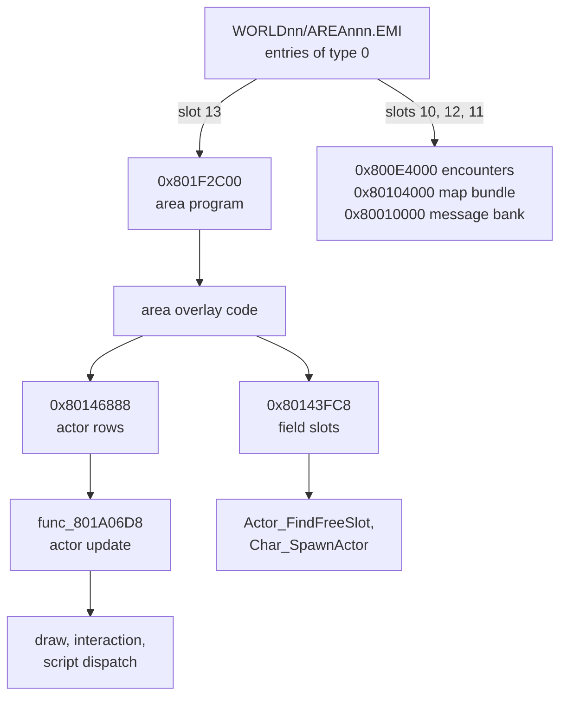

On the field the game keeps its state in fixed RAM tables: 30 actor rows of 152 bytes at `0x80146888` for the map's objects, 20 field slots of 116 bytes at `0x80143FC8` that a scene fills, the party's inventory, zenny and play clock, and the fairy-village and fishing tables. This page lists each by address, row layout and reader. The archives that feed these rows are in [area formats](../../formats/area/), the character record is in [game records](../records/#character-and-master-data), and the use of the rows by area and scenario code is in [areas and the field](../../systems/areas/).

Evidence cells name the function that reads or writes a cell, as `name (image@address)`. The executable image is `exe/slus_004_22`. Terms such as actor row and field slot are in the [glossary](../../appendix/glossary/).

## Where the records are

The table gives the address, row size and row count of each object. Several objects are the same data seen from different overlays, so a reader may be an overlay function and not an executable one.

| Object                  |      Address | Size | Count | Readers                                                                                                    |
| ----------------------- | -----------: | ---: | ----: | ---------------------------------------------------------------------------------------------------------- |
| actor rows              | `0x80146888` |  152 |    30 | `func_801A06D8 (emi/etc/game/00@0x801A06D8)`, area, plchar and scenario overlays                           |
| published actor pointer | `0x80146884` |    4 |     1 | `Area_RunParty (exe/slus_004_22@0x8015A758)`, `func_8015A7E8 (exe/slus_004_22@0x8015A7E8)`                 |
| scratchpad work pointer | `0x1F800044` |    4 |     1 | every field, plchar, world and scenario overlay                                                            |
| field slots             | `0x80143FC8` |  116 |    20 | `Actor_FindFreeSlot (emi/etc/game/00@0x8019601C)`, scene overlays and the setup stream's type-`E` record   |
| party records           | `0x80144968` |  164 |     8 | see [records](../records/#character-and-master-data)                                                       |
| inventory ids           | `0x8014504C` |  512 | 4x128 | `Party_CountItem (exe/slus_004_22@0x8016628C)`, item menu                                                  |
| inventory counts        | `0x8014524C` |  512 | 4x128 | item menu, `func_801D8364 (emi/world00/area030/04@0x801D8364)`                                             |
| vital items             | `0x8014544C` |   32 |    32 | `Party_HasVitalItem (exe/slus_004_22@0x80166140)`, `Party_AddVitalItem (exe/slus_004_22@0x80166180)`       |
| zenny                   | `0x80144F50` |    4 |     1 | `Party_SpendZenny (exe/slus_004_22@0x8016663C)`, `Party_AddZenny (exe/slus_004_22@0x8016666C)`, every shop |
| play clock              | `0x80144FC0` |    4 |     1 | `func_80198CAC (emi/etc/game/00@0x80198CAC)`, status, save and shop panels                                 |
| fairy jobs              | `0x801455C8` |    8 |    60 | `Fairy_JoinVillage (emi/etc/commu00/00@0x801F00D4)`, `func_801F01F4 (emi/etc/commu00/00@0x801F01F4)`       |
| best catches            | `0x80144FE4` |    1 |    32 | `func_801DB554 (emi/world00/area030/04@0x801DB554)`, `func_801E0B6C (emi/world00/area030/04@0x801E0B6C)`   |
| fishing rod table       | `0x801E2748` |   10 |     - | `func_801DDE2C (emi/world00/area030/04@0x801DDE2C)`                                                        |
| fishing lure table      | `0x801E2720` |   20 |     - | `func_801DDE2C (emi/world00/area030/04@0x801DDE2C)`                                                        |

The area archive feeds these rows. The diagram shows the entries of `WORLDnn/AREAnnn.EMI` and where each one loads.



The slot numbers are the TOC indexes for `WORLD00/AREA001.EMI`. The seven world shapes move the area
program between slots 9, 13 and 14 ([EMI](../../formats/emi/#archive-shapes)).

## Actor rows

An actor row is one map object or interaction slot. The table has 30 rows of 152 bytes, and the
update walks only rows whose in-use bit is set. The scratchpad work cell at `0x1F800044` points into
the table, and the pointer cell at `0x80146884` publishes the current row. Every overlay reads the
same rows. The area overlays place objects and run their scripts, the communication minigame indexes
the rows as tasks, the scenario overlays dispatch their callbacks, and the fishing code steps the
stamina gauge of the pond rows. The community map calls the table the fish pond array, but only
`world00/area030/04` reads it as a pond. Every other overlay reads map objects, tasks or scene
entities.

The code reads some offsets at several widths and signs: `+0x5D`, for example, is read as a signed and as an unsigned byte. The table lists the width of the most frequent reader.

| Offset | Type          | Meaning                                                                                                                                                    | Evidence                                                                                                                                                                                                                |
| -----: | ------------- | ---------------------------------------------------------------------------------------------------------------------------------------------------------- | ----------------------------------------------------------------------------------------------------------------------------------------------------------------------------------------------------------------------- |
| `0x00` | `u8`          | row state; bits in the flag table below                                                                                                                    | `Area_DrawObjectSprite (exe/slus_004_22@0x8014C4D4)`; `func_801A06D8`                                                                                                                                                   |
| `0x01` | `u8`          | per-kind dispatch index; the communication minigame calls it the task mode                                                                                 | `func_801A06D8` indexes `D_801C83D8`                                                                                                                                                                                    |
| `0x02` | `u8`          | task state                                                                                                                                                 | `func_801D11C0 (emi/world00/area030/04@0x801D11C0)`                                                                                                                                                                     |
| `0x05` | `u8`          | region or scene index; scales the script copy's staging offset; cleared at scene init                                                                      | `Actor_CopyScriptEntry (exe/slus_004_22@0x8014D54C)`; `Area_InitScene (exe/slus_004_22@0x801673AC)`                                                                                                                     |
| `0x06` | `u8`          | live flag; 9 gates the draw-mode stamp, 10 calls `func_8015A944`                                                                                           | `func_80167E00 (exe/slus_004_22@0x80167E00)`; `func_8015A944 (exe/slus_004_22@0x8015A944)`                                                                                                                              |
| `0x07` | `u8`          | spawn options; bits in the flag table below                                                                                                                | `func_801A06D8`                                                                                                                                                                                                         |
| `0x08` | `u8`          | facing direction 0-7; selects the velocity row and the script                                                                                              | `func_801A06D8`                                                                                                                                                                                                         |
| `0x09` | `u8`          | holds the row out of the script path while set                                                                                                             | `func_801A06D8`                                                                                                                                                                                                         |
| `0x0C` | `s32`         | area 032 adds it to x as the x step                                                                                                                        | `emi/world00/area032/13`                                                                                                                                                                                                |
| `0x14` | `s32`         | signed vertical speed                                                                                                                                      | none found                                                                                                                                                                                                              |
| `0x20` | `s32`         | gravity, added to the vertical speed each step                                                                                                             | none found                                                                                                                                                                                                              |
| `0x24` | `u8`          | bit 6 marks the record active                                                                                                                              | `func_8014DE78 (exe/slus_004_22@0x8014DE78)`                                                                                                                                                                            |
| `0x2E` | `s16`         | screen x, signed; the draw culls outside `-0x40` to `0x180`                                                                                                | `Area_DrawObjectSprite`                                                                                                                                                                                                 |
| `0x30` | `s16`         | screen y                                                                                                                                                   | `Area_DrawObjectSprite`                                                                                                                                                                                                 |
| `0x34` | `s32` (16.16) | world x                                                                                                                                                    | `func_8014DE78`; `Char_SpawnActor (emi/plchar/plp012/00@0x801CEF14)`                                                                                                                                                    |
| `0x38` | `s32` (16.16) | world y                                                                                                                                                    | `func_8014DE78`; `Char_SpawnActor`                                                                                                                                                                                      |
| `0x3C` | `s32` (16.16) | elevation; readers use the high half `+0x3E` as the ground height                                                                                          | `func_8014DE78`; `Char_SpawnActor`                                                                                                                                                                                      |
| `0x4B` | `u8`          | script-bank record index                                                                                                                                   | `Actor_BeginScript (exe/slus_004_22@0x8014D6DC)` reads `work + 0x4B` ([area](../../formats/area/#0x800d3800-area-script-bank))                                                                                          |
| `0x50` | `u8*`         | cursor into the area script stream                                                                                                                         | `Actor_CopyScriptEntry`; `Actor_SeekScript (exe/slus_004_22@0x8014D910)`; `func_8014DAEC (exe/slus_004_22@0x8014DAEC)`                                                                                                  |
| `0x54` | `ActorRange`  | range record pointer, also read as an integer; byte 2 is the reach, byte 3 bit `0x10` blocks                                                               | `func_8014DE78`                                                                                                                                                                                                         |
| `0x5C` | `u8[4]`       | a flags byte, then three tint bytes (`+0x5D` to `+0x5F`); read whole as a packed tint, as unsigned bytes and as the signed steps a fade adds toward `0xC0` | `func_801F3728 (emi/world00/area032/13@0x801F3728)`; `func_801F3920 (emi/world00/area032/13@0x801F3920)`                                                                                                                |
| `0x70` | `u8`          | low byte of a state word: the scene flag-table byte; packed voice numbers sit above it                                                                     | written by `Area_FindSceneRecord (exe/slus_004_22@0x8014DD3C)`; voice numbers OR'd above it by `SND_QueueSelectionFx (exe/slus_004_22@0x8015D71C)`; read as an argument by `func_801B8A9C (emi/etc/game/00@0x801B8A9C)` |
| `0x74` | `u8`          | interaction state; bits in the flag table below                                                                                                            | `func_801A06D8`                                                                                                                                                                                                         |
| `0x7A` | `u8`          | scenario callback table index; `0xFF` is none                                                                                                              | `func_801F8358 (emi/scenario/scena16/00@0x801F8358)`; `Scene_DispatchActor (emi/scenario/scena00/00@0x801FC7D0)` and the other scenario overlays index their table                                                      |
| `0x8C` | `s16`         | fishing gauge maximum                                                                                                                                      | `func_801E026C (emi/world00/area030/04@0x801E026C)`                                                                                                                                                                     |
| `0x8E` | `u16`         | fishing gauge; a signed delta is added and the result is clamped into `[0, gauge maximum]`                                                                 | `func_801E026C`                                                                                                                                                                                                         |
| `0x90` | `u16`         | compared with `0x1F` by the update: the idle path runs when it is `>= 0x1F` and `+0x09` is 0                                                               | `func_801A06D8`                                                                                                                                                                                                         |
| `0x92` | `u8`          | the fishing code writes `rand() & 3` into it; it is a lane or position selector, not a turn                                                                | `func_801DE5EC (emi/world00/area030/04@0x801DE5EC)`                                                                                                                                                                     |

```c
typedef struct Actor {
    /* 0x00 */ u8    flags_00;
    /* 0x01 */ u8    unk_01;
    /* 0x02 */ u8    state_02;
    /* 0x05 */ u8    unk_05;
    /* 0x06 */ u8    unk_06;
    /* 0x07 */ u8    option_flags;
    /* 0x08 */ u8    direction_08;
    /* 0x0C */ s32   unk_0C;
    /* 0x14 */ s32   vz;
    /* 0x20 */ s32   gravity;
    /* 0x24 */ u8    flags_24;
    /* 0x2E */ s16   unk_2E;
    /* 0x30 */ s16   unk_30;
    /* 0x34 */ Coord x;
    /* 0x38 */ Coord y;
    /* 0x3C */ Coord z;
    /* 0x4B */ u8    unk_4B;
    /* 0x50 */ u8*   source_50;
    /* 0x54 */ ActorRange range_54;
    /* 0x5C */ ActorTint tint;
    /* 0x70 */ u8    state_70;
    /* 0x74 */ u8    flags_74;
    /* 0x7A */ u8    callback_index;
    /* 0x8C */ s16   stamina_max_8C;
    /* 0x8E */ u16   stamina_8E;
    /* 0x90 */ u16   roll_90;
    /* 0x92 */ u8    facing_92;
} Actor;                 /* 0x98 bytes; other members folded */
```

Source: [`include/work/actor.h`](https://github.com/raulcorreia7/bof3-decomp/blob/main/include/work/actor.h)

Offsets `0x03`, `0x04`, `0x0A`, `0x0B`, `0x10`, `0x25-0x2D`, `0x32`, `0x40`, `0x44`, `0x49`, `0x4C`,
`0x5A`, `0x60-0x6C`, `0x71-0x73`, `0x76-0x77`, `0x79`, `0x7B`, `0x7E`, `0x80-0x88` and `0x93-0x97`
have no proven role. Other overlays use further cells for their own purposes (`+0x18`, `+0x1C`,
`+0x48`, `+0x78` and `+0x7C` in the communication minigame, `+0x4A`, `+0x58` and `+0x75`). Those
names describe one overlay and are `[inferred]` for the others.

### Flag bits

Three bytes of an actor row carry flags. The update `func_801A06D8` reads `+0x74` and the spawn
options, `Area_DrawObjectSprite` reads `+0x00`, and `func_8014DE78` reads `+0x24`.

| Byte    |    Bit | Name                | Effect                                                                                                          |
| ------- | -----: | ------------------- | --------------------------------------------------------------------------------------------------------------- |
| `+0x00` | `0x01` | in use              | the update and draw walk the row                                                                                |
| `+0x00` | `0x02` | skip palette stage  | skips queuing the row's palette pair                                                                            |
| `+0x00` | `0x10` | step move           | takes the advance-stream tail after the step deltas                                                             |
| `+0x00` | `0x20` | semi transparent    | marks the row's primitives semi-transparent                                                                     |
| `+0x00` | `0x40` | hidden              | the draw returns before queuing sprite cells; also hides the row from the walkability and entity-lookup paths   |
| `+0x00` | `0x80` | offscreen           | culled outside the window; treated as arrived                                                                   |
| `+0x24` | `0x40` | active              | the record is active                                                                                            |
| `+0x74` | `0x01` | interaction pending | runs the area interaction handler                                                                               |
| `+0x74` | `0x02` | fade white          | selects the white fade handler                                                                                  |
| `+0x74` | `0x04` | fade black          | selects the black fade handler                                                                                  |
| `+0x74` | `0x08` | moving              | a path or movement step is in progress; set when a move starts, cleared on arrival; the route needs re-applying |
| `+0x74` | `0x10` | script request      | starts the map or message request                                                                               |
| `+0x74` | `0x20` | script pending      | dispatches the scenario record                                                                                  |
| `+0x07` | `0x01` | hidden on spawn     | sets bit `0x40` of `+0x00` at spawn                                                                             |
| `+0x07` | `0x02` | keep facing         | keeps the row's own facing instead of the opposite one                                                          |
| `+0x07` | `0x04` | no script start     | drops the script arm                                                                                            |
| `+0x07` | `0x08` | route locked        | skips re-applying the route                                                                                     |
| `+0x07` | `0x20` | wait for stream     | skips the animation-stream advance                                                                              |
| `+0x07` | `0x80` | no target           | skips the walkability and target test and the entity lookup                                                     |

### The per-frame update

`func_801A06D8` publishes each row through `g_SpadWork` and `g_CurrentActor`. It returns at once
while the area walk step is active. Otherwise it visits the 30 rows in order. For each row:

1. Publish the row.
2. Skip it when the in-use flag is clear.
3. Clear the scratchpad step byte.
4. When `+0x09` is 0 and a script is pending: with a script request, arm the script and turn the row
   unless the route is locked. Without one, dispatch the scenario record.
5. Else, when an interaction is pending, run the interaction handler and go to the next row.
6. Else, when `+0x90` is at least `0x1F` and `+0x09` is 0, run the idle path.
7. Else run the per-kind handler `D_801C83D8[+0x01]`.
8. Re-apply the route when the row is moving. Otherwise advance the animation stream unless the
   wait-for-stream flag is set.

The per-kind table `D_801C83D8` is the game overlay's row update table. The scratchpad cell is a
pointer, so every overlay types the same cell with its own work view. The field view is the actor
row above. The state step in the scratchpad work cell is the byte that task dispatch indexes and
that the battle step tables read and write. Clearing the row's state sets `+0x02` to 0, so the
record starts a new task at state 0.

## Field slots

A field slot belongs to the scene. The scene and frontend code claim, fill and clear slots, while the
actor rows are the live map objects. There are twenty slots of 116 bytes at `0x80143FC8`
(`g_ActorSlots`).

| Offset | Type          | Meaning                                                                                                                                         | Evidence                                                                                                                                                         |
| -----: | ------------- | ----------------------------------------------------------------------------------------------------------------------------------------------- | ---------------------------------------------------------------------------------------------------------------------------------------------------------------- |
| `0x00` | `u8`          | set to 1 when the slot is claimed                                                                                                               | `Actor_FindFreeSlot (emi/etc/game/00@0x8019601C)`                                                                                                                |
| `0x01` | `u8`          | kind passed to `Char_SpawnActor`                                                                                                                | `Char_SpawnActor (emi/plchar/plp012/00@0x801CEF14)`                                                                                                              |
| `0x05` | `u8`          | actor type and handler index; seen values `0x0F`, `0x10`, `0x1E`, `0x32`, `0x69`; `0x34` for a character spawn; also read as an accessory count | `Char_SpawnActor`                                                                                                                                                |
| `0x06` | `u8`          | area id in area 030; slot index in the game overlay                                                                                             | none found                                                                                                                                                       |
| `0x09` | `u8`          | draw layer; seen values `0x20`, `0x40`, `0x60`, `0x90`, `0xFF`                                                                                  | no reader named                                                                                                                                                  |
| `0x0B` | `u8`          | index of the linked slot                                                                                                                        | `Char_SpawnActor`                                                                                                                                                |
| `0x0C` | `s32`         | scenario step                                                                                                                                   | scene readers                                                                                                                                                    |
| `0x10` | `s32`         | frontend selection                                                                                                                              | frontend readers                                                                                                                                                 |
| `0x18` | `s32`         | counter                                                                                                                                         | writer `func_801F92DC (emi/scenario/scena00/00@0x801F92DC)`; also written by `func_801F2C04`, `func_801F2CD4` and `func_801F5A44` as slot cells; no reader found |
| `0x1C` | `s32`         | counter                                                                                                                                         | same writers as `+0x18`; no reader found                                                                                                                         |
| `0x29` | `u8`          | cleared when the slot is rebuilt                                                                                                                | none found                                                                                                                                                       |
| `0x34` | `s32` (16.16) | world x; `Area_SampleHeight` argument                                                                                                           | `Char_SpawnActor`                                                                                                                                                |
| `0x38` | `s32` (16.16) | world y; `Area_SampleHeight` argument                                                                                                           | `Char_SpawnActor`                                                                                                                                                |
| `0x3C` | `s32` (16.16) | `Area_SampleHeight` of x and y in the integer half (`+0x3E`); the call passes the shifted 16.16 values                                          | `Char_SpawnActor`                                                                                                                                                |
| `0x64` | `s32[3]`      | scene origin plus offset                                                                                                                        | scene readers                                                                                                                                                    |

```c
typedef struct ActorSlot {
    /* 0x00 */ u8    flags_00;
    /* 0x01 */ u8    unk_01;
    /* 0x05 */ u8    type;
    /* 0x06 */ u8    unk_06;
    /* 0x09 */ u8    layer_09;
    /* 0x0B */ u8    link_0B;
    /* 0x0C */ s32   step_0C;
    /* 0x10 */ s32   selection_10;
    /* 0x18 */ s32   counter_18;
    /* 0x1C */ s32   counter_1C;
    /* 0x29 */ u8    unk_29;
    /* 0x34 */ Coord x;
    /* 0x38 */ Coord y;
    /* 0x3C */ Coord z;
    /* 0x64 */ Vec3i pos;
} ActorSlot;             /* 0x74 bytes; gaps are pad_XX or unk_XX */
```

Source: [`include/game/records.h`](https://github.com/raulcorreia7/bof3-decomp/blob/main/include/game/records.h)

Other cells have no proven role: `0x02-0x04`, `0x07`, `0x08`, `0x0A`, `0x14`, `0x20-0x28`,
`0x2A-0x33`, `0x40-0x63` (including `0x4A`) and `0x70-0x73`.

### Allocation and spawn

`Actor_FindFreeSlot` returns the first slot whose first byte is 0, or `0xFF` when all 20 are taken.
`Char_SpawnActor(kind, x, y)` is shared by every plchar program. It returns when the allocation gives
`0xFF`. Otherwise it does this:

1. Set the first byte to 1 and `type` (`+0x05`) to `0x34`.
2. Set x and y to the arguments shifted left by 16.
3. Set `+0x01` to `kind`.
4. Set the integer half of z to the sampled ground height plus `0x100`.
5. Set the link byte (`+0x0B`) to 0.

`Area_SampleHeight (exe/slus_004_22@0x8015477C)` samples the four corner height bytes of the map
bundle and returns the ground height as `s16`. It is a height, not a distance
([area](../../formats/area/#0x80104000-map-bundle)).

## Inventory, money and time

The inventory is four parallel rows of 128 id bytes and four rows of 128 count bytes, plus a 32-byte vital-item row. The category index follows the item category ([value ranges](../records/#masks-and-value-ranges)). The table adds the retail menu label of each.

| Index | Category   | Retail menu label |
| ----: | ---------- | ----------------- |
|   `0` | item       | item              |
|   `1` | weapon     | weapon            |
|   `2` | armor      | armor             |
|   `3` | accessory  | accessory         |
|   `4` | vital item | `VITAL`           |

The arrays are flat. The pointer tables `D_801C893C` (ids) and `D_801C8950` (counts) hold their bases in
category order, with five slots each. The vital-item row is the fifth id pointer, and the fifth count
pointer is null. The code proves the first four labels. The fifth is `[inferred]` from its position
and category 4. A count is the stack size, and `0x63` (99) is the cap that the code tests.

Zenny is a `u32` that `Party_AddZenny` clamps at 9,999,999. A shop subtracts only when the balance covers the price. The play clock is four bytes.

| Offset | Type | Name         | Meaning              |
| -----: | ---- | ------------ | -------------------- |
| `0x00` | `u8` | `hours`      | stops at `0x63` (99) |
| `0x01` | `u8` | `minutes`    | rolls at 60          |
| `0x02` | `u8` | `seconds`    | rolls at 60          |
| `0x03` | `u8` | `thirtieths` | rolls at 30          |

```c
typedef struct GameClock {
    /* 0x00 */ u8 hours_00;
    /* 0x01 */ u8 minutes_01;
    /* 0x02 */ u8 seconds_02;
    /* 0x03 */ u8 thirtieths_03;
} GameClock;
```

Source: [`include/menu/clock.h`](https://github.com/raulcorreia7/bof3-decomp/blob/main/include/menu/clock.h)

The clock stops at `99:59:59`, where the low three bytes read `0x3B3B63`, instead of incrementing past
it. The two countdown timers at `0x80145554` (celerity) and `0x80145558` (bonebreak) use the same
fields in reverse and borrow at the same boundaries. Both lie in the saved block, at save offsets `+0xE7C` and `+0xE80` ([save layout](../records/#save-layout)). The tick loop is in the `emi/etc/game/00` overlay.
The shop, `commu00` and `emi/etc/game/01` overlays format the same bytes for display.

## Fairy village and fishing

A fairy job row records one job in the village. There are 60 rows of 8 bytes at `0x801455C8`
(`g_FairyJobs`).

| Offset | Type  | Meaning                                     |
| -----: | ----- | ------------------------------------------- |
| `0x00` | `u8`  | the slot is live while set                  |
| `0x01` | `u8`  | the job being worked                        |
| `0x02` | `u8`  | record state                                |
| `0x03` | `u8`  | `[unknown]`                                 |
| `0x04` | `u32` | the battle count when the job last advanced |

```c
typedef struct FairyJob {
    /* 0x00 */ u8  active;
    /* 0x01 */ u8  type;
    /* 0x02 */ u8  record_state;
    /* 0x03 */ u8  unk_03;
    /* 0x04 */ u32 progress_anchor;
} FairyJob;
```

Source: [`include/game/fairy.h`](https://github.com/raulcorreia7/bof3-decomp/blob/main/include/game/fairy.h)

The 720-fairy roster and its reward tables stay in the archives ([records](../records/#area-data)).

Fishing keeps three state bytes, 10-byte rod rows, 20-byte lure rows and 32 best-catch bytes.

| Address      | Type     | Meaning                                                                                            |
| ------------ | -------- | -------------------------------------------------------------------------------------------------- |
| `0x80145026` | `u8`     | selected lure                                                                                      |
| `0x80145027` | `u8`     | lure quantity; `Party_CountItem` adds it to the lure's item count                                  |
| `0x80145028` | `u8`     | selected rod                                                                                       |
| `0x80144FE4` | `u8[32]` | best catch, one byte per fish, in the index order of the count table; saved at save offset `0x90C` |

The rod row is `rod_table + rod * 10` and the lure row is `lure_table + lure * 20`
(`func_801DDE2C`). Nothing bounds either selector, so the code fixes no row count. Both selectors are
accessory ids: the fishing screens draw their names from the accessory table, and `Party_CountItem`
compares them with accessory ids. That table holds six rods (ids 46 to 51), so six rod rows is
`[inferred]`. `func_801E0B6C` walks all 32 best-catch bytes. The fishing code reads the pond rows
through the same actor table: the gauge at `+0x8E` is clamped into `[0, +0x8C]`, and `+0x92` takes
`rand() & 3`.

Each rod row is 10 bytes, one byte per cell.

| Offset | Type | Meaning                                                                                          |
| -----: | ---- | ------------------------------------------------------------------------------------------------ |
| `0x00` | `u8` | cast power and speed                                                                             |
| `0x01` | `u8` | cast sweep direction: 0 linear bidirectional, 1 linear unidirectional, 2 quadratic bidirectional |
| `0x02` | `u8` | maximum distance, half the value in metres                                                       |
| `0x03` | `u8` | reel cursor size                                                                                 |
| `0x04` | `s8` | cursor return speed                                                                              |
| `0x05` | `s8` | cursor left speed                                                                                |
| `0x06` | `s8` | cursor right speed                                                                               |
| `0x07` | `u8` | `[unknown]`                                                                                      |
| `0x08` | `u8` | snap left tension                                                                                |
| `0x09` | `u8` | snap right tension                                                                               |

Each lure row is 20 bytes.

| Offset | Type    | Meaning             |
| -----: | ------- | ------------------- |
| `0x00` | `u8`    | `[unknown]`         |
| `0x01` | `u8[3]` | idle float rate     |
| `0x04` | `u8[4]` | reeling float rate  |
| `0x08` | `u8[4]` | sideways float rate |
| `0x0C` | `u8[8]` | `[unknown]`         |

The community notes call each float group a 16-bit value but give the byte spans `+1..3`, `+4..7` and
`+8..11`. The group widths are unresolved.

## Open questions

- `[unknown]` Where the rod and lure tables sit. `func_801DDE2C` reads the strides 10 and 20, but
  `0x801E2748` lies inside the `D_801E2424` panel-icon array (74 x 16) and reads as icon data.
  Reference notes give `0x801E2914` and `0x801E2950`, which are unverified. A read-breakpoint on
  `func_801DDE2C` would settle it.
- `[unknown]` The roles of the actor-row and field-slot cells listed as having no proven role.
- `[unknown]` The widths of the lure float-rate groups.

## Sources and confidence

- **Confidence:** medium. The addresses, strides and the main fields are established, but many cells have no proven role and the fishing tables and the lure float widths are unresolved.
- **Evidence:** the functions named in the evidence cells, in the executable, the `emi/etc/game/00` overlay, the area, plchar and scenario overlays and the fishing overlay. Community notes confirm addresses and strides only ([sources](../../appendix/sources/)).

## Related

- [Game records](../records/): the character record, the item tables and the save map for these rows.
- [Battle records](../battle/): the work rows that a fight builds from the party and the candidates.
- [Areas and the field](../../systems/areas/): how the area overlay and the scenario code use the rows.
- [Area formats](../../formats/area/): the archives that load into these tables.
- [Saving and loading](../../systems/saving/): how the clock, zenny and inventory reach the memory card.
