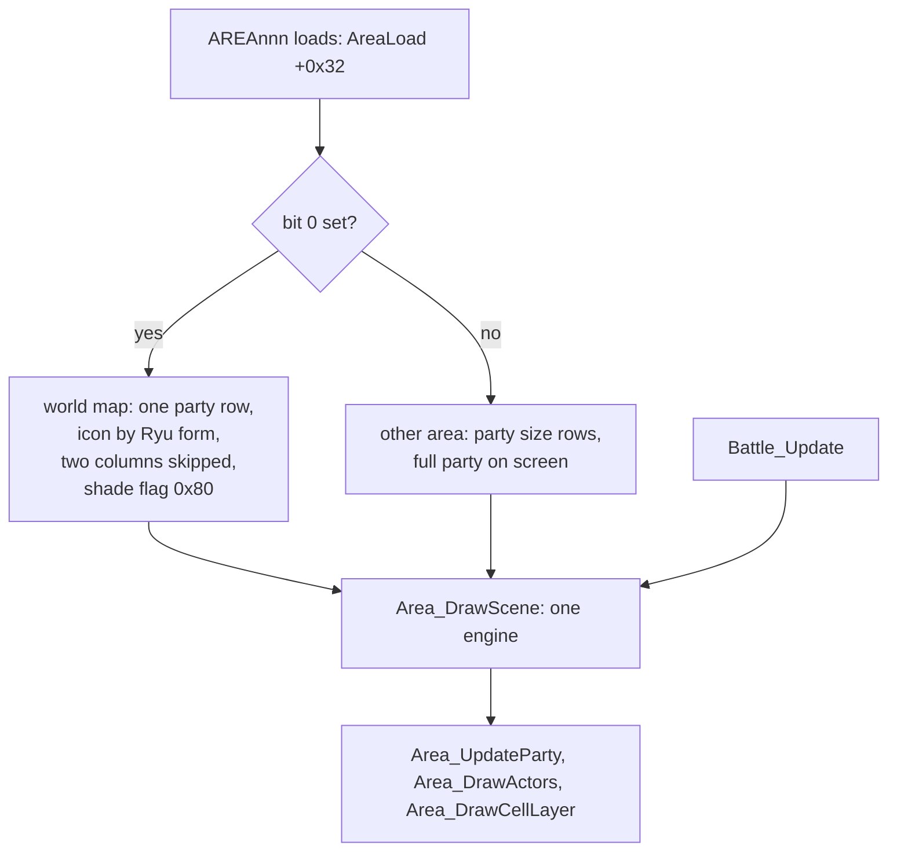

The game is one resident program, `SLUS_004.22`, plus code and data that the loader streams from EMI archives into fixed RAM windows. Each program loads at one address, and programs that share an address replace one another. This page names the programs, lists the load address of each family, describes the module windows and the reserved space in the executable, and shows how the single map engine tells a world map from a town. The path from power-on to the title, the load sequence and the RAM map are on other pages.

## Images

An image is one program the game loads: the main executable, the logo executable, or the code held in one EMI entry. [Notation and conventions](../../concepts/notation/#images-and-citations) defines the image ids. An image has its own payload and load address. Two images can use the same address for unrelated code, so a citation always names the image with the address.

Names belong to one owner: the SDK libraries, the BIOS, the main executable `exe/slus_004_22` (which every EMI image calls into), `exe/logo`, or the image itself for its local names. There is no global name map. An EMI archive is a container, never an image.

## Load addresses

Each image loads at one address. Images that share an address share a RAM window, and the loader replaces the previous occupant when it loads the next one. The table lists the retail families.

| Load address | Images                                                                                                                                                                                          |
| -----------: | ----------------------------------------------------------------------------------------------------------------------------------------------------------------------------------------------- |
| `0x80096800` | `exe/slus_004_22` image base (the PS-X header `t_addr`; its code and data sit higher, see [executable layout](#executable-layout)); `emi/battle/battle/15`, the battle command-menu overlay     |
| `0x800C1800` | `emi/boss/*`: boss battle modules                                                                                                                                                               |
| `0x800F5000` | `emi/world00/area030/05`: the fishing companion module (8,784 bytes); copies in `area089` and `area129`                                                                                         |
| `0x80117000` | one single-area module in each of nine areas (049, 067, 077, 104, 108, 121, 135, 145, 173)                                                                                                      |
| `0x80195800` | `emi/etc/game/00`: resident game core (actors, scene and state tables, camp and status menu panels)                                                                                             |
| `0x801CE000` | `exe/logo`: the logo player, an independent executable                                                                                                                                          |
| `0x801CE400` | `emi/plchar/*`: character code overlays                                                                                                                                                         |
| `0x801D0C00` | `emi/battle/battle/03` (main battle program); `emi/etc/{bate,commu01-05,game/01,shisu,shop,sisyou,start/08}`; `emi/scenario/sce10eff`, `sce15ef0-3`; `emi/world00/area030/04` (fishing program) |
| `0x801EEC00` | `emi/bmagic/*` (battle-effect modules); `emi/battle/{batl_end,batl_ovr}`; `emi/etc/commu00/00`; `emi/etc/start/09`                                                                              |
| `0x801F2C00` | `emi/world0N/area*`: the area program of each of the 200 areas                                                                                                                                  |
| `0x801F6C00` | `emi/scenario/scenaNN`: the 20 scenario controllers                                                                                                                                             |

Two entries load low as data. `emi/battle/batl_re2/01` goes to `0x80036E00` and `emi/etc/bate/03` to `0x80033A00`; both are 512-byte CLUT blocks and hold no code.

The battle command-menu overlay is not unique to its archive. Every `BOSS` archive and two `BATTLE` archives carry a byte-identical 133,316-byte copy, so whichever battle starts, the overlay is in the same window.

## Program families

A program family is the set of code entries that the loader copies to one address. The members share a load address and the rule that finds the first function. A payload that is byte-identical to an earlier member at the same address is a copy: it keeps its own disc entry and reuses the earlier code. A byte-identical payload at a different address is a relocated program with its own layout, not a copy.

The load address does not tell code from data. To find the first function, scan the payload for a `lui`, a stack-frame prologue (`addiu sp,sp,-N`) or a bare return, and follow the returns. A payload with no prologue and no `jr $ra` is data and loads as one data block, even if a byte sweep counts it as code. The area family at `0x801F2C00` has 200 entries: 181 code programs and 19 data blocks.

## Module windows

Two windows hold swappable battle modules rather than one program family: the boss window at `0x800C1800` and the shared window at `0x801EEC00`. Every module payload starts with a `u32` module id, the word the type-0 loader compares against the archive's table-of-contents cache ([EMI container](../../formats/emi/)).

| Window       | Entries | Ids                                       | Content                                                                           |
| ------------ | ------: | ----------------------------------------- | --------------------------------------------------------------------------------- |
| `0x800C1800` |      40 | `0x11E`-`0x140` (35 distinct)             | boss battle modules, 480 to 7,700 bytes; five ids appear in more than one archive |
| `0x801EEC00` |     157 | `0x144`-`0x1BF` (124 distinct) and others | battle-effect modules, plus the entries listed below                              |

The shared window also holds `batl_end` (id `0x142`) and `batl_ovr` (`0x143`), the card code (`0x141`, 5,268 bytes, identical in `SHOP.EMI#8` and `START.EMI#9`), and the fairy-village program (id `0x18`, 15,696 bytes, in `COMMU00.EMI#0` and in entry 14 of areas 175 to 185). The fishing companion at `0x800F5000` has id `0x17`, and the nine single-area modules at `0x80117000` have ids `0xFC` to `0x104`.

The boss window is 210,944 bytes, from `0x800C1800` to the next window at `0x800F5000`. Battle code reaches a boss module through the callback table `D_801EB298` in `emi/battle/battle/03`: 63 rows, row 0 null, rows 1 to 62 pointing into `0x800C1804..0x800C1EB0`. The battle-effect modules have no static caller in the executable, so their entry path is `[unknown]`; the [open questions](../../appendix/open-questions/) list it.

A battle-effect module starts with its id and then a table of callbacks, which are addresses of functions in the same module. Its step function (`BMagic_DispatchMode`; the address differs per module) copies the first three callbacks to the stack and calls the one that the scratchpad step byte selects (`g_SpadWork + 1`, `0x1F800044`). Some modules select the step with byte 2 instead of byte 1. The modules call PsyQ GTE and GPU functions (`rsin`, `rcos`, `GetGraphType`, `SetDrawMode`, `SetSemiTrans`), the executable's primitive helper `GFX_AddPrim`, and the resident battle overlays.

## Executable layout

`SYSTEM.CNF` selects `SLUS_004.22`. The header fields and the file size are in [executables](../../formats/exe/#ps-x-exe-header). The image declares `t_addr = 0x80096800`, and most of it is reservation. Code and data occupy `0x80149800..0x8018B2B4` (file offsets `0xB3800..0xF52B4`); the BSS above them is in the [memory map](../../concepts/memory/#the-map). The rest is zero-filled space that overlay windows use: `0x80096800` (176,128 bytes), the boss window `0x800C1800`, `0x800F5000`, `0x80117000`, and, above the executable, the windows from `0x80195800` to `0x801F6C00`. Each reservation begins with one marker word and nothing else.

`LOGO/LOGO.EXE` is a second PS-X executable that loads at `0x801CE000` and runs before the title. It overlaps only the character window `0x801CE400` and the scene window `0x801D0C00`.

## Map kinds

The game has one resident map engine. The world map and the town and dungeon maps are all area images that this engine runs. A flag in each area's load entry selects the world-map variant.

`g_AreaLoads (exe/slus_004_22@0x8017F974)` holds 200 pointers, one per area. Each points to an `AreaLoad` entry inside that area's own program. Byte `+0x32` of the entry is the map-kind flag, which the game copies to `g_GameRequestFlags` when it loads the area. The table gives the kinds over all 200 areas.

| Value  | Kind                        | Areas                                       |
| ------ | --------------------------- | ------------------------------------------- |
| `0x01` | world map                   | 016, 033, 045, 065, 087, 088, 115, 151, 152 |
| `0x21` | world map, bit `0x20` set   | 104, 121                                    |
| `0x06` | random battlefield          | 020, 029, 063, 064, 072, 073, 110, 124, 125 |
| `0x08` | fishing area                | 030, 089, 129                               |
| `0x10` | fairy village (COMMU00 map) | 175-185                                     |
| `0x40` | camp scene                  | 090, 153, 154, 187, 191, 192                |
| `0x00` | walked area (town, dungeon) | the other 160, including area 000           |

Area 000 is McNeil, not the world map. Bit `0x20` appears only on two world maps and its effect is `[unknown]`. Each world map pairs with a battlefield through a table in `emi/etc/game/00` (`D_801CD224`): ten rows of two `u16`, world-map area then battlefield area. The pairs are 16 to 20, 33 to 29, 45 to 63, 65 to 64, 87 to 72, 88 to 73, 115 to 110, 121 to 20, 151 to 124 and 152 to 125.

The flag changes three behaviors:

- **Party rows.** `func_801BFF9C (emi/etc/game/00@0x801BFF9C)` sets the party to one row when the map is not loading and the area is a world map or fishing area, is area 187 or 189 (`0xBB`, `0xBD`), or is a camp scene while event flag `0x77` is clear. On a world map it then looks up a scene record by Ryu's form (`character_id` 0 gives record `0x52`, 9 gives `0xCB`, 7 gives `0x27A`, and any other form gives none). Otherwise the row count is the whole party.
- **Cell layer.** With bit 0 set, `Area_DrawCellLayer (exe/slus_004_22@0x80155B40)` and `func_801530D0 (exe/slus_004_22@0x801530D0)` skip the column count minus 2 columns, never fewer than 0.
- **Shading and camera.** `func_80153DE8 (exe/slus_004_22@0x80153DE8)` sets the shade flag to `0x80` when bit 0 is set. It sets the camera height to 0 for fishing areas (bit `0x08`) and to `Area_SampleHeight` of the scroll target otherwise.

One renderer draws both map kinds and battle: GTE-rotated textured quads. `Area_DrawScene (exe/slus_004_22@0x8014BA54)` runs the record list, `Area_DrawActors` and the cell layers, and `Area_DrawParts` and `Area_DrawGouraudQuads` project parts through the GTE. There is no separate flat-cell renderer for towns. The four `Actor` rows that `Area_UpdateParty` steps (`g_Actors`) are the party's map objects in every map kind and in battle ([field](../field/#actor-rows)).

## PsyQ SDK

The retail link used PsyQ 3.7 for every runtime library. Both `slus_004_22` and `logo` link all their SDK code, and carry the SCE 3.7 version word `DA 94 37 00` at `0x8017ED10` (`0x801D7940` in `LOGO.EXE`). The EMI overlays link no SDK code and call the main executable instead. Four SDK units do not match any 3.7 library member: `2MBYTE.OBJ`, `NONE3.OBJ` and the LIBGTE `MSC01` and `MSC02` span. The table gives the evidence for each library.

| Library                                 | Evidence for 3.7                                                         |
| --------------------------------------- | ------------------------------------------------------------------------ |
| LIBGPU                                  | `getTPage` and `setDrawTPage` call `GetGraphType`                        |
| LIBGTE                                  | every unit matches 3.7 (`rsin` and `rcos` included)                      |
| LIBAPI                                  | 3.7 declares `Exec`, `EnterCriticalSection`, `SystemError`, `_card_chan` |
| LIBCARD                                 | 3.6, 3.7 and 4.0 export the same 20 functions; 3.7 declares them         |
| LIBCD, LIBETC, LIBSND, LIBSPU, LIBPRESS | every unit matches 3.7                                                   |

The retail build has `checkRECT(char *, RECT *)` at `0x8017B438` and an argument-free `s32 GetGraphType(void)` at `0x8017B2B4`; 3.7's headers declare neither. [Sources](../../appendix/sources/#sony-sdk) lists the SDK releases compared.

## Open questions

- The entry path of the battle-effect modules (no static caller).
- Which code owns name entry after New Game; the mutable character record is `g_Characters` (`0x80144968`), name bytes `0x00..0x04`.
- The `emi/etc/game/00` handler tables at `0x801C7B08..0x801C7BB0` (`g_GameCampMenuLoad`, `g_GameStates`, `g_GameEntryHandlers`, `g_GameModeHandlers`, `g_GameStateHandlers`, `g_GameSubstateHandlers`, `g_MenuAbilityOpen`, `g_MenuStatusOpen`, `g_GameFlowHandlers`) are initialized data. No code writes them, so the load fixes the handlers.
- The effect of map-kind bit `0x20`.

## Sources and confidence

- **Confidence:** medium. The load addresses, windows and map kinds are read from every image and every area, but the entry path of the battle-effect modules and the effect of map-kind bit `0x20` are not established.
- **Evidence:** the load argument of every EMI entry, the PS-X headers of both executables, the area load table `g_AreaLoads` over all 200 areas, the module ids and callback tables in the battle overlays, and the linked PsyQ library members compared with the 3.7 release ([sources](../../appendix/sources/#sony-sdk)).

## Related

- [Memory](../../concepts/memory/): the full RAM map that these windows sit in.
- [Loading](../../concepts/loading/): how the loader fills a window.
- [EMI container](../../formats/emi/): the load argument and entry types.
- [Executables and boot files](../../formats/exe/): the PS-X headers and the disc file table.
- [Code map](../code-map/): which code owns which job.
- [Areas and the field](../../systems/areas/): the area load sequence that reads the map-kind flag.
