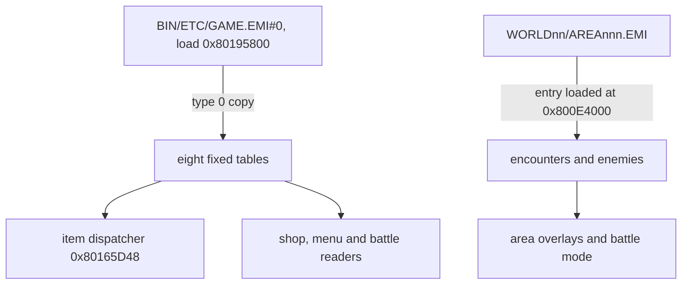

The game keeps its numeric data in fixed-size rows: items, equipment, abilities, shops and level growth in `GAME.EMI` entry 0 (resident at `0x80195800`), party starting stats and master data in the camp-menu archives, and enemies and encounters in each area archive. This page gives each table's location, row size, fields and value ranges, and the map of the save file, for the US release (`SLUS-00422`). The live copies of these rows are in [battle records](../battle/) and [field and party records](../field/), and names are text in the game's encoding ([text](../text/)).

## `GAME.EMI` fixed tables

Entry 0 of `BIN/ETC/GAME.EMI` is 229,720 bytes and loads at `0x80195800`. It holds eight tables. A row's runtime address is `0x80195800` plus its payload offset, and its archive offset is the payload offset plus `0x800`. The table shows where each table sits and how many rows it has.

| Table        |   Archive |   Payload |      Runtime | Rows × size |
| ------------ | --------: | --------: | -----------: | ----------: |
| items        | `0x33964` | `0x33164` | `0x801C8964` |     92 × 18 |
| vital items  | `0x33FDC` | `0x337DC` | `0x801C8FDC` |     16 × 16 |
| weapons      | `0x340DC` | `0x338DC` | `0x801C90DC` |     83 × 24 |
| armor        | `0x348A4` | `0x340A4` | `0x801C98A4` |     68 × 22 |
| accessories  | `0x34E7C` | `0x3467C` | `0x801C9E7C` |     52 × 20 |
| shops        | `0x3528C` | `0x34A8C` | `0x801CA28C` |     40 × 23 |
| abilities    | `0x3570C` | `0x34F0C` | `0x801CA70C` |    228 × 20 |
| level growth | `0x368DC` | `0x360DC` | `0x801CB8DC` |     693 × 8 |

The tables follow each other with one gap. A 232-byte block at runtime `0x801CA624` separates the shops from the abilities. Its first 32 bytes are zero and its use is `[unknown]`. The ability table ends where level growth starts, and level growth ends at archive `0x37E84`. The archive is 239,616 bytes. The runtime names are `g_Items`, `g_VitalItems`, `g_Weapons`, `g_Armors`, `g_Accessories`, `g_GameShopStock`, `g_Abilities` and `g_LevelGrowth`.

The item, vital item, weapon, armor and accessory tables each start with a `Nothing` row, and ability 0 is zeroed. A name is 12 bytes of text in the game's encoding ([text](../text/#byte-classes)). It needs no terminator when it uses the whole field: `Healing Herb` is 12 bytes in a 12-byte field.



### Row layouts

The table gives each row's size and the offset of each field. Each field carries its type. A `description` is a little-endian `u16` resource id in the `0x4000`-based id space of `Resource_GetText` ([text](../text/#references)).

| Table        | Size | Fields (offset)                                                                                                                                                                                                                                    |
| ------------ | ---: | -------------------------------------------------------------------------------------------------------------------------------------------------------------------------------------------------------------------------------------------------- |
| Item         |   18 | name `u8[12]` (0), flags `u8` (`0x0C`), unknown `u8` (`0x0D`), description `u16` (`0x0E`), price `u16` (`0x10`)                                                                                                                                    |
| Vital item   |   16 | name `u8[12]`, description `u16` (`0x0C`), unknown `u16` (`0x0E`)                                                                                                                                                                                  |
| Weapon       |   24 | name `u8[12]`, equipability `u8` (`0x0C`), flags `u8` (`0x0D`), kind `u8` (`0x0E`), element `u8` (`0x0F`), weight `u8` (`0x10`), sound `u8` (`0x11`), power `u8` (`0x12`), unknown `u8` (`0x13`), description `u16` (`0x14`), price `u16` (`0x16`) |
| Armor        |   22 | name `u8[12]`, equipability `u8` (`0x0C`), flags `u8` (`0x0D`), equip type `u8` (`0x0E`), weight `u8` (`0x0F`), power `u8` (`0x10`), unknown `u8` (`0x11`), description `u16` (`0x12`), price `u16` (`0x14`)                                       |
| Accessory    |   20 | name `u8[12]`, equipability `u8` (`0x0C`), flags `u8` (`0x0D`), kind `u8` (`0x0E`), weight `u8` (`0x0F`), description `u16` (`0x10`), price `u16` (`0x12`)                                                                                         |
| Ability      |   20 | name `u8[12]`, targeting flags `u8` (`0x0C`), type `u8` (`0x0D`), cost `u8` (`0x0E`), power `u8` (`0x0F`), element `u8` (`0x10`), flags `u8` (`0x11`), description `u16` (`0x12`)                                                                  |
| Shop stock   |   23 | item count `u8` (`0x00`), then eleven item references of two bytes from `0x01`: item type `u8`, item index `u8`                                                                                                                                    |
| Level growth |    8 | experience `u16` (`0x00`), HP `u8` (`0x02`), AP `u8` (`0x03`), power and defense `u8` (`0x04`), agility and intellect `u8` (`0x05`), ability `u8` (`0x06`), extra ability `u8` (`0x07`)                                                            |

How to read the fields:

- `kind`: the low nibble selects the icon (`Item_GetKind`, `exe/slus_004_22`). `sound` is a cue-table index that the battle overlay reads in `func_800AB834` and `func_800AB910` (`emi/battle/battle/15`).
- `equipability`: one bit per character, listed under [masks](#masks-and-value-ranges).
- `equip type` (armor): 0 nothing, 2 shield, 3 helmet, 4 body. The character record has one slot for each (weapon, shield, helmet, armor, two accessories).
- `type` (ability): the low two bits select heal, assist, attack or skill. [Ability targeting](#ability-targeting) lists the targeting flags.
- Level growth packs two stats in each of the two stat bytes, `high << 4 | low`: power in the high nibble and defense in the low nibble, agility high and intellect low.
- A shop reference is `item_type | item_index << 8` read as a halfword. The row's count says how many of the eleven references are valid.

Battle selection code reads the ability row through different widths: `+0x0C` selection flags, `+0x10` a `u16` selection mask (element and flags together) and `+0x12` a name or resource id. The layout is the same.

The item dispatcher (`Item_GetRecord`, `exe/slus_004_22@0x80165D48`) masks an item category and computes the row address from the table's base and stride. Categories 0 to 4 (item, weapon, armor, accessory, vital item) all enter one shared continuation at `0x80165DFC`. Callers handle `0xFF` (empty, or zenny) before they call it.

## Character and master data

A party member is one `Character` record of 164 bytes. The game keeps eight of them at `g_Characters` (`0x80144968`): Ryu, Nina, Garr, Teepo, Rei, Momo, Peco and Whelp. The starting values come from a table in the camp-menu archive, and a new game copies it into `g_Characters` (`Party_InitDefaults`, `emi/etc/start/08@0x801D15C0`). The status archive carries a byte-identical second copy.

| Table             | Archive               |    Offset |             Rows × size |
| ----------------- | --------------------- | --------: | ----------------------: |
| base stats        | `BIN/ETC/START.EMI`   | `0x72914` |                 8 × 164 |
| base-stats copy   | `BIN/ETC/STATUS.EMI`  | `0x1B114` | 8 × 164, byte-identical |
| master skills     | `BIN/ETC/SISYOU.EMI`  |  `0x3C88` |                 17 × 12 |
| master stats      | `BIN/ETC/SISYOU.EMI`  |  `0x3D54` |                  17 × 6 |
| master names      | `BIN/ETC/AFLDKWA.EMI` |  `0x1BE0` |              17 strings |
| master names copy | `BIN/ETC/FIRST.EMI`   | `0x3CBE0` |              17 strings |
| dragon pointers   | `BIN/ETC/STATUS.EMI`  | `0x1C018` |              10 × `u32` |

The base-stat table is entry 8 of `START.EMI` (payload `0x1A914`, load address `0x801D0C00`, so `0x801EB514` while resident). The master names are entry 0 of `AFLDKWA.EMI`, and the master skills and stats are entry 0 of `SISYOU.EMI`.

### The character record

The runtime record at `g_Characters` has the same layout as the archive row. The table gives the offset, type and meaning of each field. The block's header byte at `0x80144952` (22 bytes before the first record) holds the window style.

| Offset | Type      | Name                                                                                 | Meaning                                       |
| -----: | --------- | ------------------------------------------------------------------------------------ | --------------------------------------------- |
| `0x00` | `char[5]` | `name`                                                                               |                                               |
| `0x05` | `u8`      | `character id`                                                                       |                                               |
| `0x06` | `u8`      | `level`                                                                              |                                               |
| `0x07` | `u8`      | `party-row flags`                                                                    | bit 0 selects the rows the shop overlay lists |
| `0x08` | `u32`     | `experience`                                                                         |                                               |
| `0x0C` | `u16`     | `status flags`                                                                       |                                               |
| `0x0E` | `u8[4]`   | `weapon`, `shield`, `helmet`, `armor`                                                |                                               |
| `0x12` | `u8[2]`   | `accessories`                                                                        |                                               |
| `0x14` | `u16`     | `current HP`                                                                         |                                               |
| `0x16` | `u16`     | `current AP`                                                                         |                                               |
| `0x18` | `u8`      | `current willpower`                                                                  |                                               |
| `0x19` | `u8`      | `inoculations`                                                                       |                                               |
| `0x1A` | `u8`      | `fatigue`                                                                            |                                               |
| `0x1B` | `u8`      | `master id`                                                                          | `0xFF` for none                               |
| `0x1C` | `u16[6]`  | `max HP`, `max AP`, `power`, `defense`, `agility`, `intellect`                       |                                               |
| `0x28` | `u16`     | unknown                                                                              |                                               |
| `0x2A` | `u8`      | `willpower`                                                                          |                                               |
| `0x2B` | `u8[9]`   | `resistances`                                                                        |                                               |
| `0x34` | `u8[5]`   | `surprise chance`, `reprisal chance`, `critical chance`, `evasion`, `accuracy`       |                                               |
| `0x39` | `u8[3]`   | unknown                                                                              |                                               |
| `0x3C` | `u16[6]`  | `base HP`, `base AP`, `base power`, `base defense`, `base agility`, `base intellect` |                                               |
| `0x48` | `u16`     | unknown                                                                              |                                               |
| `0x4A` | `u8`      | `base willpower`                                                                     |                                               |
| `0x4B` | `u8[9]`   | `base resistances`                                                                   |                                               |
| `0x54` | `u8[5]`   | `base surprise`, `base reprisal`, `base critical`, `base evasion`, `base accuracy`   |                                               |
| `0x59` | `u8[3]`   | unknown                                                                              |                                               |
| `0x5C` | `u8[10]`  | `healing abilities`                                                                  |                                               |
| `0x66` | `u8[10]`  | `assist abilities`                                                                   |                                               |
| `0x70` | `u8[10]`  | `attack abilities`                                                                   |                                               |
| `0x7A` | `u8[10]`  | `skill abilities`                                                                    |                                               |
| `0x84` | `u8`      | `master level`                                                                       | level when the current master was assigned    |
| `0x85` | `s8[6]`   | `level-up modifiers`                                                                 | HP, AP, power, defense, agility, intellect    |
| `0x8B` | `u8[25]`  | unknown                                                                              |                                               |

```c
typedef struct Character {
    /* 0x00 */ u8  name[CHARACTER_NAME_LENGTH];
    /* 0x05 */ u8  character_id;
    /* 0x06 */ u8  level;
    /* 0x07 */ u8  unk_07;
    /* 0x08 */ u32 exp;
    /* 0x0C */ u16 status;
    /* 0x0E */ u8  weapon, shield, helmet, armor;
    /* 0x12 */ u8  accessories[CHARACTER_ACCESSORY_COUNT];
    /* 0x14 */ u16 current_hp;
    /* 0x16 */ u16 current_ap;
    /* 0x18 */ u8  current_willpower;
    /* 0x19 */ u8  inoculations;
    /* 0x1A */ u8  fatigue;
    /* 0x1B */ u8  master_id;
    /* 0x1C */ u16 max_hp, max_ap, power, defense, agility, intellect;
    /* 0x28 */ u16 unk_28;
    /* 0x2A */ u8  willpower;
    /* 0x2B */ u8  resistances[RES_SLOT_COUNT];
    /* 0x34 */ u8  surprise_chance, reprisal_chance, critical_chance, evasion, accuracy;
    /* 0x3C */ u16 base_hp, base_ap, base_power, base_defense, base_agility, base_intellect;
    /* 0x4A */ u8  base_willpower;
    /* 0x4B */ u8  base_resistances[RES_SLOT_COUNT];
    /* 0x54 */ u8  base_surprise_chance, base_reprisal_chance, base_critical_chance,
                   base_evasion, base_accuracy;
    /* 0x5C */ u8  healing_abilities[CHARACTER_ABILITY_COUNT];
    /*  ...  */ /* assist, attack and skill abilities, unk_84, level_up_modifiers, unk_8B */
} Character;                      /* 0xA4 bytes */
```

Source: [`include/game/character.h`](https://github.com/raulcorreia7/bof3-decomp/blob/main/include/game/character.h)

The record holds two copies of the stats. The "base" copy at `0x3C` is what level-ups raise. The live copy at `0x1C` is what a battle reads and what equipment and status effects change. The shop overlay reads the skill-ability bytes at `0x90` from the block base (`0x16 + 0x7A`, `emi/etc/shop/00@0x801E1710`).

Whelp stores character id 10 in its record, not 7. Every starting record has `master id` `0xFF`, so no character starts with a master. The opening values are:

| Character | Level | HP | AP | Power | Defense | Agility | Intellect |
| --------- | ----: | -: | -: | ----: | ------: | ------: | --------: |
| Ryu       |     1 | 20 | 11 |    12 |      10 |       8 |        10 |
| Nina      |     5 | 27 | 33 |    13 |      13 |      14 |        24 |
| Garr      |    13 | 99 |  7 |    58 |      44 |      17 |        21 |
| Teepo     |     1 | 22 | 13 |    13 |      10 |      10 |        12 |
| Rei       |     5 | 42 | 12 |    23 |      15 |      19 |        22 |
| Momo      |    10 | 52 | 40 |    30 |      25 |      15 |        50 |
| Peco      |     1 | 40 |  8 |    18 |      14 |       3 |         4 |
| Whelp     |     0 | 15 | 15 |    10 |       8 |       4 |         8 |

### Level growth and level-ups

The level-growth table has 693 rows: seven blocks of 99, one for each of character slots 0 to 6. Slot 7 (Whelp) has no block. Row `character × 99 + n - 1` belongs to level `n`. Its experience field is the experience needed to go from level `n-1` to `n`. A character's level is the first `L` for which the character's experience is below the sum of the experience fields of block rows 1 to `L`. The level caps at 99. Row 0 of each block is the level-1 row, and the level-up routine does not apply it.

`func_801ADDD4 (emi/etc/game/00@0x801ADDD4)` recomputes the level from the experience. For each level gained, from the old level up to the new one minus one, it adds the row's stats to the base stats at `0x3C`-`0x46`: HP and AP in full, and the four packed stats as nibbles. It adds the signed modifier byte at `0x85`-`0x8A` to each gain, floors the gain at 0 and caps the stat at 999. It then passes the row's two ability bytes to `Char_AddAbility` (`exe/slus_004_22`), stores the new level at `+0x06` and recalculates the live stats. All 693 `extra ability` bytes in the shipped table are zero. The `ability` byte is nonzero in 70 rows.

### Masters

A master is a trainer that changes a character's stat growth and teaches skills. Master ids index the master tables: 0 Bunyan, 1 Mygas, 2 Yggdrasil, 3 D'lonzo, 4 Fahl, 5 Durandal, 6 Giotto, 7 Hondara, 8 Emitai, 9 Deis, 10 Hachio, 11 Bais, 12 Lang, 13 Lee, 14 Wynn, 15 Ladon and 16 Meryleep. Runtime code assigns a master to a character. No record starts with one.

- `MasterSkills` rows are six pairs of `level | ability << 8`. A high byte of `0xFF` marks an empty pair and a low byte of `0x63` marks an unused level. The first row, for example, begins level 2 with ability `0xAA`, level 5 with ability `0x27`.
- `MasterStats` rows are six `s8` bonuses: HP, AP, power, defense, agility and intellect.
- `func_801D2CA4 (emi/etc/sisyou/00@0x801D2CA4)` assigns a master. It stores the master id at `+0x1B`, stores the character's current level at `+0x84`, and copies the six `MasterStats` bytes into the level-up modifiers at `+0x85`.
- `func_801D3A24 (emi/etc/sisyou/00@0x801D3A24)` checks the skills a master has granted. It compares each pair's level byte against the levels gained since assignment, which is the level minus the byte at `+0x84`. Masters 11 to 14 are special cases that grant a reward after three levels gained. The other masters follow the skill pairs.
- The names are 17 packed null-terminated strings in the game's text encoding. Byte `0x8E` is the apostrophe in `D'lonzo`.
- `DragonPointers` is ten `u32` addresses in the `0x801D5xxx` range of the status overlay window. What they point to is `[unknown]`.

`AFLDKWA.EMI` also holds two name-entry strings, `Please choose a name` at `0x1571` and `Close Config` at `0x1598`. `FIRST.EMI` copies them at `0x3C571` and `0x3C598`.

### Party message tables

Seven area programs hold a `g_PartyMemberMessages` table. Each row is 12 bytes: four `u8` tags at `+0x00` and four `s16` message ids at `+0x04`. The area's `Message_ShowParty` routine compares tag `i` with byte 0 of the battle-record row in `D_80145F09` and shows `messages[i]` through `Message_StartAreaMessage`. The table lists each overlay as archive and entry: `AREA112/13` is entry 13 of `AREA112.EMI`. An address is a runtime address in the area program, so the payload offset is the address minus `0x801F2C00`. The seven tables hold 18 rows in all.

| Overlay      |      Address | Rows |
| ------------ | -----------: | ---: |
| `AREA112/13` | `0x801F48FC` |    1 |
| `AREA143/13` | `0x801F52FC` |    1 |
| `AREA145/14` | `0x801F5C9C` |    3 |
| `AREA148/13` | `0x801F6144` |    2 |
| `AREA173/14` | `0x801F5914` |    2 |
| `AREA196/13` | `0x801F42F4` |    2 |
| `AREA197/13` | `0x801F4A2C` |    7 |

### Save layout

The save file is a 1-block memory-card file ([memory card save](../../formats/save/)). Its payload is a copy of one block of RAM, so a save offset maps to a RAM address by a fixed bias: RAM address = save offset + `0x801446D8` for every offset from `0x200`. The frame origin `0x801446D8` is virtual. Only the part from `+0x200` exists in live RAM, as the block at `0x801448D8`. The file header, the checksum and the load and save routines are in [memory card save](../../formats/save/#checksum) and [saving and loading](../../systems/saving/).

Community save editors use a second origin that starts at the zenny field, so an editor offset is the save offset minus `0x878`. The table lists both. Rows with no tag have a named global at that address. `[inferred]` rows rest on community notes only.

| Save offset       | Editor offset | Meaning                                                                                | Tag          |
| ----------------- | ------------: | -------------------------------------------------------------------------------------- | ------------ |
| `+0x200..+0x12B0` |               | checksum range, 4,272 bytes ([checksum](../../formats/save/#checksum))                 |              |
| `+0x85D`          |               | hide-and-seek flags (Bais `0x20`, Lang `0x40`, all found `0x80`)                       | `[inferred]` |
| `+0x85E`          |               | hide-and-seek flags (participation `0x04`, Lee `0x01`, Wynn `0x02`)                    | `[inferred]` |
| `+0x878`          |       `0x000` | zenny (`g_Zenny`)                                                                      |              |
| `+0x881`          |               | formation unlock flags                                                                 | `[inferred]` |
| `+0x882`          |               | three character ids (`D_80144F5A`), indexing `g_CharSlot`                              |              |
| `+0x885`          |               | three character ids (`D_80144F5D`), swapped against `D_80144F5A`                       |              |
| `+0x8E8`          |               | running clock, `Clock` format (`g_PlayClock`)                                          |              |
| `+0x90C`          |               | best catch per fish (`g_FishBestCatch`)                                                |              |
| `+0xE70`          |       `0x5F8` | dragon genes                                                                           | `[inferred]` |
| `+0xE7C`          |       `0x604` | celerity countdown timer, `Clock` format ([clock](../field/#inventory-money-and-time)) |              |
| `+0xE80`          |       `0x608` | bonebreak countdown timer, `Clock` format                                              |              |
| `+0xEA0`          |               | save name, five characters                                                             | `[inferred]` |
| `+0xEA5`          |               | three party portraits                                                                  | `[inferred]` |
| `+0xEA8`          |               | save level (Ryu's level)                                                               | `[inferred]` |
| `+0xEAC`          |               | save timer, `Clock` format                                                             | `[inferred]` |
| `+0xEF0`          |               | fairy jobs (`g_FairyJobs`)                                                             |              |
|                   |       `0x0FC` | item category and id arrays (`g_InventoryIds`)                                         |              |
|                   |       `0x2FC` | quantity arrays (`g_InventoryCounts`)                                                  |              |
|                   |       `0x4FC` | vital items (`g_VitalItemIds`)                                                         |              |
|                   |       `0x51C` | skill note                                                                             | `[inferred]` |
|                   |       `0x5FC` | masters                                                                                | `[inferred]` |

## Area data

Each `WORLDn/AREAnnn.EMI` is the only source for its area. Its entry loaded at `0x800E4000` is the encounter block: 1,160 bytes in all 200 archives. The block begins with eight encounters of 9 bytes (72 bytes), followed by eight enemy records of 136 bytes. A slot, 0 to 7, addresses a row. The other record families sit in other entries of the area archive. The table lists the families, their record sizes and what is established about their number.

| Family        | Record size | Rows                                                         |
| ------------- | ----------: | ------------------------------------------------------------ |
| encounters    |           9 | 1,600 slots (8 per area); 544 have a nonzero appearance rate |
| enemies       |         136 | 1,600 slots (8 per area); 448 are filled                     |
| chests        |           3 | 224 `[inferred]`                                             |
| genes         |           1 | 17 `[inferred]`                                              |
| chrysms       |           1 | 13 `[inferred]`                                              |
| fairies       |           9 | 720 in 12 archives (60 per archive)                          |
| Manillo items |           8 | 165 `[inferred]`                                             |
| Manillo stock |          10 | 16 in `AREA030.EMI` at `0x3E53E`                             |

The chest, gene, chrysm and Manillo counts are `[inferred]`; the entries that hold these rows would settle them. A chest is a memory byte (`+0x00`), an item id (`+0x01`) and an item type (`+0x02`). A gene or chrysm is one gene index. A fairy is a 5-byte name and four stat bytes. A Manillo trade is an item id (`+0x00`), an item type (`+0x01`), three fish indexes (`+0x02`) and three fish quantities (`+0x05`). A Manillo stock row is ten trade indexes. The Manillo stock at `AREA030.EMI+0x3E53E` holds ten-byte rows with `0xFF` padding.

An encounter is eight enemy slots (`+0x00`-`+0x07`, `0xFF` empty) and an appearance rate (`+0x08`). In the retail data only slots 0 to 6 occur. A boss is an enemy that no encounter with a nonzero rate uses.

### The enemy record

The table gives the offset, type and meaning of each field of the 136-byte enemy record.

| Offset | Type      | Name                                                   | Meaning                                                                       |
| -----: | --------- | ------------------------------------------------------ | ----------------------------------------------------------------------------- |
| `0x00` | `char[8]` | `name`                                                 |                                                                               |
| `0x08` | `u16`     | `enemy id`                                             |                                                                               |
| `0x0A` | `u8`      | `choice AI`                                            |                                                                               |
| `0x0B` | `u8[3]`   | unknown                                                |                                                                               |
| `0x0E` | `u8`      | `target preference`                                    |                                                                               |
| `0x0F` | `u8`      | unknown                                                |                                                                               |
| `0x10` | `u16`     | `zenny`                                                |                                                                               |
| `0x12` | `u16`     | `experience`                                           |                                                                               |
| `0x14` | `u8`      | `level`                                                |                                                                               |
| `0x15` | `u8[3]`   | unknown                                                |                                                                               |
| `0x18` | `u8[8]`   | `initial skills`                                       |                                                                               |
| `0x20` | `u16[6]`  | `HP`, `AP`, `power`, `defense`, `agility`, `intellect` |                                                                               |
| `0x2C` | `u8[2]`   | `first item row`                                       | item index, item type                                                         |
| `0x2E` | `u16`     | `first item row`                                       | rate                                                                          |
| `0x30` | `u8[2]`   | `second item row`                                      | item index, item type                                                         |
| `0x32` | `u16`     | `second item row`                                      | rate                                                                          |
| `0x34` | `u8[64]`  | `AI blocks`                                            | four blocks of 16 bytes: condition (`u8`), 7 parameters, 8 skills             |
| `0x74` | `u8[4]`   | unknown                                                |                                                                               |
| `0x78` | `u8[9]`   | `resistances`                                          |                                                                               |
| `0x81` | `u8`      | unknown                                                |                                                                               |
| `0x82` | `u8`      | `reach`                                                | footprint size for encounter placement, see the notes below `[inferred]` name |
| `0x83` | `u8`      | `height`                                               | vertical offset in pixels, see the notes below `[inferred]` name              |
| `0x84` | `u8[4]`   | unknown                                                |                                                                               |

```c
typedef struct Enemy {
    /* 0x00 */ u8  name[ENEMY_NAME_LENGTH];
    /* 0x08 */ u16 enemy_id;
    /* 0x0A */ u8  choice_ai;
    /* 0x0E */ u8  target_preference;
    /* 0x10 */ u16 zenny;
    /* 0x12 */ u16 exp;
    /* 0x14 */ u8  level;
    /* 0x18 */ u8  initial_skills[ENEMY_SKILL_COUNT];
    /* 0x20 */ u16 hp, ap, power, defense, agility, intellect;
    /* 0x2C */ u8  first_item_index, first_item_type;
    /* 0x2E */ u16 first_item_rate;
    /* 0x30 */ u8  second_item_index, second_item_type;
    /* 0x32 */ u16 second_item_rate;
    /* 0x34 */ EnemyAiBlock ai[ENEMY_AI_COUNT];  /* 16 bytes each */
    /* 0x78 */ u8  resistances[RES_SLOT_COUNT];
    /* 0x82 */ u8  reach;
    /* 0x83 */ u8  height;
} Enemy;                       /* 0x88 bytes; gaps are unk_XX */

typedef struct EnemyAiBlock {
    /* 0x00 */ u8 condition;
    /* 0x01 */ u8 parameters[ENEMY_AI_PARAMETER_COUNT];
    /* 0x08 */ u8 skills[ENEMY_SKILL_COUNT];
} EnemyAiBlock;
```

Source: [`include/game/enemy.h`](https://github.com/raulcorreia7/bof3-decomp/blob/main/include/game/enemy.h)

Notes on the fields:

- Skill byte `0x63` (99) in an AI block marks it unused.
- The enemy id is in the range `0x0001`-`0x04A8`. There are 175 ids for 168 names, and the pointer index is not the id. Six names carry two or three ids: Ammonite `0x95`/`0x96`, Beyd `0x58`/`0x59`, Garr `0x454`/`0x465`, Golem `0x4C`/`0x4D`, Nue `0x0D`/`0x0E` and ToxicMan `0x7F`/`0xAE`/`0xAF`.
- Resistances run in the order Fire, Frost, Thunder, Earth, Wind, Holy, Psionic, Status, Death. Each value is a level from 0 to 7.
- The two item rows are 4 bytes each. A battle copies them unchanged to the battler's two drop rows at battler `+0x98` and `+0x9C`, and at the end of the battle both rows roll the same way ([drops](#drops)). The row has two views: [battle records](../battle/#drops) reads the same four bytes as a `u16` item id, a `u8` rate and a padding byte. Pilfer and Steal take the first row ([steal](#steal)).
- `Enemy +0x82` (reach) and `+0x83` (height) are the two bytes at block `+0xCA` and `+0xCB` of the `0x800E4000` encounter block (`0x48 + 0x82 = 0xCA`). Placement reads both through `func_801C7064 (emi/etc/game/00@0x801C7064)`: reach sets the probe step `(reach + 1) << 14` in 16.16 units, and each of the four probe points must project inside the 320 by 240 screen. A final probe must project to a screen y of at least height plus 8. Reach alone feeds the overlap test `func_801C7498 (emi/etc/game/00@0x801C7498)` between two candidates, with half-extent `(reach + 1) << 15`. The battle panels subtract height plus 8 from an enemy's y, and at least one spell effect adds it to a y cell.
- A chest with item type `0xFF` gives zenny: `item_index × 40`.
- Manillo fish items start at item index `0x38`.

Dragon genes sit in several archives `[inferred]`: Flame and Defender in `SCENA03`, Shadow and Fusion in `SCENA08`, Frost in `AREA067`, Thunder in `AREA100`, Radiance in `AREA146`, Force in `AREA117`, Eldritch in `AREA077`, Miracle in `AREA103`, Gross in `AREA105`, Thorn in `AREA054`, Reverse in `AREA093`, Mutant in `AREA075`, the unnamed gene in `AREA114`, Trance in `AREA123` and Failure in `AREA145`. Infinity has no pointer. Gene indexes run `0x00`-`0x11`, and `0x21` is reserved for a patch-gated Flame. Chrysms use the same byte layout in a separate namespace.

The fairy roster (9-byte rows) is separate from the reward tables. The `COMMU00` gifts are 20 rows of 4 bytes at `0x848`, its exploration rewards are 48 rows of 2 bytes at `0x4218`, and the `COMMU02` prizes are 48 rows of 2 bytes at `0x2D900`.

## Masks and value ranges

The first table gives the numeric namespaces in these tables. The second table gives the bit layout of each mask.

| Namespace                  | Width | Values                                                             | Where                |
| -------------------------- | ----: | ------------------------------------------------------------------ | -------------------- |
| item category              |  `u8` | 0 item, 1 weapon, 2 armor, 3 accessory, 4 vital item, `0xFF` empty | dispatcher           |
| item index                 |  `u8` | `0x00`-`0x5B`                                                      | item table           |
| fish item index            |  `u8` | `0x38`-`0x4C`                                                      | item table           |
| ability index              |  `u8` | `0x00`-`0xE3` (228)                                                | ability table        |
| level-growth index         | array | 0-692                                                              | level growth         |
| character slot             | array | 0-7; Whelp stores id `0x0A`                                        | base stats           |
| master id                  | array | 0-16                                                               | master tables        |
| enemy id                   | `u16` | `0x0001`-`0x04A8`                                                  | enemy `+0x08`        |
| gene or chrysm byte        |  `u8` | 0-17; `0x21` patch-gated                                           | gene and chrysm rows |
| shop index                 | array | 0-39                                                               | shop stock           |
| fairy gift, explore, prize | array | 0-19, 0-47, 0-47                                                   | reward tables        |

| Mask          | Bits                                                                                                                                           |
| ------------- | ---------------------------------------------------------------------------------------------------------------------------------------------- |
| equipability  | 0 Ryu, 1 Nina, 2 Garr, 3 Teepo, 4 Rei, 5 Momo, 6 Peco, 7 Whelp                                                                                 |
| element       | 0 Fire, 1 Ice, 2 Lightning, 3 Earth, 4 Wind, 5 Holy, 6 Psionic, 7 Status                                                                       |
| item flags    | 0 usable in the field, 1 usable in battle, 2 no hit reaction, 3 cannot be sold, 4 a whole side, 5 the other side, 6 player picks, 7 both sides |
| ability flags | 4 affects stats, 2 default target ally, 1 examinable; bits 0 and 3 are `[unknown]`                                                             |
| status word   | `0x04` paralyzed, `0x08` blind, `0x10` silenced, `0x20` confused, `0x40` sleeping, `0x80` poisoned, `0x4000` knocked out                       |

The status word tests or clears bits `0x01`, `0x02`, `0x04`, `0x08`, `0x10`, `0x40`, `0x80`, `0x800`, `0x2000` and `0x4000`. The code uses the rejection mask `0x4944` and the heal mask `0xEF`. The map loader clears bit `0x20` for the party, and the code restores it later. That behavior is why the bit is named confused `[inferred]`.

The item flags byte (item `+0x0C`, read through `Item_GetFlags`, `exe/slus_004_22@0x80165F68`) has the bit layout of the [ability targeting](#ability-targeting) byte. The list predicate `func_801AF494 (emi/etc/game/00@0x801AF494)` tests bit 0 for the camp menu's item list (mode 1, `emi/etc/start/08`), bit 1 for the battle item list (mode 2, `emi/battle/battle/15`) and a clear bit 3 for the shop's sell list (mode 3, `emi/etc/shop/00`). The Faerie Tiara also needs the party on cell code `0xAE` in mode 1. When bit 2 is set, `func_801DFCB4` and `func_801E3C14` (`emi/battle/battle/03`) skip the hit reaction, as they do for an ability's bit 2. The battle target comes from bits 4 to 7 in `func_800989FC (emi/battle/battle/15@0x800989FC)`:

- Bit 6 set: the player picks one battler, or one side when bit 4 is set. Bit 5 starts the cursor on the enemies (battler slot 3 and up), and bit 7 lets it move to the other side `[inferred]`.
- Bit 6 clear and bit 7 set: both sides (selector `0xC0`).
- Bits 6 and 7 clear and bit 4 set: one side, the enemies (`0x40`) when bit 5 is set and the party (`0x80`) when it is clear.
- Bits 4, 6 and 7 clear: the user.

### Ability targeting

The targeting byte of an ability row selects who the ability can hit. Bit `0x01` is the usable-in-field switch and bit `0x10` gates the all-targets sets. The table gives the values in the retail data. The side names are `[inferred]` from the abilities that use them.

| Value                  | Targets                         |
| ---------------------- | ------------------------------- |
| `0x02`, `0x0E`         | self                            |
| `0x1E`, `0x1F`         | all party members               |
| `0x32`, `0x3A`, `0x3E` | all enemies                     |
| `0x4E`                 | one party member                |
| `0x62`, `0x6A`, `0x6E` | one enemy                       |
| `0x7A`, `0x7E`         | all enemies (`0x7A` is a guess) |
| `0x96`                 | all on both sides               |
| `0x9E`                 | all on both sides, random       |
| `0xBA`                 | one on either side, random      |
| `0xCE`, `0xCF`         | one on either side              |
| `0xDE`, `0xDF`         | all on either side              |
| `0xE2`, `0xEA`, `0xEE` | one on either side, enemy first |
| `0xF2`                 | all on either side, enemy first |

Four values occur with no established meaning: `0x00` (the empty row), `0x06`, `0x09` and `0x0A`. The values `0x4E`, `0x62` and `0x6A` are also battle command ids. The two namespaces are separate.

### Drops

A drop row's rate is an index into the eight-byte chance table `g_BattleDropChances (emi/battle/battle/03@0x801D0CB8)`. The roll passes when `chance[rate] >= rand() & 0xFF`, so the probability is `(chance + 1) / 256`. Rate 0 and item 0 never drop. The roll is in `func_801E531C (emi/battle/battle/03@0x801E531C)`. The drop row's layout is in [battle records](../battle/#drops).

| Rate        |     0 |     1 |     2 |     3 |     4 |      5 |       6 |      7 |
| ----------- | ----: | ----: | ----: | ----: | ----: | -----: | ------: | -----: |
| Chance byte |     0 |     0 |     1 |     3 |     7 | `0x1F` |  `0x7F` | `0xFF` |
| Probability | never | 1/256 | 2/256 | 4/256 | 8/256 | 32/256 | 128/256 | always |

Rate 0 never drops because the code skips the row. Rate 1 and rate 0 hold the same chance byte, but only rate 1 rolls.

### Steal

Pilfer (ability 65) and Steal (ability 216) take the target's first drop row. The roll is in each ability's effect overlay, not in the battle overlays: `func_801EEC90 (emi/bmagic/magic065/00@0x801EEC90)` for Pilfer and `func_801EECDC (emi/bmagic/magic216/00@0x801EECDC)` for Steal run the same code. The roll passes when `rand() & 0xFF` is less than `steal rate × factor`, so the probability is `steal rate × factor / 256`. The row's rate byte (battler `+0x9A`) indexes an eight-byte steal-rate table in the overlay.

| Rate       |   0 |   1 |   2 |   3 |    4 |    5 |    6 |    7 |
| ---------- | --: | --: | --: | --: | ---: | ---: | ---: | ---: |
| Steal rate |   0 |   1 |   3 |   6 |   12 |   16 |   32 |   32 |

The factor comes from the user's agility (party battler `+0x98`) minus the target's (enemy battler `+0xA8`).

| Difference | 49 and up | 29 to 48 | 19 to 28 | 9 to 18 | -10 to 8 | -20 to -11 | -30 to -21 | -50 to -31 | under -50 |
| ---------- | --------: | -------: | -------: | ------: | -------: | ---------: | ---------: | ---------: | --------: |
| Factor     |        12 |       11 |       10 |       9 |        8 |          7 |          6 |          5 |         4 |

A passed roll on a non-zero item adds one of it to the inventory (`Item_Add`, `exe/slus_004_22@0x801650B4`). When that succeeds, the code clears the row's item (`+0x98`) and rate (`+0x9A`), so the item cannot be stolen again and does not drop at the end of the battle. A failed roll, an empty row or a failed `Item_Add` leaves the row as it is.

## Archive index

The table lists which archive holds each kind of data.

| Data                                             | Archive                                             |
| ------------------------------------------------ | --------------------------------------------------- |
| items, equipment, abilities, shops, level growth | `ETC/GAME.EMI` entry 0                              |
| base stats                                       | `ETC/START.EMI` entry 8 (copy in `ETC/STATUS.EMI`)  |
| master skills and stats                          | `ETC/SISYOU.EMI` entry 0                            |
| master names                                     | `ETC/AFLDKWA.EMI` entry 0 (copy in `ETC/FIRST.EMI`) |
| fairy gifts and exploration                      | `ETC/COMMU00.EMI` (prizes in `COMMU02.EMI`)         |
| enemies and encounters                           | each `WORLDn/AREAnnn.EMI`                           |
| chests, genes, chrysms, Manillo trades           | selected area archives                              |

`BENEMY` archives hold enemy audio, not enemy code. `ENEMYnnn.EMI` is the enemy sound bank of `AREAnnn`, not of an enemy id: a random battle streams slot `0x9 + g_GameAreaId` ([battle engine](../../systems/battle/#mode-0-reset-and-entrance)). An enemy's cues in that bank are `0x600 | 2n` and `0x601 | 2n`, where `n` is the index of its record in the area's enemy block. `Battle_LoadEnemyBattler (emi/battle/battle/15@0x800AC218)` stores `n` at enemy battler `+0xE0`, and `func_801E3A44`, `func_801E4C7C` (`emi/battle/battle/03`) and `func_800AFC98` (`emi/battle/battle/15`) play the cues only in a random battle.

## Community RAM map

Community notes agree with the retail code on a set of live-RAM records. They confirm an address or stride and never prove a field's role. The sources are the `bof3-notes` repository, a memory-card save editor, and the DuckStation, Almar's Guides, Game Buster and GameShark cheat lists ([sources](../../appendix/sources/)). The table lists the records and what the cheats confirm.

| Record            | Address and stride                                                                           | What the cheats confirm                                                                      |
| ----------------- | -------------------------------------------------------------------------------------------- | -------------------------------------------------------------------------------------------- |
| Party             | `0x80144968`, 8 × 164                                                                        | level `+6`, experience `+8`, equipment `+0xE`, HP and AP, max HP and AP, the four main stats |
| Player combatants | `0x80145E90`, 3 × 320                                                                        | status `+0x80`, HP `+0x88`, AP `+0x8A`                                                       |
| Enemy combatants  | `0x801EB630`, 8 × 280                                                                        | HP `+0x94`, first drop rate `+0x9A`, second drop rate `+0x9E`                                |
| Inventory         | ids `0x8014504C`, `0x801450CC`, `0x8014514C`, `0x801451CC` (128 bytes each), counts `+0x200` | vital items 32 bytes at `0x8014544C`                                                         |
| Money and clock   | zenny `u32` at `0x80144F50`; play time at `0x80144FC0`                                       |                                                                                              |
| Fairy village     | stats `0x801F2700` (60 × 9), jobs `0x801455C8` (60 × 8), rooms `0x801457A8` (9 × 8)          |                                                                                              |

The community notes give 320 bytes as the enemy row stride. That is the player row's stride. Both battle overlays read enemy rows at 280 bytes. Party fields beyond those in the table rest on the community notes alone. The flag block at `0x80144F2x`-`0x80144F5x` and the counters near `0x80145000` come from single cheats. The roles of these rows are in [field and party records](../field/) and [battle records](../battle/).

## Sources and confidence

- **Confidence:** medium. The table layouts, counts and strides are established, but several fields, the chest, gene and Manillo counts and most save-offset names are `[inferred]` or `[unknown]`.
- **Evidence:** the retail archives and the functions named in each section (the item dispatcher, `Party_InitDefaults`, the level-up and master routines, the drop roll, the encounter placement functions `Area_BuildEncounter`, `func_801C7064` and `func_801C7498`, the enemy-to-battler copy `Battle_LoadEnemyBattler`, the item-flag readers `func_801AF494`, `func_801DFCB4`, `func_801E3C14` and `func_800989FC`, the Pilfer and Steal rolls in the `MAGIC065` and `MAGIC216` overlays, and the enemy-bank load in `func_801D1228`). Community notes and cheat lists confirm addresses and strides only ([sources](../../appendix/sources/)).

## Related

- [Battle records](../battle/): the live player and enemy rows built from these records.
- [Field and party records](../field/): the inventory, money and actor rows in RAM.
- [Game text](../text/): the encoding of names and the `description` resource ids.
- [Memory card save](../../formats/save/): the save file around the offsets listed here.
- [Area formats](../../formats/area/): the area archives that hold encounters and enemies.
- [Edit items, skills and shops](../../guides/items/): the limits of editing these tables.
