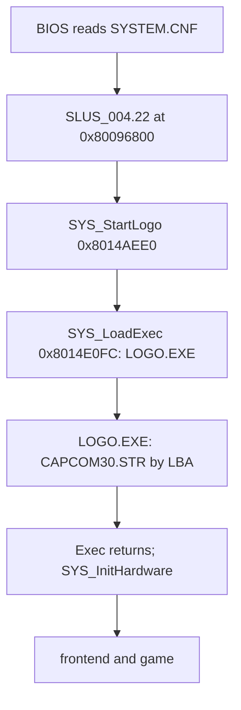

Two PS-X executables, `SLUS_004.22` and `LOGO/LOGO.EXE`, and the boot file `SYSTEM.CNF` start the game, with the logo video and the license sectors beside them. The main executable also holds `g_EmiSlotLbas`, the table of 887 start sectors through which the game finds every other file on the disc. This page covers these files, the PS-X header and that table. The boot sequence is in [boot](../../systems/boot/), and the [EMI](../emi/) archives are on their own page.

## Files

| Path                |        Size (bytes) |     LBA | Kind                                   | Read by                                 |
| ------------------- | ------------------: | ------: | -------------------------------------- | --------------------------------------- |
| `SYSTEM.CNF`        |                  70 | 187,467 | text, 4 `KEY = value` lines            | the BIOS (boot)                         |
| `SLUS_004.22`       |           1,445,888 | 187,468 | PS-X EXE, resident game                | the BIOS, from `BOOT`                   |
| `LOGO/LOGO.EXE`     |             122,880 | 187,407 | PS-X EXE, Capcom logo                  | `SYS_StartLogo`, through `SYS_LoadExec` |
| `LOGO/CAPCOM30.STR` |           2,365,440 | 186,252 | MDEC video and XA, see [STR](../str/)  | `LOGO.EXE`, by a fixed sector number    |
| license sectors     | 28,032 (12 x 2,336) |    0-11 | license text and logo, outside ISO9660 | the BIOS only                           |

The disc also has one CDDA track (track 2, 37,044,044 bytes). Every sample in it is zero. No function that was read issues `CdlPlay`, so nothing in the code read so far plays it. Code that was not read is outside that search, so "nothing plays it" is `[inferred]`.

## PS-X EXE header

Both executables begin with the standard 2,048-byte PS-X EXE header: the `PS-X EXE` magic at offset 0 and fields as `u32` from `0x10` ([psx-spx](https://psx-spx.consoledev.net/cdromformat/)). The BIOS copies `t_size` bytes from sector 1 of the file to `t_addr`, then jumps to `pc`. The table gives the fields that the game files set.

| Offset | Type                  | Name                           |   `SLUS_004.22` |   `LOGO.EXE` |
| -----: | --------------------- | ------------------------------ | --------------: | -----------: |
| `0x10` | `u32`                 | `pc`                           |    `0x8014AA0C` | `0x801CE724` |
| `0x14` | `u32`                 | `gp`                           |             `0` |          `0` |
| `0x18` | `u32`                 | `t_addr`                       |    `0x80096800` | `0x801CE000` |
| `0x1C` | `u32`                 | `t_size`                       |      `0x160800` |    `0x1D800` |
| `0x20` | `u32[4]`              | `d_addr` to `b_size` (4 words) |             `0` |          `0` |
| `0x30` | `u32`                 | `s_addr`                       |    `0x801FFFF0` | `0x801FFFF0` |
| `0x34` | `u32`                 | `s_size`                       |             `0` |          `0` |
| `0x4C` | `char[]` `[inferred]` | region marker                  | "North America" |      "Japan" |

These facts hold on both files:

- The file size equals `0x800 + t_size` (1,445,888 and 122,880 bytes).
- Header bytes `0x83` to `0x7FF` are zero.
- `SLUS_004.22` starts at `stup2` (the PsyQ `2MBYTE.OBJ` start-up code). The header `gp` is `0`: `stup1` sets `gp` to `0x8018B2B4`, and `stup2` clears the BSS `0x8018B2B8..0x80190C60` ([memory map](../../concepts/memory/#the-map)). `LOGO.EXE` starts at `__SN_ENTRY_POINT (exe/logo@0x801CE724)`.
- The `LOGO.EXE` region marker is the Japanese string, and the US executable keeps it. No reader looks at it.
- The main executable image spans `0x80096800` to `0x801F7000`. The module windows from `0x801EEC00` and `0x801F2C00` lie inside that range, and overlays overwrite them at run time ([runtime](../../data/programs/#module-windows)). The last 17,408 bytes of the file (the `0x801F2C00` window) hold only the byte values 0, 14 and 15.

## SYSTEM.CNF

The file has four lines of the form `KEY = value`:

| Key     | Value                  |
| ------- | ---------------------- |
| `BOOT`  | `cdrom:\SLUS_004.22;1` |
| `TCB`   | `4`                    |
| `EVENT` | `16`                   |
| `STACK` | `0x801FFF00`           |

The BIOS reads the file, and the game never opens it. `TCB` and `EVENT` size the kernel's thread control block and event tables. `STACK` is the initial stack pointer (`[inferred]` from the PsyQ boot convention).

## Boot chain

The BIOS reads `SYSTEM.CNF` and loads `SLUS_004.22`. The game first runs the logo program as a nested executable, then returns and starts the frontend. [Boot](../../systems/boot/#the-logo-program) describes `SYS_StartLogo` and `SYS_LoadExec`.

`SYS_StartLogo` passes the path `\LOGO\LOGO.EXE;1` to `SYS_LoadExec`.

`LOGO.EXE` finds the video by sector number, not by file name. It stores the start LBA as the 32-bit constant `D_801D8BB0 (exe/logo@0x801D8BB0)`, which is `0x0002D78C` (186,252), the LBA of `CAPCOM30.STR` (checked against the directory). Moving the STR file requires the same change in `LOGO.EXE`.

## The disc file table

`g_EmiSlotLbas` in `SLUS_004.22` is an array of 887 `u32` start sector numbers, one per disc file. `EMI_GetArchiveSector (exe/slus_004_22@0x80162160)` returns `g_EmiSlotLbas[slot_id]`. Every EMI and XA read goes through it ([EMI slot ids](../emi/#disc-slot-ids)). The table is the only place where the game learns where a file starts. The table has these properties.

| Property                                               | Value                                                   |
| ------------------------------------------------------ | ------------------------------------------------------- |
| File offset of slot 0                                  | `0xEC444` (the address minus `0x80096000`)              |
| Entries                                                | 887, 4 bytes each, 3,548 bytes                          |
| Order                                                  | ascending LBA                                           |
| The set of values equals the LBAs of the ISO9660 files | yes, 887 of 887                                         |
| Slots 0-882                                            | the 883 files under `BIN/`                              |
| Slots 883-886                                          | `CAPCOM30.STR`, `LOGO.EXE`, `SYSTEM.CNF`, `SLUS_004.22` |

The table follows the on-disc order, not the directory-record order. The directory lists `SLUS_004.22` before `SYSTEM.CNF`, and the table lists them the other way. The `u32` after the last slot (`0x0002E03A`) is not a file: it is not the LBA of any file.

A file may shrink in place. A file that moves or grows needs both its ISO9660 directory record and this table rewritten ([sector layout](../conversion/#sector-sealing)).

## Other executable data

The table lists data that editors look for in the main executable, and whether it is there.

| Data                           | Address                                                         | Shape                                                        | Reader or page                                     |
| ------------------------------ | --------------------------------------------------------------- | ------------------------------------------------------------ | -------------------------------------------------- |
| XA stream slot ids             | `D_80183230` = `{0x2A9, 0x1B2, 0x2AA}` (S_XA00, MAGIC00, VOICE) | 3 `u32` slot ids                                             | `SND_ResolveXAStream (exe/slus_004_22@0x80163744)` |
| XA cue-array pointers          | `D_8018323C` = `{0x801839C4, 0x801832C4, 0x80183298}`           | 3 pointers to `u16` arrays, see [STR](../str/#xa-cue-tables) | -                                                  |
| BGM id to slot table           | `g_BGMTracks[id]`                                               | slot ids `0xD1`-`0x121`                                      | [EMI](../emi/#disc-slot-ids)                       |
| Item, ability and level data   | not here: `ETC/GAME.EMI` entry 0                                | [game records](../../data/records/)                          | -                                                  |
| Save frame, checksum constants | not here                                                        | [save format](../save/)                                      | -                                                  |

## Sources and confidence

- **Confidence:** high. The header fields, the file table and the boot files were read and checked on every file; only the use of the CDDA track and of `STACK` is `[inferred]`.
- **Evidence:** the PS-X headers of both executables, the `SYSTEM.CNF` text, the ISO9660 directory records compared with `g_EmiSlotLbas`, and `SYS_StartLogo`, `SYS_LoadExec` and `EMI_GetArchiveSector`.

## Related

- [Boot](../../systems/boot/): how the BIOS handoff, the logo and the frontend run.
- [Disc and files](../disc/): the slot id range of each directory.
- [EMI container](../emi/): how a slot id becomes an archive read.
- [STR and XA playback](../str/): the logo video and the XA streams.
