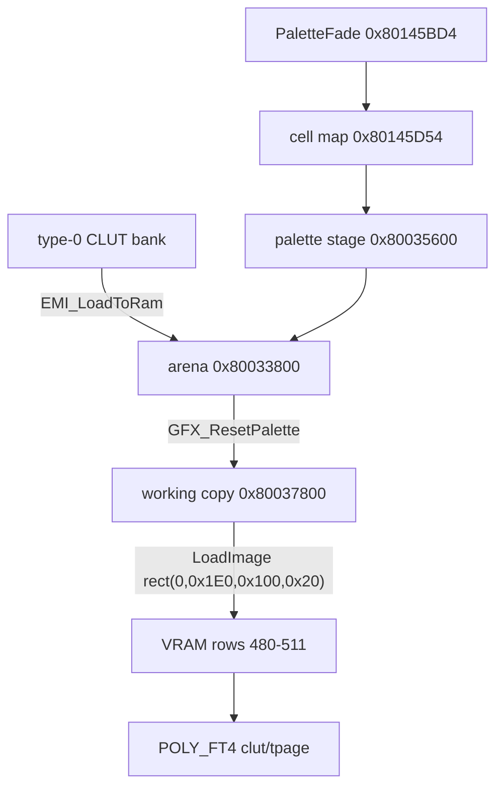

A texture on the disc is a headerless block of raw VRAM words (EMI type 3), and its palette is a separate block of color words (a type-0 entry). Nothing in either block says which palette goes with which texture: the drawing code holds that link, because it names a texture page and a palette row for each primitive. This page covers how both blocks are stored and loaded, how the VRAM words are encoded and which texture-to-palette pairings (joins) are established. The map-tile descriptor is in [area formats](../area/#tile-descriptor).

## Primitives

The game draws with the PsyQ primitive records: `SPRT` (free size), `SPRT_8` and `SPRT_16` sprites, textured quads `POLY_FT4` and `POLY_GT4`, and untextured `TILE` and `POLY_G`. The identifier counts in the game code read are `POLY_FT4` 152, `SPRT` 95, `POLY_GT4` 36, `SPRT_8` 13 and `SPRT_16` 5. The menu's panel icon is one `SPRT_8` written at the primitive cursor `g_GfxPrimCursor (exe/slus_004_22@0x8014598C)`.

## Type-3 load argument

The type-3 handler `EMI_LoadToVram (exe/slus_004_22@0x80162698)` reads the load argument as masked fields ([EMI load argument](../emi/#load-argument)).

| Bits                    | Meaning                            | Unit                  |
| ----------------------- | ---------------------------------- | --------------------- |
| `24 to 31`, mask `0x3F` | first rectangle column             | 32 VRAM words         |
| `16 to 23`, mask `0x1F` | first rectangle row                | 32 VRAM rows          |
| `8 to 15`, mask `0x3F`  | rectangles per row                 | 32x32-word rectangles |
| `0 to 7`                | unused (`0` in 592 of 593 entries) |                       |

For example, the argument `0x1A080400` has column `0x1A` = 26 (VRAM x = 832), row `0x08` = 8 (VRAM y = 256) and `0x04` rectangles per row. A 65,536-byte payload holds 32 rectangles, so it fills 8 rectangle rows of 4 rectangles, 128 words wide and 256 rows tall, from (832, 256).

### Chunk layout

Each 2,048-byte chunk of the payload is one 32x32 rectangle of 16-bit VRAM words: 32 rows of 32 little-endian words. Rectangles fill a row from left to right up to `rectangles per row`. Then the destination moves 32 VRAM rows down. The payload order is the rectangle order.

All 593 payloads are a whole number of rectangles, and the count divides into whole rows (54,840 rectangles in all). A rectangle uploads only if its whole 32x32 extent is inside the 1,024 by 512 word frame buffer. The loader drops the rest instead of clipping: `EMI_UploadSectorImage (exe/slus_004_22@0x80163378)` calls `LoadImage` while `x < 1001` and `y < 501`, which for these 32-aligned destinations means the rectangle fits. `ETC/FIRST.EMI#6` starts at row 15 and spans 8 rectangle rows, so rows 16 to 22 fall outside. All 14 rectangles dropped on the disc are zero.

A rectangle is 32 VRAM words wide in every mode, so its size in pixels depends on the color depth of the draw. No payload or descriptor field carries the depth.

| Mode  | Pixels per rectangle |
| ----- | -------------------- |
| 4bpp  | 128x32               |
| 8bpp  | 64x32                |
| 16bpp | 32x32                |

## Palettes

A palette is a run of color words. A word is a raw little-endian PSX color:

```text
15      14..10 9..5 4..0
STP     blue   green red
```

STP is the semi-transparency bit. A texel of `0x0000` is never drawn. With any other value, STP set marks the texel as semi-transparent when the primitive's blend mode is on. A desktop viewer expands each 5-bit channel to 8 bits.

A 4bpp texture uses a row of 16 colors and an 8bpp texture a row of 256. A CLUT bank is a whole number of 4bpp rows, so its payload is a multiple of 32 bytes. A bank whose word count is also a multiple of 256 is a whole number of 8bpp rows.

| Mode | Colors | Row size |
| ---- | -----: | -------: |
| 4bpp |     16 |       32 |
| 8bpp |    256 |      512 |

Nothing in a bank names its depth, geometry or owner. Palette banks are type-0 entries that load into `0x80033800` to `0x80036E00` and the engine uploads them to VRAM rows 480 to 511 ([palette arena](../area/#palette-arena)). The disc holds 620 such entries: 32 to 6,144 bytes each, 1,121,696 bytes in all, and every size is a multiple of 32. 577 carry 64 bytes or more, and 43 are a single 16-color row. The arena of one area is a single type-0 entry, and its load argument is `0x80033E00` in most areas.

## VRAM coordinates

A palette-arena word `w` sits at VRAM column `w % 256` and row `480 + w / 256`. A 16-color CLUT at arena offset `o` sits at VRAM `x = (o mod 0x200) / 2` and `y = 480 + o / 0x200`.

A CLUT word packs the position of a palette row in VRAM. A texture-page word (`tpage`) packs a page, a depth and a blend mode.

- CLUT word: `(x / 16) | (y << 6)`.
- `tpage` page column: `(w & 0xF) * 64` words. Page row: 256 if `w & 0x10`, else 0.
- `tpage` color mode: `(w >> 7) & 3` (0 is 4bpp, 1 is 8bpp, 2 is 15bpp, 3 is reserved). Blend: `(w >> 5) & 3`.

### Palette words and runtime records

`GetClut (exe/slus_004_22@0x8017A6F0)` builds a 16-bit CLUT word. Bits 0 to 5 are the column in 16-word units and bits 6 to 15 are the row:

```text
clut = ((y & 0x3FF) << 6) | ((x >> 4) & 0x3F)
```

`GetTPage (exe/slus_004_22@0x8017A620)` has two encodings, chosen by the graph type. `GetGraphType (exe/slus_004_22@0x8017B2B4)` returns the byte at `D_8018B15C`, which `ResetGraph (exe/slus_004_22@0x8017AF0C)` writes from the result of `_reset (exe/slus_004_22@0x8017DA54)`. The US disc runs graph type 0 (a high-confidence inference from the boot path, not a hardware capture): the logo overlay calls `ResetGraph(0)`, and `SYS_InitHardware (exe/slus_004_22@0x8014AD28)` calls `ResetGraph(0)` on first boot and `ResetGraph(3)` later. `_reset(3)` returns 0, and `ResetGraph(0)` returns `_version(0)`, which is 0 when its GPU status probe fails.

| Graph type | TPage word                                                                                          |
| ---------- | --------------------------------------------------------------------------------------------------- |
| 0          | `(tp & 3) << 7 \| (abr & 3) << 5 \| ((y & 0x100) >> 4) \| ((x & 0x3FF) >> 6) \| ((y & 0x200) << 2)` |
| 1, 2       | `(tp & 3) << 9 \| (abr & 3) << 7 \| ((y & 0x300) >> 3) \| ((x & 0x3FF) >> 6)`                       |

`tp` is 0 for 4bpp, 1 for 8bpp and 2 for 15bpp. A site that writes the type 1 or 2 form decodes with the second row. The game also writes both forms by hand as `getTPage` and `getTPageN` in `Area_DrawObjectSprite (exe/slus_004_22@0x8014C4D4)`.

The palette arena is not the only palette writer. The frontend keeps three more records beside it.

| Record                     | Address      | Size | Count | Readers                                                 |
| -------------------------- | ------------ | ---: | ----: | ------------------------------------------------------- |
| `PaletteFade`              | `0x80145BD4` |   12 |    32 | `GFX_AllocPaletteFade`, `GFX_MarkPaletteCells`          |
| cell map                   | `0x80145D54` |    1 |  4x16 | `GFX_FindPaletteCell`, `GFX_AllocPaletteCell`           |
| `GraphicsPaletteAnimation` | `0x80145D94` |   16 |     8 | `GFX_StartPaletteAnimation`, `GFX_StepPaletteAnimation` |
| palette stage              | `0x80035600` |   64 |     - | `GFX_LoadPalette` callers                               |

A `PaletteFade` record has 12 bytes:

| Offset | Size | Type  | Meaning                                                  |
| -----: | ---: | ----- | -------------------------------------------------------- |
| `0x00` |    1 | `u8`  | flags                                                    |
| `0x01` |    1 | `u8`  | unknown                                                  |
| `0x02` |    1 | `u8`  | red offset                                               |
| `0x03` |    1 | `u8`  | green offset                                             |
| `0x04` |    1 | `u8`  | blue offset                                              |
| `0x05` |    1 | `u8`  | table index                                              |
| `0x06` |    1 | `u8`  | step                                                     |
| `0x07` |    1 | `u8`  | unknown                                                  |
| `0x08` |    4 | `u8*` | target pointer (the target pattern at `+0x08` sets size) |

A `GraphicsPaletteAnimation` record has 16 bytes:

| Offset | Size | Type  | Meaning                                                  |
| -----: | ---: | ----- | -------------------------------------------------------- |
| `0x00` |    1 | `u8`  | flags (bit 0: slot in use)                               |
| `0x01` |    1 | `u8`  | frames left on the current entry                         |
| `0x02` |    1 | `u8`  | last owner animation id (`0xFF` on start)                |
| `0x03` |    1 | `u8`  | initial value, copied from owner `+0x27` on start        |
| `0x04` |    4 | `u8*` | pointer to the source table                              |
| `0x08` |    4 | `u8*` | pointer to the current entry                             |
| `0x0C` |    4 | `u8*` | pointer to the owner (owner `+0x4B` is the animation id) |

The cell map has one byte per cell, and `0xFF` is empty. `GFX_StepPaletteAnimation` selects the source-table entry named by the owner's animation id and advances four bytes at a time (entry byte 3 is the frame count). It wraps when the next entry starts with `0xFF`: that entry's second byte is the back-step, a count of four-byte entries. The battle overlay views the same address `0x80145BD4` differently, as a 12-byte `BattleSpriteSlot` that reads bytes `+0x02` (a second copy of the shared sprite value), `+0x03` and `+0x04`. The same address is not the same object in another overlay.



The arena base holds 256 units of 64 bytes (32 rows of 512). [Rendering](../../systems/rendering/) describes how the working copy and the upload run each frame. `GFX_StepPaletteAnimation` copies colors inside the working copy and sets the upload flag. It does not change the arena.

## Load path

| Asset                         | Route                                                                                                                                                                                                                           |
| ----------------------------- | ------------------------------------------------------------------------------------------------------------------------------------------------------------------------------------------------------------------------------- |
| texture page, type 3          | `EMI_LoadToVram` uploads it with `LoadImage`, one 32x32 rectangle at a time ([chunk layout](#chunk-layout))                                                                                                                     |
| CLUT bank, type 0             | `EMI_LoadToRam (exe/slus_004_22@0x801625E4)` copies it into the palette arena at its load address; the engine uploads the arena's working copy to VRAM rows 480 to 511 ([area](../area/#palette-arena))                         |
| `etc/start/09` save-icon TIMs | never uploaded: `SAVE_BuildFileHeader (emi/etc/start/09@0x801EF27C)` copies icon 0's CLUT colors and each icon's pixels into the memory card save frame at `0x800C1800`; nothing reads the TIM headers ([save](../save/#icons)) |

## Texture-to-palette join

A join pairs a texture with the palette it is drawn with. The pairing comes from the scene that draws the texture, never from the texture payload. A draw site names a texture page and a CLUT row, and the VRAM those names address holds whatever the scene's loads left there. A join is therefore read from a replay of the scene's loads, not from the archive alone.

### Replay

A scene is the ordered loads that build its screen. Each starts from the frame buffer that `SYS_StartFrontend (exe/slus_004_22@0x8014EA80)` clears and the `FIRST` archive it streams. The replay then applies, in order:

- `EMI_LoadArchive (exe/slus_004_22@0x80161FDC)` for each archive the scene streams. A type-3 entry is uploaded one 32x32 rectangle at a time by `EMI_UploadSectorImage (exe/slus_004_22@0x80163378)`, skipped when the rectangle's left edge is at column 1001 or beyond or its top edge at row 501 or beyond. A type-0 entry that lands in the palette arena changes arena RAM, not VRAM.
- `GFX_ResetPalette (exe/slus_004_22@0x8014E284)` and `GFX_CopyPalette (exe/slus_004_22@0x8014E3A0)`, which copy arena rows to the working copy, then `GFX_UploadPalette (exe/slus_004_22@0x8014E22C)`, which writes the working copy to VRAM rows 480 to 511.

Every VRAM word keeps the archive entry that wrote it, and a palette word keeps the entry that wrote its arena word. Later writes replace earlier ones, so a bank from another archive serves a row only when it is the one the scene left there. The scenes are the frontend, the title, each walked area and each world-map area, the menu overlays, the Fairy Village events, the battle archives and the spell and summon effects in battle. Palettes that actors load at run time with `GFX_LoadPalette (exe/slus_004_22@0x80166C48)` and palette fades are not replayed.

### Join

A rule names a page and a CLUT row, and the replay says what wrote them. The texture is the upload that wrote the page's first word. The palette is the one entry that wrote the whole row, 16 words at 4bpp and 256 at 8bpp. A row with words from two entries, or none, does not join, and no palette is guessed. Two kinds of rule name a page and a row:

- A draw site with a literal page and CLUT in one function. `WORLD00/AREA024.EMI#14` writes the page `0x003B` and the CLUT `0x78CA`; in the `AREA024` scene the page is written by entry 7 and the row `(160, 483)` by entry 8.
- The tile descriptor word read by `func_80155560 (exe/slus_004_22@0x80155560)`, which every area map bundle uses, walked area and world map alike. Bit 31 selects the depth, bits 24 to 27 the CLUT index and bits 28 to 29 the page selector. An 8bpp descriptor (`bit 31 = 0`) reads CLUT row `(0, 483 + index)`. A 4bpp descriptor reads `(16 * index, 483)`. Both use page `(320 + 128 * bank, 256)`. Empty descriptors name nothing. [Area](../area/#terrain-mesh) describes the descriptor.

A site whose page or CLUT depends on runtime state (a caller argument, a branch or a table) names no row. A `GetGraphType()` test is different: it chooses between two encodings of one page, so it does not change which page the site names. Several sites write the page twice, once per graph-type encoding. Decoding each pair (`0x229` with the type 1 and 2 form and `0x99` with the type 0 form, and so on) gives the same page in all eight pairs, so the table lists one decoded page.

### Sites

Each row states that the function writes this page and CLUT. "Family" means that the CLUT column is a function of a caller argument. A row yields a join only when the scene that runs it holds a texture at the page and a palette at the row.

| Overlay and function                                                                                                                                    | tpage (decoded)                                            | clut (decoded)                                          | Note                                                                               |
| ------------------------------------------------------------------------------------------------------------------------------------------------------- | ---------------------------------------------------------- | ------------------------------------------------------- | ---------------------------------------------------------------------------------- |
| `func_801F2DF8 (emi/world00/area024/14@0x801F2DF8)`                                                                                                     | `0x003B` (4bpp, abr 1, page (704, 256))                    | `0x78CA` ((160, 483))                                   |                                                                                    |
| `func_801F6E48 (emi/scenario/scena00/00@0x801F6E48)`                                                                                                    | `0x001B` (4bpp, (704, 256))                                | `0x78CB` ((176, 483))                                   |                                                                                    |
| `Fishing_DrawFishArrow (emi/world00/area030/04@0x801D2C34)`                                                                                             | `0x229` or `0x99`: 8bpp, page (576, 256)                   | `0x7A40` ((0, 489))                                     |                                                                                    |
| `func_800F5E44 (emi/world00/area030/05@0x800F5E44)`                                                                                                     | `0x225` or `0x95`: 8bpp, page (320, 256)                   | `0x7A80` ((0, 490))                                     |                                                                                    |
| `func_801D8248 (emi/world00/area030/04@0x801D8248)`                                                                                                     | `0x1D`: 4bpp, page (832, 256)                              | `0x7887` ((112, 482))                                   |                                                                                    |
| `func_801D799C (emi/world00/area030/04@0x801D799C)`                                                                                                     | column from a style table entry, row 256                   | `0x7887` ((112, 482))                                   | the page column is table data                                                      |
| `Area_DrawHudSprite (emi/world00/area016/13@0x801F39D8)`                                                                                                | `0x22C` or `0x9C`: 8bpp, page (768, 256)                   | `0x7B80` ((0, 494))                                     | the same body is in 11 area overlays                                               |
| `func_801F4768 (emi/world00/area016/13@0x801F4768)`                                                                                                     | `0x12B` or `0x5B`: 4bpp, abr 2, page (704, 256)            | `0x78CB` ((176, 483))                                   |                                                                                    |
| `func_801F7134 (emi/scenario/scena00/00@0x801F7134)`                                                                                                    | `0x32D` or `0xDD`: 8bpp, abr 2, page (832, 256)            | `0x7A80` ((0, 490))                                     |                                                                                    |
| `Menu_DrawIcon (emi/etc/shop/00@0x801DA00C)`                                                                                                            | `0x8F` or `0x2F`: 4bpp, abr 1, page (960, 0)               | `0x7800` ((0, 480))                                     |                                                                                    |
| `Menu_DrawPortrait (emi/etc/sisyou/00@0x801D23A0)`                                                                                                      | `0x2E` or `0x1E`: 4bpp, page (896, 256)                    | `getClut(entry[2], entry[3] + 0x1E0)`                   | palette from a table entry                                                         |
| `Scene_DrawBands (emi/scenario/sce10eff/00@0x801D165C)`                                                                                                 | `0xA5` or `0x35`: 4bpp, abr 1, page (320, 256)             | none in function                                        |                                                                                    |
| `Menu_DrawHeaderBar (emi/world00/area008/13@0x801F3D88)` and `Menu_DrawHeaderBar (emi/etc/sisyou/00@0x801D1E54)`                                        | `0x0F` (4bpp, (960, 0))                                    | `GetClut(clut_x, 0x1E1)`, `clut_x = (arg4 << 5) + 0x10` | family: row 481, column `2 x arg4 + 1`                                             |
| `func_801D7D10 (emi/battle/battle/03@0x801D7D10)`                                                                                                       | `GetTPage(0, 0, 0x100, 0x100)` = `0x14` (4bpp, (256, 256)) | `(table[arg0] & 0x3F) \| 0x7800`, row 480               | table of 7 bytes at `0x801D0C64`; the texture is not at (256, 256) in `BATTLE.EMI` |
| `func_801D94D4 (emi/battle/battle/03@0x801D94D4)` and `func_801D9804 (emi/battle/battle/03@0x801D9804)`                                                 | none in function                                           | `GetClut((arg2 & 0xFF) << 4, 0x1E0)`                    | family: row 480, column from `arg2`                                                |
| `UI_DrawSprite (emi/etc/game/00@0x801AF2A0)` and `func_801AE984 (emi/etc/game/00@0x801AE984)`                                                           | none in function                                           | `(176, 481)`, `(128, 482)`, `(192, 480)`                |                                                                                    |
| `UI_DrawSpriteRun (emi/etc/game/00@0x801AF390)`                                                                                                         | 832 or 896 (modes 2 and 3)                                 | none in function                                        | not a texture page                                                                 |
| `GFX_UpdateScreenFade (exe/slus_004_22@0x8014F704)`, `func_8014FC00 (exe/slus_004_22@0x8014FC00)`, `Menu_DrawCursorSprite (exe/slus_004_22@0x801647C4)` | `GetTPage(1, p4, 0x140, 0)`, `\| 0x2F`; clut `0x7802`      | -                                                       |                                                                                    |

`BMAGIC/MAGIC218.EMI` is the one effect archive with a site, read from assembly: page `0x00BD`, CLUT `0x7E80` (row (0, 506)).

### Coverage

The two rules together join 202 of the 593 type-3 textures to 882 distinct (texture, depth, CLUT row) pairs. Those textures hold 52,510,720 of the 112,312,320 bytes of type-3 payload. The tile descriptors join 200 textures (865 rows, all 8bpp): one terrain sheet in each of the 200 area bundles, the 11 world-map areas among them. Thirteen of those sheets also match a literal site (17 rows in all with the two below). Two textures join through a site alone: `WORLD00/AREA030.EMI#19` and `BMAGIC/MAGIC218.EMI#4`. Every terrain row is at 8bpp, so no retail descriptor that names a joined page has bit 31 set.

| Folder     | Textures | Joined |
| ---------- | -------: | -----: |
| `WORLD00`  |       80 |     39 |
| `WORLD01`  |       76 |     38 |
| `WORLD02`  |       78 |     38 |
| `WORLD03`  |       78 |     38 |
| `WORLD04`  |       96 |     48 |
| `BMAGIC`   |       97 |      1 |
| `BOSS`     |       40 |      0 |
| `ETC`      |       36 |      0 |
| `BATTLE`   |       10 |      0 |
| `SCENARIO` |        2 |      0 |

### Unjoined textures

The other 391 textures have no established depth or palette. A scoring heuristic can rank a depth and CLUT rows from the texture's words and the scene's palette rows. Its ranking is a suggestion, not a join.

- Depth. Each of 4bpp, 8bpp and 16bpp reads the words as an image. A drawn image repeats a texel next to itself far more often than chance, and the wrong depth loses that. The score is the agreement of each texel with its right and lower neighbours, corrected for the agreement the texel histogram gives by chance (Cohen's kappa).
- CLUT. A candidate is a row of the palette band that one entry wrote: column 0 of each row at 8bpp, each 16-word column at 4bpp. Neighbouring texels with different indices should get close colours, so the score is one minus their mean colour distance, less the share of texels that land on the transparent word `0x0000`, plus a bonus of 0.25 when the texture's own archive wrote the row.

Measured on the 202 joined textures with the join hidden: the top-ranked depth is right for 196 (97 percent), while a fixed guess of 8bpp is right for 201, because the joined set is nearly all terrain. The best depth and row together match the join for 146 (72 percent), the best five rows include it for 195, and the first row that the texture's own archive wrote matches for 2. The heuristic is validated only on terrain-heavy data, so it says little about sprite and effect sheets.

A reading of a texture without a join is limited. Read as 16bpp, each VRAM word is one pixel, and 4bpp and 8bpp textures look like noise. A texture and one CLUT row are what a Sony TIM file holds (Sony's *File Formats* manual, chapter 3), but the game stores no TIM of its own for textures. The six TIM records on the disc are the memory card icons ([save](../save/#icons)).

## Open questions

These are ranked by the textures they leave unexplained.

1. The 391 unjoined textures: 207 sheets in the area archives that are not the terrain sheet (`WORLD00` to `WORLD04`), 96 in `BMAGIC`, 40 in `BOSS`, 36 in `ETC`, 10 in `BATTLE` and 2 in `SCENARIO`. No site in the table joins them in a replayed scene. The sites that could name some of them (battle, `SCENARIO`, `ETC`, and the family and table rows above) take the page or the CLUT from a table or a caller argument, so they need the callers' arguments.
2. `ENDKANJI` and `SCENA17` (4 uploads) have no default scene: the loaders that stream them are not read, so their VRAM is not replayed.
3. `FIRST` entry 4 does not appear in the replayed VRAM, because entry 12 covers all of its words. `FIRST` entries 3 to 7 and 12 stay unjoined.
4. Texel depth without a site. A depth of 4bpp, 8bpp or 15bpp is known only for the sites in the table and for a joined terrain descriptor.
5. Scene state the replay does not hold: palette fades, cycling and the palettes actors load with `GFX_LoadPalette`, and the leftovers of an earlier screen, which depend on the route the player took.

## Sources and confidence

- **Confidence:** medium. The upload, the color words and the replayed joins are read and checked on every payload, but 391 of 593 textures have no established depth or palette.
- **Evidence:** all 593 type-3 payloads and 620 palette banks, the loader and drawing functions named above (including `GFX_CopyPaletteAnimationColors`, which copies colors inside the working copy), the archive load order of each scene, and every CLUT and TPage write in the game code. The community [BoF3-Data-Doc](https://github.com/GlitchedDragon-dev/BoF3-Data-Doc) (texture and palette notes) only confirms. The runtime primitives are PsyQ 3.7 ([sources](../../appendix/sources/)).

## Related

- [EMI container](../emi/): the type-3 and type-0 entries that carry these blocks.
- [Area formats](../area/): the palette arena slices and the map tile descriptor.
- [Rendering](../../systems/rendering/): how the palette copy, upload and primitives run each frame.
- [Edit graphics and textures](../../guides/graphics/): what can change safely.
