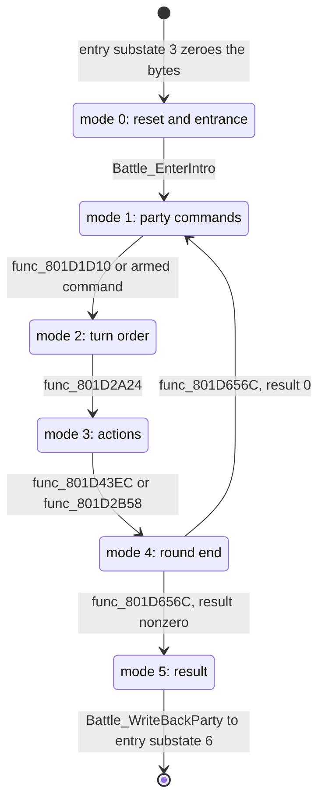

A battle is a request from the field: the field sets request code 3, the main state machine enters its battle state, and that state loads the battle overlay and hands every frame to `Battle_Update`. This page follows the flow: what triggers a battle, which code and archives run it frame by frame, and how it ends. The record layouts that the flow reads (battler rows, enemy records, status words, the reprisal exchange) are in [battle records](../../data/battle/).

## Terms

| Term            | Meaning                                                                                                                                      |
| --------------- | -------------------------------------------------------------------------------------------------------------------------------------------- |
| Encounter       | A random battle: `g_BattleEncounter == 0`. The enemies come from the area's formation table ([area format](../../formats/area/)).            |
| Scripted battle | `g_BattleEncounter != 0`, a record index of `s_BattleModeRecords`. The enemies and a boss module come from an archive that the record names. |
| Mode            | `g_BattleMode` (`0x801462E0`): one of 6 rows of `g_BattlePhases`.                                                                            |
| Step, sub-step  | `g_BattleStep` (`0x801462E1`) and `g_BattleSubStep` (`0x801462E2`): the second and third index inside a mode.                                |
| UI step         | `g_BattleUiStep` (`0x801462E3`): the index the `BATL_END` and `BATL_OVR` overlays dispatch on.                                               |
| Entry substate  | `g_GameEntrySubstate` while `g_GameEntryState == 5`: index into `g_GameModeHandlers[8]` (`0x801C7B54`). One entry runs `Battle_Update`.      |
| Boss module     | The code image of a `BOSSnnn.EMI` archive, loaded at `0x800C1800`. It publishes three hooks.                                                 |

## Starting a battle

### Random encounter

The player's field step handler `func_801B146C` counts steps and asks `Area_CanStartEncounter (emi/etc/game/00@0x801B3EB0)` on every move. A yes sets the party actor's step byte to 5 and clears its state. A small two-entry table, `D_801CD118`, then runs `func_801B2AB4` and `func_801B2B6C`; the second writes `g_GameStateIndex = 3`. That `D_801CD118` is the step-5 state table is `[inferred]` from its shape.

`Area_CanStartEncounter` returns 0 (no battle) when any of these holds:

| Test                                                                                    | Meaning                                        |
| --------------------------------------------------------------------------------------- | ---------------------------------------------- |
| `g_GameFlags & 0x20`                                                                    | A script flag switched encounters off.         |
| The zone's `rate` byte gives threshold 0                                                | Town or safe zone.                             |
| Step counter `D_80143F22` (scaled by 7/10 when `D_80145FAC < 4`) is below `D_80145FB8`  | Not enough steps yet.                          |
| `D_80145FBC & 1`                                                                        | Another state suppresses it.                   |
| Not on the world map and `D_80143EFC >= 0xF1`                                           | A gate on a game counter. `[unknown]` meaning. |
| A party battler row has `flags_00` bit `0x40` (hidden)                                  | A party member is off screen.                  |
| `Area_BuildEncounter(4, 0)` fails, or a party member has no free cell (`func_801C472C`) | No enemy fits around the party.                |

The step threshold comes from the area's [zone list](../areas/#zone-list). `func_801B3C3C` finds the rectangle that holds the party's cell. `Area_RollEncounterThreshold (emi/etc/game/00@0x801B3CCC)` reads the rectangle's byte 4, `rate`:

    threshold = base[rate] + min(rand() & 0x1F, cap[rate])

The pair `(base, cap)` comes from `s_EncounterStepThresholds (emi/etc/game/00@0x801CD1B8)`. The total doubles when any party member has trait `(3, 0x15)` (`func_801C38F4`) and halves when any has trait `(3, 0x14)`. Which abilities those traits belong to is `[unknown]`. The table gives the pair for each `rate`.

| `rate` | 0   | 1   | 2   | 3   | 4   | 5   | 6   | 7   |
| ------ | --- | --- | --- | --- | --- | --- | --- | --- |
| base   | 0   | 120 | 96  | 72  | 24  | 16  | 8   | 0   |
| cap    | 0   | 60  | 48  | 36  | 12  | 8   | 4   | 0   |

A base of 0 means no encounters. Higher `rate` values give shorter walks between battles.

### Formation and enemies

`Area_BuildEncounter (emi/etc/game/00@0x801C60E0)` builds the field-side description of the battle. It rolls a formation, copies the enemy list, tests each party cell, and clears every enemy that does not fit. It returns 1 only when the gate passes and at least one enemy remains.

1. `func_801C6A7C` rolls `(rand() & 0xF) + 1` and walks the eight 9-byte formation records at `0x800E4000`, adding byte 8 (the weight) until the running sum reaches the roll. A roll past all eight weights gives formation 0.
2. `func_801C6AEC` copies the record's 8 enemy ids into `D_801463DC` (8 `EncounterEnemy` of 12 bytes). An id other than `0xFF` stays when `(rand() & 0xF) + 1 <= s_EntitySpawnChances[slot]`. The chances are `16, 16, 16, 10, 8, 6, 4, 2`, so slots 0 to 2 always stay and slot 7 stays 2 times in 16. If no enemy stays, there is no battle.
3. `func_801C6BB4` places each remaining enemy. For `n` active enemies the offset comes from `D_801CD620[n(n-1)/2 + placed]`, which is why the table has `1 + 2 + ... + 8 = 36` entries. The code then tries up to 49 cells from `s_EntitySpawnOffsets` around the party until `func_801C7518` and `func_801C6EE0` accept one. An enemy with no cell is dropped. `func_801C6DCC` and `func_801C7244` adjust positions for the scroll direction `g_BattleScrollDir`. The cell tests in step 3 are `[inferred]`.

The enemy record layout (`0x800E4048 + id * 0x88`, 8 records) is in the [area format](../../formats/area/).

### Scripted battle

`Battle_StartScripted (emi/etc/game/00@0x801C7A54)` takes a record index. It stores it in `g_BattleEncounter`, clears `g_BattleSurprise`, copies byte 0 of `s_BattleModeRecords[index * 4]` to `g_BattleOptions`, and sets bit 12 (`0x1000`) of `g_AreaWalkFlags`. The table has 56 records of 4 bytes at `0x801CD78C`. Byte 3 of the record is the archive column used at stream time (see the next section). The scenario code or the actor step then sets `g_GameStateIndex = 3` `[inferred]`.

The one caller found is `func_801FA7D8` in `emi/scenario/scena00/00`. Calls in scenario overlays that were not read are not searched.

The entry and exit substates test these bits of `g_BattleOptions` (masks `0x01`, `0x02`, `0x10` and `0x40`):

| Bits | Meaning                                          |
| ---: | ------------------------------------------------ |
|    0 | Skip the camera pitch change.                    |
|    1 | Skip the scroll restore at exit.                 |
|    4 | Skip the `BPLU` or `BPLD` character bank stream. |
|    6 | Keep the field BGM.                              |

## Entry state 5

`Game_RunFieldState` case 3 zeroes `g_BattleMode`, `g_BattleStep` and `g_BattleSubStep`, increments `g_BattleCount`, and sets `g_GameEntryState = 5` and `g_GameEntrySubstate = 0`. `Game_RunBattleState (emi/etc/game/00@0x80197A24)` then calls `g_GameModeHandlers[g_GameEntrySubstate]` once per frame. The eight substates are the field-side wrapper around the battle:

| Substate | Function (`emi/etc/game/00`)                      | Work                                                                                                                               |
| -------: | ------------------------------------------------- | ---------------------------------------------------------------------------------------------------------------------------------- |
|        0 | `func_80197A60`                                   | `func_801BEDD0`, field redraw, advance.                                                                                            |
|        1 | `Battle_LoadPartySprites`                         | Wait for the field to be ready, change the camera pitch, stream `BPLU` (scroll direction bit 1) or `BPLD` character bank, advance. |
|        2 | `func_80197C1C`                                   | Wait for the loader and the camera.                                                                                                |
|        3 | `Battle_LoadBattleArchive`                        | Pause BGM, save the sequence table, stream the battle archive, reset the battle bytes.                                             |
|        4 | `func_80197E54`                                   | Wait for the archive and set `g_BattlePartyCount = Party_CountOrder(1)`.                                                           |
|        5 | `Battle_Update (emi/battle/battle/03@0x801D1014)` | The battle itself, every frame.                                                                                                    |
|        6 | `func_80197EFC`                                   | Field-side redraw, advance.                                                                                                        |
|        7 | `func_80197F48`                                   | Restore BGM and scroll, clear `g_BattleOptions` and `g_BattleEncounter`, return to state 2.                                        |

`Battle_LoadBattleArchive` picks the archive to stream. For a scripted battle it is `g_BossArchiveSlots[s_BattleModeRecords[g_BattleEncounter * 4 + 3]]`. For a random battle it is slot 6 (`BATTLE`) when `g_SceneState.scenario_id < 8` and slot 7 (`BATTLE2`) otherwise. `g_BossArchiveSlots` has 42 `u16` entries: slot 6, then the `BOSS` slots `0x1B3` to `0x1DA` in a game-specific order, then `0xFFFF`.

Unless `g_BattleOptions & 0x40` is set, substate 3 copies 1,376 bytes of the sequence table (`D_80148A50` to `D_8018E268`) away, and substate 7 copies them back ([audio](../audio/)).

`Battle_Update` never changes the entry substate. The advance from 5 to 6 happens in `Battle_WriteBackParty` (mode 5, step 4, sub-step 2).

## The battle state machine

`Battle_Update` runs once per frame in a fixed order:

1. `Battle_DispatchMode`, but only when `g_BattleState` bit `0x0002` (boss window busy) is clear, no panel task 0 is live (or the mode is 5), and `g_BattleEventFlags & 2` is clear (or the mode is 5).
2. `Battle_RunParty`, `Battle_RunEnemies`, `Battle_RunEvents`, `func_801527E4`, `Battle_RunEffects`.
3. `Battle_UpdatePartyActors`, `Battle_UpdateEnemyActors`.
4. `func_801A0514` (scripted battle) or `func_801A061C` (random battle): the battle scene draw.
5. `Area_RunParty`, `Actor_DispatchAll`, `GFX_UpdatePaletteAnimations`, `func_8019625C`, `Menu_RunPanelTasks`, `Area_DrawScene`.

`Battle_DispatchMode (emi/battle/battle/03@0x801D112C)` first calls `g_BossBattleEventHook(3)` when `g_BattleEncounter != 0` and the mode is not 0. Then it calls `g_BattlePhases[g_BattleMode]`. Mode 0 calls `Battle_DispatchStep`. Modes 1 to 5 read a step table by `g_BattleStep`, and some steps read a sub-table by `g_BattleSubStep`.

The six modes make up one battle: set-up and entrance once, then rounds of commands, ordering, actions and round end, then the result.

| Mode | Handler (`emi/battle/battle/03`) | Steps | Step table                                                                                     |
| ---: | -------------------------------- | ----: | ---------------------------------------------------------------------------------------------- |
|    0 | `Battle_DispatchStep`            |     2 | `func_801D1228` (reset), `Battle_DispatchEntrance` (4 sub-steps)                               |
|    1 | `func_801D1C54`                  |     5 | `D_801EABB8`. Steps 3 and 4 use sub-tables `D_801EABD8[3]` and `D_801EABE4[8]`.                |
|    2 | `func_801D2740`                  |     3 | `D_801EAC04`                                                                                   |
|    3 | `func_801D2AA8`                  |     5 | `D_801EAC10`. Sub-tables `D_801EAC24[2]`, `D_801EAC2C[6]`, `D_801EACA4`, `D_801EACB0[3]`.      |
|    4 | `func_801D4AC0`                  |     3 | `D_801EACBC`. Sub-table `D_801EACC8[3]`.                                                       |
|    5 | `func_801D6774`                  |     5 | `D_801EACD4`. Sub-tables `D_801EACE8`, `D_801EACF4`, `D_801EAD00`, `D_801EAD0C`, `D_801EAD20`. |

The mode names in the diagram come from the shape of the steps and from `func_801D656C`, which either returns to mode 1 or leaves for mode 5. They are `[inferred]`. Mode 3 also clears `g_BattleState` bit `0x0010` (command armed) when a button in `D_80145AC4` is held. Some step functions, for example `Battle_WaitUiMode` and `Battle_ReloadMusicBank`, advance their sub-step through a pointer that is written during the wait.

### Mode 0: reset and entrance

Step 0, `func_801D1228`, clears the battle state block, counts living party slots, copies the party stat blocks, and uploads palettes `0x1A` and `0x1B`. For a random battle it streams slot `0x9 + g_GameAreaId` (the area's enemy bank). For a scripted battle it calls `g_BossBattleEventHook(6)` instead. It then increments `g_BattleStep`.

Step 1, `Battle_DispatchEntrance (emi/battle/battle/03@0x801D17C4)`, runs four sub-steps from `g_BattleEntrances` (`0x801D0C1C`):

1. `Battle_ReserveStagePanels` arms the selection panels and writes the initiative text when `g_BattleSurprise` is 1 or 2.
2. `Battle_WaitUiMode` waits for the UI mode byte to read 1.
3. `Battle_InitPanels` presets the seven panel widths.
4. `Battle_EnterIntro` waits for `EMI_IsReady` and the intro helper, calls `func_801D93E4` with 1 (2 when `g_BattleSurprise >= 2`) and `func_801D9428(2)`, zeroes step and sub-step, and sets `g_BattleMode` to 1.

### Modes 1 to 4: one round

Mode 1 collects party commands, mode 2 orders the actors, mode 3 runs each action, and mode 4 closes the round `[inferred]`. The mode 1 sub-table `D_801EABE4` points partly into the second battle overlay at `0x800968xx` (`func_80096A74`, `func_80096F00`, `func_8009834C`, `func_800980A8`), so the command menus live in `battle/battle/15`. That the entries are menus is `[inferred]`.

`func_801D656C` ends mode 4. It waits until the 8 bytes `D_8018E140[16..23]` are zero. In a scripted battle it then calls `g_BossBattleEventHook(2)`, and returns early while the hook answers `0xFF`. A nonzero `g_BattleResult` sets mode 5, step 0. Otherwise it streams slot 8 (`COMN_SE`, when no command is armed), marks free party slots as step 2, clears `g_BattleSurprise`, and returns to mode 1.

The boss hook is called with seven event codes. The call sites are known; what each code means is `[unknown]`.

| Code | Caller                                              |
| ---: | --------------------------------------------------- |
|    0 | `func_801D43EC` (mode 3, last step)                 |
|    1 | `func_801D2FC0` (mode 3, step 0, sub-step 1)        |
|    2 | `func_801D656C` (mode 4, round end)                 |
|    3 | `Battle_DispatchMode` (every frame in modes 1 to 5) |
|    4 | `func_801D3F6C` (mode 3)                            |
|    5 | `func_801D43EC` (mode 3, last step)                 |
|    6 | `func_801D1228` (reset)                             |

### Mode 5: result and exit

Mode 5 has five steps, each with a sub-table in `D_801EACD4`.

| Step | Sub-table    | Role                                                                                                             |
| ---: | ------------ | ---------------------------------------------------------------------------------------------------------------- |
|    0 | `D_801EACE8` | The third sub-step is `Battle_StreamEndOverlay`, the chooser.                                                    |
|    1 | `D_801EACF4` | Ends in `func_801EEC58`, the `BATL_END` entry (victory).                                                         |
|    2 | `D_801EAD00` | Ends in `func_801EEC04`, the `BATL_OVR` entry (defeat).                                                          |
|    3 | `D_801EAD0C` | Reloads the area slot (`0x2AB + area`), then sets step 4.                                                        |
|    4 | `D_801EAD20` | Exit: free battlers, stream slot `0x256` (`AFLDKWA`), restore BGM, `Battle_WriteBackParty`, wait for the window. |

The chooser, `Battle_StreamEndOverlay (emi/battle/battle/03@0x801D6A14)`, waits until no party row has bit `0x2000` and `g_BattleRowCursor == g_BattlePartyCount`. If the result is not defeat, it ANDs every party member's status with `0xBF5F`, which keeps KO (`0x4000`), poison (`0x80`) and confusion (`0x20`). A member with status bit `0x800` first gets HP, AP and willpower set to their maximums. For a random battle it then sets step 2 on defeat (`g_BattleResult` bit 0) or step 1 on victory (bit 1). It calls `g_BattleChooseEndingHook` and `SND_SetBankLayout(0)`, and streams slot 1 (`BATL_END`) for step 1 or slot 2 (`BATL_OVR`) for step 2. In a scripted battle, `g_BattleChooseEndingHook` sets the step. That the boss hook does this is `[inferred]`.

**Victory.** `BATL_END` runs at `0x801EEC00`. Its entry is the image head plus `0x58`, and it dispatches on `g_BattleUiStep`. `Battle_GrantQueuedItems (emi/battle/batl_end/00@0x801EF870)` grants the queued items (`D_80146327`: a count, 16 item words, 16 levels) through `Party_AddItem` and sets `g_BattleStep = 4`. The experience and money payout code lives in the same image and is not traced `[unknown]`.

**Defeat.** `BATL_OVR` also runs at `0x801EEC00`. Its entry is the image head plus 4. `Battle_RunGameOver (emi/battle/batl_ovr/00@0x801EF0A8)` fades the screen, frees the palette rows, clears `g_BattleEncounter`, `g_BattleOptions` and the mode bytes, then runs `SND_Exit` and `CallbackReplace(SYS_StartFrontend)`. The game returns to the first load and the title.

**Exit.** Step 4, sub-step 2 is `Battle_WriteBackParty (emi/battle/battle/03@0x801D7350)`. It revives party rows with status bit `0x4000` (KO): current HP and willpower become 1, `fatigue` rises by 1 while it is below 5, the status loses bit `0x4000`, and the flag byte loses bit `0x04`. Living rows are untouched. It then zeroes every battle byte and increments `g_GameEntrySubstate` to 6. Substate 7 hands control back to the field (`g_GameEntryState = 2`).

**Default hooks.** For a random battle `func_801E320C` (the first enemy step handler, `D_801EB3B0[0]`) installs `func_801E5768` as `g_BattleChooseEndingHook` and `func_801E57C8` as `g_BattleEndHook`. In area `0xBD` (`D_80143F04 == 0xBD`) a defeat does not go to game over. The hooks request a scene (`D_80146875 = 0x19`) and a screen effect. What the scene is, is `[unknown]`.

## Boss modules

A scripted boss battle runs extra code from a boss module, the code entry of a `BOSSnnn.EMI` archive. It sits at `0x800C1800` and is entry 16 of the archive (entry 13 for boss001, boss004, boss022, boss025 and boss031). Random battles do not load one.

`Boss_InstallBattleHooks` stores three function pointers: `Boss_ChooseBattleEnding` into `g_BattleChooseEndingHook` (`0x801463A4`), `Boss_EndBattle` into `g_BattleEndHook` (`0x801463A8`) and `Boss_HandleBattleEvent` into `g_BossBattleEventHook` (`0x801463AC`). Each of the 35 boss modules has its own copy. A `jal` never calls it. `Battle_RunEnemies` runs, for each of the 8 enemy slots, `D_801EB298[enemy->unk_F0]()` in a scripted battle and `D_801EB294[enemy->unk_F0]()` (one entry, `func_801E31C8`) otherwise. `D_801EB298` has 63 entries, and the targets lie in the boss window (`func_800C1804` onward). For boss015 the target `func_800C18F0` is the installer's address, so the installer runs as the per-frame enemy handler of a boss whose kind index matches. That every module is reached this way is `[inferred]`; the table-to-module match for the other 34 is `[unknown]`.

Installer addresses in the boss window, by module. A module that has more than one installer publishes variants of the three hooks.

| Installer   | Modules and addresses                                                                                                                                                                                                                                                                                                                                                                                                                                                                                                                                                                                                                                                                                                           |
| ----------- | ------------------------------------------------------------------------------------------------------------------------------------------------------------------------------------------------------------------------------------------------------------------------------------------------------------------------------------------------------------------------------------------------------------------------------------------------------------------------------------------------------------------------------------------------------------------------------------------------------------------------------------------------------------------------------------------------------------------------------- |
| `...Hooks`  | boss015, boss029 `0x800C18F0`; boss037, boss042 `0x800C18FC`; boss050 `0x800C1908`; boss054 `0x800C1930`; boss023 `0x800C1984`; boss017 `0x800C19C4`; boss031, boss032 `0x800C19C8`; boss030 `0x800C19DC`; boss014, boss024 `0x800C19E8`; boss040, boss049 `0x800C19F4`; boss022 `0x800C1A08`; boss007 `0x800C1A0C`; boss051 `0x800C1A14`; boss021 `0x800C1AD0`; boss052 `0x800C1B0C`; boss028 `0x800C1B40`; boss035 `0x800C1B4C`; boss012 `0x800C1B68`; boss038 `0x800C1B7C`; boss004 `0x800C1C0C`; boss002 `0x800C1D50`; boss033 `0x800C1D70`; boss036 `0x800C1D78`; boss001 `0x800C1E50`; boss008 `0x800C1F9C`; boss013 `0x800C200C`; boss018 `0x800C2114`; boss034 `0x800C2340`; boss055 `0x800C24A0`; boss025 `0x800C2B60` |
| `...Hooks2` | boss040, boss049 `0x800C1A88`; boss014 `0x800C1A94`; boss024 `0x800C1AB0`; boss035 `0x800C1C70`; boss036 `0x800C1E0C`; boss002 `0x800C1E3C`; boss004 `0x800C1FB0`; boss008 `0x800C2088`; boss018 `0x800C23F8`; boss025 `0x800C2710`                                                                                                                                                                                                                                                                                                                                                                                                                                                                                             |
| `...Hooks3` | boss002 `0x800C1F08`; boss008 `0x800C2184`; boss004 `0x800C234C`; boss018 `0x800C26DC`                                                                                                                                                                                                                                                                                                                                                                                                                                                                                                                                                                                                                                          |

`BATL_END` and `BATL_OVR` follow the same code-entry head convention: a word that equals the table of contents' cached first word, then the entries named above.

## Archives in a battle

| Archive (slot)                           | Loaded by                                            | Window                                      |
| ---------------------------------------- | ---------------------------------------------------- | ------------------------------------------- |
| `BPLU` `0x1EE` or `BPLD` `0x1DB` family  | entry substate 1 (`EMI_GetArchiveId`)                | character bank                              |
| `BATTLE` 6, `BATTLE2` 7, `BOSS` `0x1B3+` | entry substate 3 (`Battle_LoadBattleArchive`)        | battle overlay; boss module at `0x800C1800` |
| `ENEMY` `0x9 + area`                     | `func_801D1228` (random battle)                      | enemy bank                                  |
| `BATL_SE` 5                              | `func_801D277C`, `func_801D25A0`, `func_8009B488`    | sound bank                                  |
| `BATL_RET` 4, `BATL_RE2` 3               | `func_801D3E80`; several sites in `battle/battle/15` | effect banks                                |
| `BATL_DRA` 0                             | `func_800A4700` (`battle/battle/15`)                 | effect bank                                 |
| `COMN_SE` 8                              | `func_801D656C`                                      | sound bank                                  |
| `BATL_END` 1 or `BATL_OVR` 2             | `Battle_StreamEndOverlay`                            | `0x801EEC00`                                |
| `AREA` `0x2AB + area`, `AFLDKWA` `0x256` | mode 5 steps 3 and 4                                 | area image, field sound                     |

The loader streams one archive at a time, and callers wait on `EMI_IsReady` ([loading](../../concepts/loading/)). The overlay windows are in [memory](../../concepts/memory/).

## Data and limits

The battler rows and the enemy record fields are in [battle records](../../data/battle/). The encounter block layout is in the [area format](../../formats/area/). The table lists the limits that the battle code enforces and that this page does not give elsewhere.

| Limit                    | Value                                                          | Source                                                                |
| ------------------------ | -------------------------------------------------------------- | --------------------------------------------------------------------- |
| Formation weights        | Roll 1 to 16 against the running sum of the eight weights      | `func_801C6A7C`; a roll above the total gives formation 0             |
| Step threshold           | Base 0 to 120, random part capped by the pair's second byte    | `s_EncounterStepThresholds[16]`                                       |
| Zone `rate`              | 0 to 7 (index `rate * 2` into a 16-byte table)                 | `Area_RollEncounterThreshold`                                         |
| Encounter zone lists     | 200 lists over 666 records of 8 bytes                          | `D_80181164[200]`, `g_AreaEncounterZones[666]`                        |
| End-of-battle item queue | 16 entries (member sizes 32 and 16 bytes) `[inferred]`         | `PartyGrantQueue` in `Battle_GrantQueuedItems`                        |
| Target pick tables       | Partial party `{9,7}, {12,4}, {8,8}`; full party six rows of 3 | `s_BattlePartialPartyTargetWeights`, `s_BattleFullPartyTargetWeights` |
| Random ability pools     | 32 slots each (`Recall`, `MagicShuffle`)                       | `g_BattleRecallAbilities`, `g_BattleMagicShuffleAbilities`            |

An edit must keep these limits.

- **Formation weights.** Make the eight weights total 16. A lower total sends high rolls to formation 0. A higher total makes the last formations unreachable.
- **Enemy slots.** A formation with no enemy id in slots 0 to 2 can roll no active enemy, and the field step then continues without a battle.
- **Zone rate.** Keep `rate` at 7 or less.
- **New scripted battle.** It needs a record in `s_BattleModeRecords`, an archive column that exists in `g_BossArchiveSlots`, and a boss module in the `BOSS` archive when its enemies use a boss handler.

## Open questions

| Question                                                                  | What would settle it                                                   |
| ------------------------------------------------------------------------- | ---------------------------------------------------------------------- |
| Mode-5 step 3 writer (`D_801EAD0C`: area reload) is not reached by a read | Search the `batl_end` and boss overlays for `g_BattleStep = 3`.        |
| Meaning of the seven boss event codes                                     | Read `Boss_HandleBattleEvent` in several modules.                      |
| Per-boss `D_801EB298` index to module mapping (34 of 35)                  | Read each module's head for the installer address, match to the table. |
| Reward payout (experience, money, drops) in `BATL_END`                    | Read the `BATL_END` functions after `Battle_GrantQueuedItems`.         |
| Trait ids `(3, 0x14)` and `(3, 0x15)` for the step threshold              | Read `func_801C38F4` and the ability trait table.                      |
| Meaning of the `D_80143EFC >= 0xF1` gate                                  | Find its writers in the field engine.                                  |
| Scene `0x19` requested by the area `0xBD` defeat hook                     | Read the scenario that owns it.                                        |
| Mode names (party commands, turn order, actions, round end, result)       | Read the mode 1 to 4 steps in full, or an emulator trace.              |
| Scripted-battle starts in scenario overlays not read                      | Search the scenario overlays for calls to `Battle_StartScripted`.      |

## Sources and confidence

- **Confidence:** medium. The start paths, the entry substates, the mode dispatch, the formation roll and the exit are read in the code. The mode names, the boss event codes, the reward payout and most boss-module links are `[inferred]` or `[unknown]`.
- **Evidence:** the field functions in `emi/etc/game/00`, the battle overlay `emi/battle/battle/03`, the `BATL_END` and `BATL_OVR` overlays, the installers in the boss modules, and the encounter block read from RAM.

## Related

- [Battle records](../../data/battle/): the battler rows, enemy records and status words that this flow reads.
- [Game phases](../phases/): the entry states and request codes that start and end a battle.
- [Areas and the field](../areas/): the zone list that sets the encounter step threshold.
- [Area formats](../../formats/area/): the encounter block and the enemy record layout.
- [Loading](../../concepts/loading/): the archive streaming that every step waits on.
