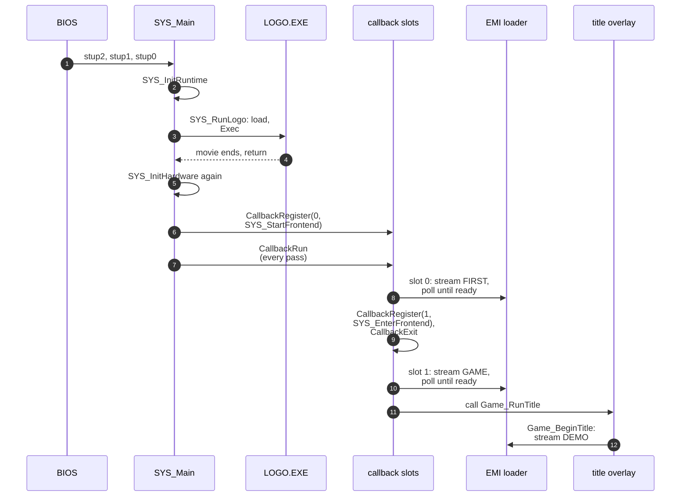

Boot is the path from the BIOS handoff to the first title frame. A C runtime stub prepares the CPU, `SYS_Main` initializes the console, the `LOGO.EXE` program plays the Capcom movie, and two callbacks load the first two archives and start the title. After that the [frame loop](../../concepts/frame-loop/) runs for the rest of the session. This page does not cover the title's states ([game phases](../phases/)) or the loader's steps ([loading](../../concepts/loading/)).

:::note
`exe/logo` and `exe/slus_004_22` are separate programs with separate symbols. They share one RAM, so the same address can mean different things in each ([memory map](../../concepts/memory/)).
:::

## Executable header and C runtime

The BIOS reads `SYSTEM.CNF`, loads `SLUS_004.22` and jumps to its entry address. That the BIOS copies `t_size` bytes to `t_addr` and jumps to the start address is BIOS behavior outside the game files. `[inferred]` The header fields are in [executables and boot files](../../formats/exe/#ps-x-exe-header).

The payload is far larger than the resident code. The rest is zero fill, apart from a few stamp words. That zero fill reserves RAM for overlays and for the resident game program, which later loads write over it ([memory map](../../concepts/memory/#the-executable-image)).

Three stubs prepare the CPU and start the game. The start address of the header points at the first, `stup2`.

| Stub                                 | What it does                                                                                                         |
| ------------------------------------ | -------------------------------------------------------------------------------------------------------------------- |
| `stup2 (exe/slus_004_22@0x8014AA0C)` | zero-fills `0x8018B2B8..0x80190C60`, the BSS ([memory map](../../concepts/memory/#the-map)), then falls into `stup1` |
| `stup1 (exe/slus_004_22@0x8014AA30)` | sets `sp` to `0x80200000`, `gp` to `0x8018B2B4`, copies `sp` to `fp`, calls `InitHeap(0x80190C64, 0x673A0)`          |
| `stup0 (exe/slus_004_22@0x8014AAAC)` | `jal SYS_Main`, followed by a `break` that is never reached                                                          |

`stup1` takes the stack top from a constant (`0x80200000`, the top of the 2 MiB RAM) and ends the heap 32,768 bytes below it, which is `0x801F8004`. The heap range overlaps the resident game program at `0x80195800` and the overlay arena at `0x801CE000`. The executable has no `malloc`, `free`, `calloc` or `realloc`, so the heap is declared and never used. `[inferred]` The assembly shows the missing thunks. That no PsyQ library code allocates from it is not shown. `__main (exe/slus_004_22@0x8014AA04)` is a bare `jr $ra`.

## `SYS_Main` sequence

`SYS_Main` initializes, then enters the permanent loop:

1. `__main`, then clear `g_SysHardwareInitialized`.
2. `SYS_InitRuntime (exe/slus_004_22@0x8014ACA0)`: `SYS_InitHardware`, `SYS_InitDisplay`, reset both render records, `CallbackInitThreads`, clear all of VRAM, `DrawSync(0)`, `SetDispMask(1)` and `SYS_PrepareFrame`.
3. `SYS_RunLogo`: run the logo program, described below.
4. Install `SYS_CaptureDrawTime` as the `DrawSync` callback and `CallbackRegister(0, SYS_StartFrontend)`.
5. Enter the permanent loop. The first `CallbackRun` opens slot 0.

`SYS_InitHardware (exe/slus_004_22@0x8014AD28)` runs twice, once before the logo and once after it. It does this in order:

1. `ResetCallback`, then `EMI_Init (exe/slus_004_22@0x80161F58)`. The loader init loops on `CdInit` until the drive answers, waits `VSync(3)` and clears the 24 loader slot states.
2. On the first call: `VSync(0)`, `ResetGraph(0)`, `SetVideoMode(MODE_NTSC)`, set `g_SysHardwareInitialized` and enable the CPU trap event with `SYS_ShowException` as its handler. On the second call: `VSync(0)` and `ResetGraph(3)`, which keeps the display.
3. `InitGeom`, `SetGeomScreen(0x3E8)`, `SetGeomOffset(0xA0, 0x78)`.
4. `PadInit(0)`, `SYS_InitCard` (seven card events, `InitCARD(1)`, `StartCARD`, `_bu_init`) and `ChangeClearPAD(0)`.

`SYS_ShowException (exe/slus_004_22@0x8014B3C4)` draws a register dump on a double-buffered screen and never returns. Sound is not initialized here. `SYS_StartFrontend` does it after the logo.

`SYS_InitDisplay (exe/slus_004_22@0x8014AE08)` sets up two draw and display environment pairs of 320 x 240. One draws at y = 0 and displays y = 0xF0, and the other draws at y = 0xF0 and displays y = 0. The [frame loop](../../concepts/frame-loop/) alternates between them.

## The logo program

`SYS_RunLogo (exe/slus_004_22@0x8014AEE0)` loads `LOGO.EXE` and runs it as a separate PlayStation program:

1. `SYS_LoadExec (exe/slus_004_22@0x8014E0FC)` finds the file with `CdSearchFile`, reads its header sector into the buffer at `0x800E4800`, and copies the ten header words to `D_80143E70`. It then reads `t_size` bytes from the next sector to `t_addr`. A failed read retries, up to ten attempts, and then returns -1. `SYS_ReadCd (exe/slus_004_22@0x8014E0A8)` blocks: no callback thread runs and no frame is drawn while it reads.
2. It sets the stack address of the exec block at `0x80143E80` (`D_80143EA0`) to `0x801FF000`, stops the callback, pad and card services, and calls `Exec` inside a critical section.
3. When `Exec` returns, it runs `SYS_InitHardware` again, clears the display and the VRAM, and turns the display on.

`LOGO.EXE` loads at `0x801CE000` and runs to `0x801ECEC0` with its BSS. The payload of the main executable is zero over that range, apart from two stamp words, so the logo overwrites no resident byte. No overlay is loaded yet. The first `EMI_LoadArchive` call comes later, in `SYS_StartFrontend`.

`exe/logo` starts at `__SN_ENTRY_POINT (exe/logo@0x801CE724)`, which zeroes its BSS (`0x801EB430..0x801ECEC0`), sets `gp` and jumps to `Logo_Main (exe/logo@0x801CEDFC)`. The logo carries its own copy of the PsyQ libraries and does not link against the main executable. `Logo_Main` calls `CdInit` and `Logo_Init`, then loops until the stream ends or the Start button is held. At the end it fades the audio out, stops the stream, the callbacks and the pad, and returns. That a return resumes `SYS_RunLogo` follows the BIOS `Exec` contract, which is outside the game files. `[inferred]`

The movie is read by sector number and not by name. `Logo_Init` receives the literal LBA `0x2D78C`. That LBA is the start of disc file slot `0x373`, and slot `0x374` starts 1,155 sectors later, so the file is 2,365,440 bytes long. This is the size of `LOGO/CAPCOM30.STR`. [Disc and files](../../formats/disc/) lists the slots, and [loading](../../concepts/loading/#movie) describes the movie code.

## The first two callbacks

After the logo, the first pass of the loop opens slot 0, which runs `SYS_StartFrontend (exe/slus_004_22@0x8014EA80)`. It does this in order:

1. Clear VRAM, then `CallbackWait(1)` to yield one frame.
2. `SND_Init`, `SND_SetBankLayout(0)`.
3. Stream `FIRST.EMI` (slot `0x261`) and wait with `CallbackWait(1)` until `EMI_IsReady`. [Loading](../../concepts/loading/) explains the stream.
4. Set reverb depth, call `SND_Start`.
5. Clear 4,272 bytes of game state from `D_801448D8`. Reset the game flags, the walk flags and `g_EmiLoadedCharacterIndex` (to `0xFF`), and copy nine halfwords from `D_8017F56C` into `g_InputMasks`.
6. Reset the panel tasks, palette fades, palette slots, draw flags and script bank. Set the area draw mode to 6 and request a palette upload.
7. `CallbackRegister(1, SYS_EnterFrontend)`, then `CallbackExit`, which ends slot 0's own thread.

`SYS_EnterFrontend (exe/slus_004_22@0x8014EC64)` starts in slot 1 in the pass where slot 0 registers it, because the walk reaches slot 1 after slot 0. It streams `GAME.EMI` (slot `0x262`), waits for `EMI_IsReady`, and calls `Game_RunTitle (emi/etc/game/01@0x801D0C04)`. The `GAME.EMI` stream carries two programs. Entry 0 is the resident game program at `0x80195800`, which stays in RAM until power-off. Entry 1 is the title overlay at `0x801D0C00`, which `Game_RunTitle` belongs to.

`Game_RunTitle` clears its state and loops forever on slot 1's thread. Each pass it yields with `CallbackWait(1)`, handles the Start button, runs one of eight title handlers that `g_UiTitleState` selects, and updates the banner and fades. The first handler, `Game_BeginTitle (emi/etc/game/01@0x801D0C90)`, selects sound bank layout 2, streams `DEMO` (slot `0x25F`), resets the palette stage and starts music cue `0x8D`. The title and its exits are in [phases](../phases/).

The first frame with the title drawn and input enabled is the first playable frame. The fade and input gate states between `Game_BeginTitle` and that frame are in [phases](../phases/).

## Boot functions

| Function                                         | Role                                                     |
| ------------------------------------------------ | -------------------------------------------------------- |
| `SYS_Main (exe/slus_004_22@0x8014AAC8)`          | boot sequence, then the permanent frame loop             |
| `SYS_InitRuntime (exe/slus_004_22@0x8014ACA0)`   | hardware, display records, callback threads, first frame |
| `SYS_InitHardware (exe/slus_004_22@0x8014AD28)`  | SDK and BIOS init; runs before and after the logo        |
| `SYS_RunLogo (exe/slus_004_22@0x8014AEE0)`       | load, `Exec` and recover from `LOGO.EXE`                 |
| `SYS_StartFrontend (exe/slus_004_22@0x8014EA80)` | first callback: sound, `FIRST.EMI`, state clear          |
| `SYS_EnterFrontend (exe/slus_004_22@0x8014EC64)` | second callback: `GAME.EMI`, then the title              |
| `Game_RunTitle (emi/etc/game/01@0x801D0C04)`     | the title loop, the first game mode                      |

## Open questions

| Question                                                     | What would settle it                                                   |
| ------------------------------------------------------------ | ---------------------------------------------------------------------- |
| How the BIOS loads the executable and returns from `Exec`    | A trace of a run, or the BIOS source; the game files do not show it    |
| Whether PsyQ library code uses the `InitHeap` memory         | Search the linked PsyQ objects for heap users                          |
| Other readers of `D_80143EFC`, the `DrawSync` callback value | `Area_CanStartEncounter` is the only reader found; search the overlays |
| Why the soft reset waits for `EMI_IsReady`                   | Read the loader state machine in [loading](../../concepts/loading/)    |

## Sources and confidence

- **Confidence:** medium. The steps of the boot path are read in the code of the executable, the title overlay and `LOGO.EXE`, but the BIOS behavior at load and at `Exec`, and the heap use, are `[inferred]` or `[unknown]`.
- **Evidence:** the code of `stup2`, `stup1`, `stup0`, `SYS_Main`, `SYS_InitRuntime`, `SYS_InitHardware`, `SYS_RunLogo`, `SYS_LoadExec`, `SYS_StartFrontend`, `SYS_EnterFrontend` and `Game_RunTitle`; the entry code of `LOGO.EXE`; the logo's literal movie LBA against the disc file table.

## Related

- [Frame loop](../../concepts/frame-loop/): the loop that `SYS_Main` enters.
- [Scheduler and tasks](../../concepts/scheduler/): the callback slots that carry the first two callbacks.
- [Loading](../../concepts/loading/): how `FIRST.EMI` and `GAME.EMI` stream.
- [Game phases](../phases/): the title, the start menu and the path to the field.
- [Executables and boot files](../../formats/exe/): the header fields and the disc file table.
