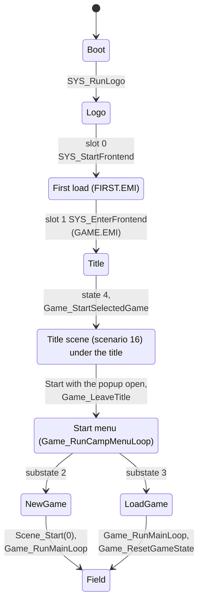
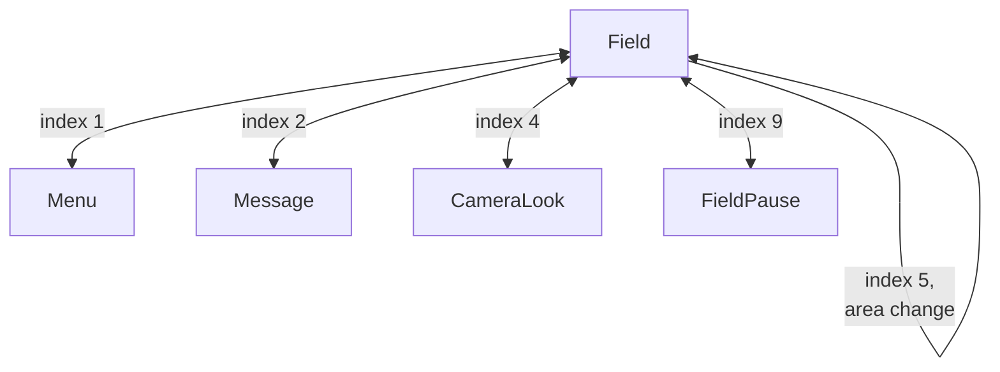
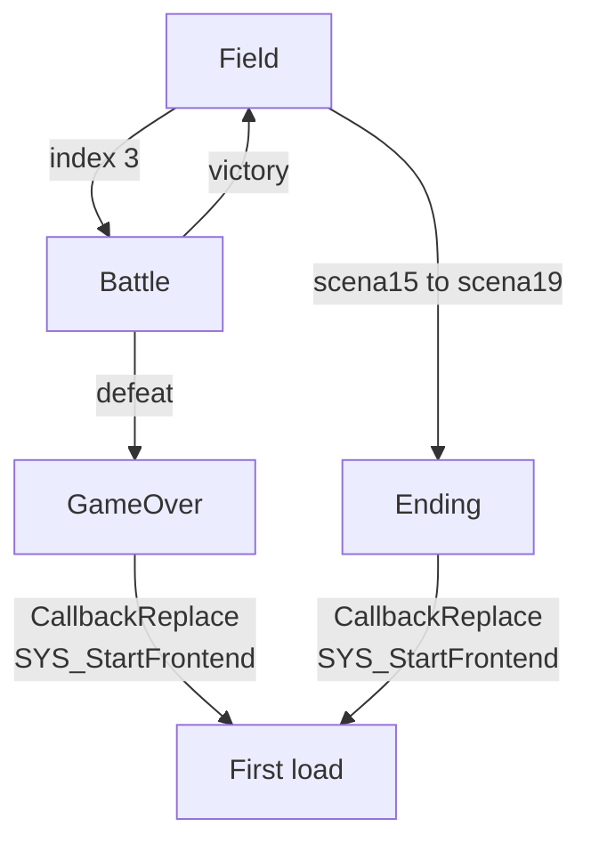

The game is a stack of modes: boot, title, start menu, field, menu, battle, scenes and game over. Three mechanisms carry the transitions between them. The callback slots ([scheduler](../../concepts/scheduler/)) hold the running mode, a state table `g_GameStates` selects what the game does each frame, and a request code `g_GameStateIndex` tells that table which transition to make next. After the game starts, almost everything happens inside one entry state, the field, as area and scenario code. Menus, battles and shops are brief excursions from it. This page does not cover what each mode does inside ([scenario engine](../scenario/), [areas and the field](../areas/), [battle flow](../battle/)).

## From power-on to the field

[Boot](../boot/) ends with the title running on slot 1. The diagram shows the path from there to the first playable field frame.

The field then reaches the other phases by request code. Four of them return to the field:

Battle and the ending leave the field differently. Defeat and the ending go back to the first load:

Holding Select and Start for 61 frames jumps back to the "First load" node from any phase ([frame loop](../../concepts/frame-loop/#soft-reset)).

The title thread on slot 1 steps through eight states (`g_UiTitleState`). States 0 to 3 load `DEMO`, start music cue `0x8D` and fade the title in. State 2 waits 360 ticks and state 3 waits 900 more. Pressing Start below state 3 jumps to state 2 with the timer at 1.

:::note
State 4 is `Game_StartSelectedGame (emi/etc/game/01@0x801D0E54)`. Despite its name it starts no selection. It clears the actors, zeroes `g_PlayClock`, calls `Scene_Start(16)` and registers `Game_RunMainLoop` in slot 0, so the title scene runs in the game's own loop underneath the title.
:::

States 5 and 6 draw the choice prompt. The scenario 16 code raises the popup request, and Start with that popup open sets state 7, `Game_LeaveTitle (emi/etc/game/01@0x801D1000)`. That function registers the start-menu loop in slot 0 and ends the title thread. The start menu loads the `START` overlay and offers New Game or Load Game. Both choices end in `CallbackReplace(Game_RunMainLoop)`, which puts the game proper in slot 0. The main loop starts in entry state 0, which asks for the saved area and walks through entry state 1 (load the area) into entry state 2 (the field).

New Game takes a longer path inside the `START` overlay. `Start_RunNewGame (emi/etc/start/08@0x801E2584)` finishes a countdown, calls `Scene_Start(0)` to load the first scenario, and installs `Game_RunMainLoop`. The first scenario then selects the first area. Name entry belongs to this path, but where it runs is `[unknown]`. Load Game scans both card ports for a save, restores eight characters with `Char_RebuildStats`, and installs `Game_RunMainLoop`. `Game_ResetGameState` then re-enters the saved area from the saved seed and position. [Saving](../saving/) covers the card.

## The entry-state machine

`Game_RunMainLoop (emi/etc/game/00@0x80197068)` runs in slot 0. It zeroes `g_GameEntryState (exe/slus_004_22@0x80143B90)` and the substate, resets the panel tasks, and then repeats forever: call `g_GameStates[g_GameEntryState]()`, call `func_80198CAC` (the play clock and timers), and `CallbackWait(1)`. The play clock does not advance while `g_GameStateIndex` is 9. The substate `g_GameEntrySubstate (exe/slus_004_22@0x80143B92)` selects a handler inside the states that own a sub-table. `g_GameStates` holds 12 entries at `0x801C7B14`.

| Entry state | Function                                                | What it does                                                                                                                 |
| ----------: | ------------------------------------------------------- | ---------------------------------------------------------------------------------------------------------------------------- |
|           0 | `Game_ResetGameState (emi/etc/game/00@0x801970EC)`      | clears the draw flags, sets `g_GameAreaId` to `0xFFFF`, requests the saved area with `Game_RequestAreaChange`, goes to 1     |
|           1 | `Game_RunAreaLoadState (emi/etc/game/00@0x801971E8)`    | loads the area through `func_8019FAA0`, applies the load flags, starts a screen effect, clears `g_GameStateIndex`, goes to 2 |
|           2 | `Game_RunFieldState (emi/etc/game/00@0x80197378)`       | the field: `Game_RunScenarioEntry`, then the per-frame update `Area_RunFrame`, then dispatch on `g_GameStateIndex`           |
|           3 | `Game_RunMenuState (emi/etc/game/00@0x801975E4)`        | menu: streams `STATUS`, runs the menu panels, returns to the field                                                           |
|           4 | `func_801979D4`                                         | waits for the message window to close, then returns to 2                                                                     |
|           5 | `Game_RunBattleState (emi/etc/game/00@0x80197A24)`      | battle: runs the eight functions of `g_GameModeHandlers`                                                                     |
|           6 | `Game_RunCameraLookState`                               | camera look mode (D-pad orbit); back to 2 when the camera is restored                                                        |
|           7 | `Game_RunShopState (emi/etc/game/00@0x80198234)`        | runs `g_GameStateHandlers[substate]`; substate 0 streams `SHOP`, or returns to 2 at once for a shop actor of kind 9          |
|           8 | `Game_RunFishingState (emi/etc/game/00@0x801984AC)`     | runs `g_GameSubstateHandlers[substate]`; entered from state 1 when `g_GameRequestFlags` bit 3 is set                         |
|           9 | `Game_RunAbilityMenuState (emi/etc/game/00@0x80198744)` | 3-handler table `g_MenuAbilityOpen`: streams `BATE`, an equipment screen and a stat tally for character record 7             |
|          10 | `Game_RunStatusMenuState (emi/etc/game/00@0x80198904)`  | 3-handler table `g_MenuStatusOpen`: streams `SHISU`, an item minigame that scores the items used and ranks the score 0 to 5  |
|          11 | `Game_RunSceneCameraState (emi/etc/game/00@0x80198AC4)` | 3-handler table `g_GameFlowHandlers`: scene dispatch with camera control, camera reset, back to 2                            |

State 2 is where the game spends most of its time. World map, cutscenes, bosses, the fairy village and fishing do not have states of their own, with fishing the exception that sets state 8. They run as area and scenario code inside the field.

### The request code

Code deep inside the field does not set `g_GameEntryState` directly. It writes a request code to `g_GameStateIndex (exe/slus_004_22@0x80143BB0)`, a byte. State 2 reads the code after the per-frame update and makes the transition.

| Code | Set by                                                                                                             | State 2 then                                                                                                          |
| ---: | ------------------------------------------------------------------------------------------------------------------ | --------------------------------------------------------------------------------------------------------------------- |
|    0 | idle; many handlers reset it                                                                                       | does nothing                                                                                                          |
|    1 | `func_801B2A00` and one area handler; the menu-open request `[inferred]`                                           | starts effect 2, goes to state 3 (menu)                                                                               |
|    2 | `Message_*` and the scenario, area, `commu`, `sisyou` and fairy handlers, about a dozen                            | goes to state 4 (message window wait)                                                                                 |
|    3 | `func_801B2B6C`                                                                                                    | zeroes the battle mode, step and sub-step, adds 1 to `g_BattleCount`, goes to state 5                                 |
|    4 | `func_801B5884`, when a button is held and `g_GameFlags & 0x2000` is clear                                         | goes to state 6 (camera look)                                                                                         |
|    5 | `Game_RequestAreaChange (emi/etc/game/00@0x8019FA28)` and five other field handlers                                | area change: sets the entry flag, fades the music if the selection changes, starts `g_GameEntryMode`, goes to state 1 |
|    6 | `Party_JoinMember`, on party overflow                                                                              | goes to state 7, the shop state by its name `[inferred]`                                                              |
|    7 | `scena06`: `func_801F97C0` (three stores) and `func_801F9DF4` (two stores)                                         | goes to state 9, the `BATE` screen ([screens](../screens/#bate-and-shisu-entry-states-9-and-10))                      |
|    8 | `scena11`: `func_801F8B84`, two stores                                                                             | goes to state 10, the `SHISU` screen ([screens](../screens/#bate-and-shisu-entry-states-9-and-10))                    |
|    9 | `func_801B5910`, when Start is pressed and `g_GameRequestFlags & 0x69` is clear; `func_80167428` in the executable | goes to state 11; Start-in-field is `[inferred]`                                                                      |

`Game_RequestAreaChange` stores the seed, position and kind in `0x80143F10..0x80143F1C`, calls `func_801A02E8` and `func_801A0380`, and sets code 5. `g_GameEntryMode (exe/slus_004_22@0x80143F1E)` is the effect index that state 1 starts: 10 when the load flags have bit 0 set (the world map), 20 for area `0xBD`, otherwise 0.

### Screen effects

`UI_SetMode(m)` starts a transition effect in slot 2 and does nothing while one is running ([scheduler](../../concepts/scheduler/#local-ui-modes)). Phase code calls it at a boundary and waits for `g_UiWindowEffectBusy` to clear. The effect table has 21 entries: full-screen tints, fades, zooms and camera-angle wipes. What each number looks like is `[inferred]` from the call sites:

| Call                          | Where                                               | Meaning               |
| ----------------------------- | --------------------------------------------------- | --------------------- |
| `UI_SetMode(0)`               | title, start menu, end of New Game                  | leave-screen effect   |
| `UI_SetMode(2)`               | entry state 2, code 1                               | menu-open effect      |
| `UI_SetMode(3)`               | `func_80197620`, after `STATUS` streams             | menu entry            |
| `UI_SetMode(4)`               | `UI_WaitTitleInput (emi/etc/game/01@0x801D0F00)`    | choice-confirm effect |
| `UI_SetMode(g_GameEntryMode)` | area reload                                         | field entry (read)    |
| `UI_SetMode(0x13)`            | `func_801EEC40 (emi/battle/batl_ovr/00@0x801EEC40)` | game over             |

## Phase reference

Every phase has the executable and the resident program `emi/etc/game/00` in RAM. The table lists what each phase adds. The scene window at `0x801D0C00` holds one overlay at a time. The area program is at `0x801F2C00`, the scenario controller at `0x801F6C00`, and `BMAGIC`, `BATL_END` and `BATL_OVR` code at `0x801EEC00`.

| Phase                                | Entered when                                                            | Code and overlay                                                                                                                                                    | Leaves by                                                                          |
| ------------------------------------ | ----------------------------------------------------------------------- | ------------------------------------------------------------------------------------------------------------------------------------------------------------------- | ---------------------------------------------------------------------------------- |
| Boot                                 | console reset                                                           | `SYS_Main`, `SYS_InitRuntime`; no overlay                                                                                                                           | `SYS_RunLogo`                                                                      |
| Logo                                 | end of init                                                             | `SYS_RunLogo`, `SYS_LoadExec`; `exe/logo` at `0x801CE000`                                                                                                           | `Exec` returns; `SYS_Main` registers `SYS_StartFrontend`                           |
| First load                           | after the logo; soft reset; game over; some endings                     | `SYS_StartFrontend`; `FIRST`                                                                                                                                        | `CallbackRegister(1, SYS_EnterFrontend)`, `CallbackExit`                           |
| Title                                | `SYS_EnterFrontend` streams `GAME` and calls `Game_RunTitle`            | `Game_RunTitle`, `UI_HandleStartButton (emi/etc/game/01@0x801D104C)`; `game/01` at `0x801D0C00`, `DEMO`                                                             | state 4 starts the title scene; Start with the popup open leaves to the start menu |
| Title scene                          | title state 4, `Game_StartSelectedGame`                                 | `Scene_Start(16)`, `scena16` at `0x801F6C00`, `Game_RunMainLoop` in slot 0                                                                                          | runs until `Game_LeaveTitle` replaces slot 0                                       |
| Start menu                           | `Game_LeaveTitle (emi/etc/game/01@0x801D1000)`                          | `Game_RunCampMenuLoop`, `Game_LoadCampMenu`; `START` entry 8 (`emi/etc/start/08`) at `0x801D0C00`                                                                   | New Game or Load Game, by `g_GameEntrySubstate` 2 or 3                             |
| New game                             | menu choice `D_801ED7EC != 0`                                           | `func_801E462C`, `g_MenuCampSubFuncs`, `Start_RunNewGame`; `start/08`, then `scena00`                                                                               | the field, first scenario                                                          |
| Load game                            | menu choice `D_801ED7EC == 0` and a save found on either port           | `func_801E4ED4` (card probe and read), `Camp_EnterMainLoop (emi/etc/start/08@0x801E62A8)`                                                                           | `Game_ResetGameState` re-enters the saved area                                     |
| Field                                | entry state 1 finished                                                  | state 2, `Area_RunFrame`, `Game_RunScenarioEntry`; the area program, a character bank and the scenario controller                                                   | `g_GameStateIndex` codes 1 to 9                                                    |
| World map                            | load flag bit 0 (`g_GameRequestFlags & 1`)                              | state 1 sets `g_GameEntryMode` to 10; world map logic runs as area code (`emi/world*`) `[inferred]`                                                                 | area change (code 5)                                                               |
| Cutscene                             | a scenario entry or area script sets a request, or scenario updates run | `Game_RunScenarioEntry`, `Game_RunSceneUpdate`; `scenaNN` at `0x801F6C00`, effect overlays `SCE10EFF`, `SCE15EF0` to `SCE15EF3` at `0x801D0C00`                     | message wait (code 2); area change                                                 |
| Battle                               | code 3 from `func_801B2B6C`                                             | state 5, `g_GameModeHandlers`; step 5 is `Battle_Update`; `BATTLE` or `BATTLE2` or an encounter slot, `BPLU` and `BPLD`                                             | victory: steps 6 and 7 restore the field; defeat: game over                        |
| Boss                                 | an encounter with a boss entry in `D_801EB298` of `battle/03`           | the battle chain, with a boss module at `0x800C1800`                                                                                                                | as Battle `[inferred]`                                                             |
| Menu                                 | code 1                                                                  | state 3: `func_80197620` streams `STATUS`; `func_80199368`, `Menu_RunPanelTasks`                                                                                    | `func_801976EC` re-streams the character bank, re-enters the area, goes to 2       |
| Game over                            | defeat: `g_BattleResult & 1` and `g_BattleEncounter == 0`               | `Battle_StreamEndOverlay (emi/battle/battle/03@0x801D6A14)` picks `BATL_OVR`; `Battle_RunGameOver (emi/battle/batl_ovr/00@0x801EF0A8)`                              | `SND_Exit`, `CallbackReplace(SYS_StartFrontend)`: first load, then title           |
| Ending                               | scenarios 15 to 19                                                      | `scena17` loads `ENDKANJI` (`0x260`) and `SHOP` (`0x266`); `scena15` and `scena17` call `CallbackReplace(SYS_StartFrontend)`                                        | the first load and the title; the sequence that reaches them is `[unknown]`        |
| Shop, master, fishing, fairy village | not traced as phases                                                    | `SHOP` (`0x266`) and `SISYOU` (`0x267`) exist as overlays; fishing is entry state 8 with code in `emi/world00/area030`; the fairy village loads `COMMU00` (`0x258`) | not traced `[unknown]` for entry; flags are read                                   |

A battle ends one of two ways. Victory runs the battle code that writes the party back (`Battle_WriteBackParty`), advances to step 6, and step 7 (`func_80197F48`) restores the music and goes to state 2. Defeat picks `BATL_OVR` and ends in the game over callback replacement above.

## Story progression

`Scene_Start(n)` sets `g_SceneState.scenario_id`, clears that scenario's flag word and calls `Scene_RequestOverlay`, which streams the scenario overlay ([loading](../../concepts/loading/#scenario)). When the loader is ready, `Game_RunScenarioEntry` calls `g_SceneScenes[n]->entry_00` and `Game_RunSceneUpdate` runs the scene states.

The progression step lives in the area loader. `func_8019FAA0` checks `g_SceneState.flags_01 & 0x80`. When it is set, the loader adds 1 to `scenario_id`, with a result of 16 becoming 17, and calls `Scene_Start`. `Scene_RequestChapterAdvance (emi/etc/game/00@0x801A78F8)` sets that bit. Its callers include `scena00/00`, after `Game_RequestAreaChange(9, 0x570000, 0x40000, 7)`, and, in assembly, `scena08`, `scena10` and `scena15`. Which chapter each scenario is, is `[unknown]` here; see [scenario](../scenario/).

There are 20 scenario overlays, `SCENA00` to `SCENA19`. Scenario 16 is the title scene, and the counter skips it. Some scenarios load extra overlays: `scena07` loads `A085SE2` (`0x254`), `scena08` loads `A108SE2` (`0x255`), `scena10` loads `SCE10EFF` (`0x290`), `scena15` loads `0x291` to `0x294`, and `scena17` loads `ENDKANJI` and `SHOP`. XA audio starts from `scena01`, `scena08`, `scena12`, `scena14`, `commu00`, `shop` and two area overlays. No MDEC or STR call exists outside `LOGO.EXE`, so no other video plays. Whether the scenario number is saved is in [saving](../saving/).

## Data and limits

The table lists the symbols that carry the phase state. All of them are work variables of the executable, in the range below its code that [memory](../../concepts/memory/#the-map) maps. The resident game program reads and writes them but does not own them.

| Symbol                 | Address                      | Type       | Meaning                                                                                                               |
| ---------------------- | ---------------------------- | ---------- | --------------------------------------------------------------------------------------------------------------------- |
| `g_GameEntryState`     | `exe/slus_004_22@0x80143B90` | u16        | index into `g_GameStates` (12 entries)                                                                                |
| `g_GameEntrySubstate`  | `exe/slus_004_22@0x80143B92` | u16        | handler index inside states with sub-tables; also the New or Load choice (2 or 3)                                     |
| `g_GameStateIndex`     | `exe/slus_004_22@0x80143BB0` | u8         | request code 0 to 9                                                                                                   |
| `g_GameEntryMode`      | `exe/slus_004_22@0x80143F1E` | u8         | field-entry effect index passed to `UI_SetMode`                                                                       |
| `g_GameRequestFlags`   | `exe/slus_004_22@0x80143F02` | u8         | area load flags: bit 0 world map, `0x08` fishing, `0x10` fairy village; `0x20` and `0x40` are also tested `[unknown]` |
| `g_UiLocalMode`        | `exe/slus_004_22@0x80143C90` | u8         | current transition effect index                                                                                       |
| `g_UiWindowEffectBusy` | `exe/slus_004_22@0x80143C40` | u8         | nonzero while an effect runs; blocks `UI_SetMode`                                                                     |
| `g_SceneState`         | `exe/slus_004_22@0x80146870` | SceneState | `scenario_id`, `flags_01`, `mode_02`, `state_04`, `step_05`, `timer_06`                                               |
| `g_GameAreaId`         | `exe/slus_004_22@0x80143F00` | u16        | current area; `0xFFFF` forces a reload                                                                                |

## Open questions

| Question                                                       | What would settle it                                                                     |
| -------------------------------------------------------------- | ---------------------------------------------------------------------------------------- |
| The menu trigger for code 1 and Start-in-field for code 9      | Read the callers of `func_801B2A00` and `func_801B5910`                                  |
| Where name entry runs                                          | Read the `g_MenuCampSubFuncs` tables `D_801ECCF8`, `D_801ECD1C` and `D_801ED138`         |
| Entry paths of the shop, master, fishing and the fairy village | Callers of `EMI_LoaderStreamInitSlot` with `0x266`, `0x267`, `0x258` and the area flags  |
| World map code                                                 | Read the world area overlays that load flag bit 0 selects                                |
| Boss entry                                                     | Read the callback table `D_801EB298` of `battle/03` and its callers                      |
| What reaches the credits and the end-of-game restart           | Trace the `scena15` to `scena19` assembly and the users of `ENDKANJI`                    |
| The exit from `BATL_END` to the field                          | Read the exit calls in `batl_end/00`                                                     |
| What scenario 16 draws, and when it raises the popup request   | Read the `scena16` overlay                                                               |

## Sources and confidence

- **Confidence:** medium. The entry states, the request codes and the title path are read in the code, but several codes and states have no known writer, and the phases of the world map, the boss, the shop, fishing and the ending are `[inferred]` or `[unknown]`.
- **Evidence:** the code of `Game_RunMainLoop`, the 12 handlers of `g_GameStates`, `Game_RequestAreaChange`, `func_8019FAA0`, `Scene_Start`, the stores to `g_GameStateIndex` in `func_801F97C0`, `func_801F9DF4` and `func_801F8B84` (no other program on the disc stores 7 or 8 there), the step tables of `BATE` and `SHISU`, the title and start-menu overlays, and the `UI_SetMode` and `CallbackReplace` call sites in the executable and the overlays.

## Related

- [Scheduler and tasks](../../concepts/scheduler/): the callback slots that hold each mode.
- [Boot](../boot/): how the title starts on slot 1.
- [Scenario engine](../scenario/): the scenario overlays and the story state.
- [Areas and the field](../areas/): the field handlers that raise request codes.
- [Battle flow](../battle/): the battle chain that entry state 5 runs.
- [Screens](../screens/): the full-screen modes that `g_GameStates` selects.
