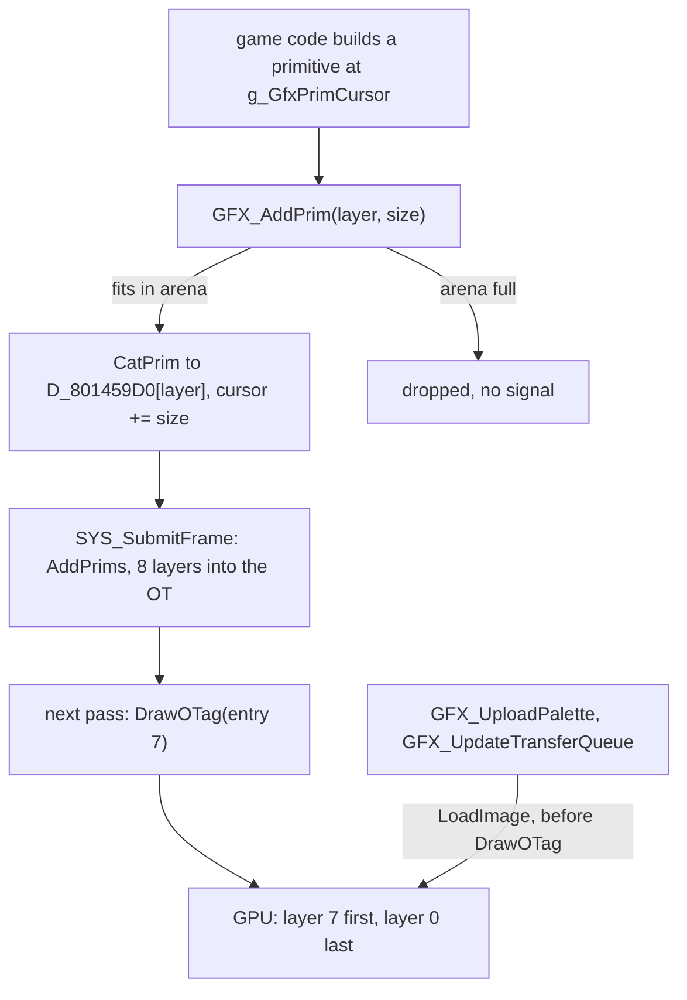
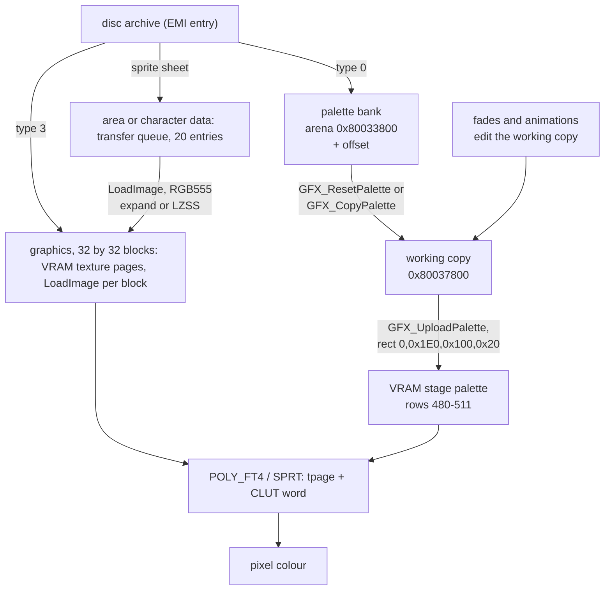

The game draws each frame by writing GPU primitives into a fixed RAM arena, threading them into eight depth layers of an ordering table and handing the table to the GPU. It has no scene graph and no draw library beyond a few helpers. Textures and palettes sit in VRAM, and each primitive names the texture page and palette row it samples. This page covers the primitive arena, the VRAM layout, how textures and palettes reach VRAM and how a sprite picks its colors. It does not cover the order of a whole frame, text drawing or the loader that fills VRAM.

## Terms

| Term          | Meaning                                                                                                               |
| ------------- | --------------------------------------------------------------------------------------------------------------------- |
| Primitive     | One GPU packet (`SPRT`, `POLY_FT4`, `DR_MODE`, `DR_AREA`) built at `g_GfxPrimCursor`.                                 |
| Arena         | The RAM block that holds one frame's primitives. Two arenas, one per render record.                                   |
| Layer         | One of 8 ordering-table entries. `GFX_AddPrim` appends a primitive to one layer's chain.                              |
| Cell          | A 16-color palette unit: 16 VRAM words of one palette row. A 256-color palette is 16 cells.                           |
| Palette arena | The RAM block at `0x80033800` that holds loaded palette banks. Its working copy at `0x80037800` is what the GPU sees. |
| Stage palette | The VRAM rectangle (0, 0x1E0, 0x100, 0x20): 32 palette rows of 256 words.                                             |
| Sprite record | The work record (`Actor`) at scratchpad `work_ptr`. Its bytes `+0x24` to `+0x29` pick page, CLUT and layer.           |

## Frame pipeline

1. `SYS_PrepareFrame (exe/slus_004_22@0x8014B020)` points `g_GfxPrimCursor` at `0x80020000 + b * 0x9000` (`b` is `g_FrameBufferIndex`). It resets the 8 layer tail pointers `D_801459D0[0..7]` to 8 dummy head words at `D_80145990 + b * 0x20`, and resets 56 scene packet records (48 bytes each at `D_80142CC0`).
2. Game code builds each primitive in place at the cursor and calls `GFX_AddPrim (exe/slus_004_22@0x8014E5A0)` with a layer and a size. The call links the primitive behind the layer's tail and advances the cursor by `size`.
3. `SYS_SubmitFrame (exe/slus_004_22@0x8014B0F0)` calls the PsyQ `AddPrims` once per layer. Ordering-table entry `i` of the render record (`record + 0x70 + 4 * i`) links to layer `i`'s chain.
4. On the next loop pass `SYS_Main` calls `DrawOTag(record + 0x8C)`, which is entry 7. Entry 7 starts the chain, so layer 7 draws first (at the back) and layer 0 last (in front). That ordering follows PsyQ `ClearOTagR` semantics, where each entry links to the one below it `[inferred]`.

`LoadImage` calls run in the loop step before `DrawOTag`. Whether the GPU finishes each copy before the draw starts is `[unknown]`.

### Layers in use

The game code calls `GFX_AddPrim` with a literal layer about 200 times for layer 1, about 30 times for layer 2, and a handful of times for layers 3, 6 and 7. Text and menu sprites go to layer 1. Scene sprites take their layer from the sprite record byte `+0x29`, and the map engine takes it from `g_AreaDrawMode`. What each layer number means for ordering, for example which layer is the HUD, is `[unknown]` beyond "1 is in front of 2".

## Display and VRAM

`SYS_InitDisplay (exe/slus_004_22@0x8014AE08)` sets two 320 by 240 draw and display environments. Record 0 draws to (0, 0) and shows (0, 240). Record 1 draws to (0, 240) and shows (0, 0). `SYS_InitHardware` sets `SetGeomScreen(0x3E8)` and `SetGeomOffset(0xA0, 0x78)`: projection distance 1,000 and screen center (160, 120).

The code names these regions of VRAM.

| VRAM region (x, y, w, h)    | Use                                                                      | Evidence                      |
| --------------------------- | ------------------------------------------------------------------------ | ----------------------------- |
| (0, 0, 320, 480)            | The two frame buffers.                                                   | `SYS_InitDisplay`             |
| (0, 0x1E0, 0x100, 0x20)     | Stage palette, 32 CLUT rows.                                             | `GFX_UploadPalette`           |
| 64 by 256 texture pages     | 16 columns by 2 rows: page `p` is x `(p % 16) * 64`, y `(p / 16) * 256`. | `Area_DrawObjectSprite` tpage |
| (960, 0) texture page       | Font sheets, 4 bits per pixel.                                           | `func_8014FC00` tpage `0x2F`  |
| (0x340, 0x100, 0xC0, 0x100) | Draw area for sprites with record flag `0x08`. Purpose `[unknown]`.      | `Area_DrawObjectSprite`       |
| 32 by 32 blocks             | Graphics payloads, x up to 1,000 and y up to 500.                        | `EMI_UploadSectorImage`       |

Text uses CLUT word `0x7800 | n`, which is VRAM row `0x7800 >> 6 = 480` and column `n * 16`: the first cells of stage palette row 0. The texture page word `0x2F` is column 15 (x 960), row 0, semi-transparency mode 1, 4 bits per pixel. That decoding follows the PsyQ `tpage` layout, which is outside the game files `[inferred]`.

No table lists the allocation of the page area between area sheets, character sheets, battle sheets and the font. Each payload names its own rectangle `[unknown]`. See [memory](../../concepts/memory/) for RAM.

## Textures, TIMs and palettes

The game loads no TIM files. Payloads carry no TIM header and go to VRAM as raw 16-bit words; the only TIM data is the memory-card save icon, which is never uploaded ([graphics formats](../../formats/graphics/)).

### The chain for one color

1. **Palette bank.** A type-0 EMI entry is copied to the RAM address in its table row. Arena offsets `+0x000`, `+0x200`, `+0x400`, `+0x600`, `+0x2000` and `+0x3600` are used ([area formats](../../formats/area/) has the table).
2. **Working copy.** `GFX_ResetPalette (exe/slus_004_22@0x8014E284)` zeroes arena rows 28 to 31, then copies all 32 rows (512 bytes each) to `0x80037800`. `GFX_CopyPalette (exe/slus_004_22@0x8014E3A0)` copies one row. Both set `g_GfxPalettePending`. Code that changes a palette (fades, animations, battle row moves) writes the working copy, not the arena.
3. **VRAM.** `SYS_Main` calls `GFX_UploadPalette (exe/slus_004_22@0x8014E22C)` every frame. It uploads the whole 256 by 32 rectangle only if `g_GfxPalettePending` is set. A palette edit takes effect one frame later.
4. **Texture.** Pixels reach a texture page through the loader or the sprite-sheet queue. The page and the bit depth are chosen when the primitive is built, not stored with the pixels.
5. **CLUT word.** The primitive's `clut` field names the palette row and column. For sprite records it comes from `Area_BuildClut`; for text it is `0x7800 | n`.

### Sprite CLUT word

`Area_BuildClut (exe/slus_004_22@0x8014CE78)` builds the word from three bytes of the sprite record: flags `+0x24` (bit `0x04`), selector `+0x27` (`sel`) and kind `+0x28`. `base` is `0x1E0`, or `0x1F0` when flag bit `0x04` is set. The kind sets how many palette cells the sprite owns:

| Kind (`+0x28`) | CLUT word                                       | Palette size          | Cells per row |
| -------------: | ----------------------------------------------- | --------------------- | ------------: |
|              0 | `((base + (sel >> 4)) << 6) \| (sel & 0xF)`     | 1 cell, 16 colors     |            16 |
|              1 | `(base + sel) << 6`                             | Whole row, 256 colors |             1 |
|              2 | `((base + (sel >> 3)) << 6) \| ((sel & 7) * 2)` | 2 cells               |             8 |
|              3 | `((base + (sel >> 2)) << 6) \| ((sel & 3) * 4)` | 4 cells               |             4 |
|              4 | `((base + (sel >> 1)) << 6) \| ((sel & 1) * 8)` | 8 cells               |             2 |

The row is `word >> 6` and the column is `(word & 0x3F) * 16`. The cell counts match the table `s_PaletteFadeColorCounts = {1, 16, 2, 4, 8}` that the fade code uses. The texture depth follows the kind: `Area_DrawObjectSprite` passes `tp = (kind != 0)`, so kind 0 is a 4-bit texture and kinds 1 to 4 are 8-bit. That kinds 2 to 4 use only the first 32, 64 or 128 colors of a CLUT placed at a multiple of its width is `[inferred]`.

The transparency mode in the page word is the low two bits of record byte `+0x5C` (`tint.bytes.flags`). The vertex color for each of `+0x5D`, `+0x5E` and `+0x5F` is `byte - 0x80`.

### Texture page and sheet upload

`Area_DrawObjectSprite` takes the page from record byte `+0x25`, plus a bank offset of -1, 0 or 1 when the kind is nonzero. The offset comes from the cell's `u`: below `0x28` gives -1, and `0xA1` and above gives 1. For graph type 0 the page word is

    (tp << 7) | (abr << 5) | ((y & 0x100) >> 4) | ((x & 0x3FF) >> 6)

with `x = (page % 16) << 6` and `y = (page / 16) << 8`. `v` is the cell `v` plus record byte `+0x26`. Graph types 1 and 2 use another page encoding. The US disc selects type 0 ([graphics formats](../../formats/graphics/)).

`Actor_SelectScriptBank (exe/slus_004_22@0x8014DC08)` queues the sheet for the record unless record flag `0x02` is set. For `level = +0x25` up to `0x10`, x is `level << 6`. Above that, x is `(level - 0x10) << 6` and y gains `0x100`. Y is otherwise record byte `+0x26`. Page `0x10` gives x = 1024 in this formula, but the draw code maps page 16 to x = 0 and y = 256. Which of the two shipped data uses is `[unknown]`.

### Causes of wrong texture colors

When a texture shows the wrong colors, one of these four items disagrees with the others `[inferred]`:

- The palette bank sits at another arena offset.
- The CLUT word names another row or column.
- The bit depth (4 or 8) differs from the pixel data.
- A fade or animation overwrote the working copy after the upload.

## Palette runtime

The last four stage palette rows are handed out dynamically to sprites that need their own colors, such as fading or recolored characters. Three tables track them.

| Object          | Address      | Size                              | Role                                                                              |
| --------------- | ------------ | --------------------------------- | --------------------------------------------------------------------------------- |
| Cell map        | `D_80145D54` | 4 rows by 16 bytes, `0xFF` = free | One byte per 16-color cell. It holds the fade record id that owns it.             |
| Fade records    | `D_80145BD4` | 32 records of 12 bytes            | `GFX_AllocPaletteFade` fills the first record with bit 0 clear.                   |
| Animation slots | `D_80145D94` | 8 slots                           | `GFX_StartPaletteAnimation` starts one. `GFX_UpdatePaletteAnimations` steps them. |

`GFX_AllocPaletteCell (emi/etc/game/00@0x801968BC)` takes a mode and scans the map row by row, returning the first run of free cells that fits. Mode 0 is one cell, 1 a whole row, 2 two cells (even column), 3 four cells (column multiple of 4) and 4 eight cells. The result is a selector for `Area_BuildClut` of the same kind. Mode 0 returns `cell - 0x40` as a byte. With record flag `0x04` set, `Area_BuildClut` turns that into rows `0x1FC` to `0x1FF`. Those are the same rows (28 to 31) that `GFX_ResetPalette` zeroes, so the dynamic cells live in the last four rows of the stage palette `[inferred]`.

A fade, `GFX_AllocPaletteFade (emi/etc/game/00@0x8019651C)`, takes a free cell run for the sprite record, remembers the record's old selector in the fade record, and `GFX_FreePaletteFade` restores it and frees the cells. `GFX_UploadPaletteRows` sets bit `0x8000` (the STP bit) on every color of the record's cells. The code that interpolates colors during a fade is in overlays (`emi/world00/area036/13`, `emi/world02/area085/13`, `emi/world02/area108/14`, `emi/bmagic/magic064/03`), not in the resident core, and was not read `[unknown]`.

Palette animations read 4-byte steps (`dst`, `src`, `count`, `wait`) and copy `count` colors from `src` to `dst` inside one row of the working copy. A step whose first byte is `0xFF` loops back by its second byte (`GFX_StepPaletteAnimation`, `GFX_CopyPaletteAnimationColors`). The copy sets the pending flag and uploads nothing.

## Sprite sheet queue

`GFX_UpdateTransferQueue (exe/slus_004_22@0x8014E6D0)` runs once per frame after the palette upload. Each of up to 20 entries holds an `x` and `y` (`D_80145A54[0..19]` and `D_80145A54[20..39]`) and a record pointer (`D_80145A04[0..19]`). The record is `w`, `h`, a kind word and the payload at `+8`. Kind 1 expands packed RGB555 pixels to one byte per component and uploads them. Kind 2 decodes LZSS and uploads. Any other kind is a raw `LoadImage`. The count `D_80145A00` is then cleared.

`Actor_SelectScriptBank` does not test the count before it queues, so a 21st entry in one frame writes past the table.

## Scene drawing

`Area_DrawScene (exe/slus_004_22@0x8014BA54)` switches the stack to the top of the scratchpad (`0x1F800400`), runs three steps, and clears the two record counters. Field and battle both call it.

1. `Area_RunBundleRecords (exe/slus_004_22@0x801584A4)`: when `g_AreaDrawFlags` bit 2 (cell layers) is set, walks the map-bundle record list at `0x80104000 + D_80104022 * 4`, dispatching each record's opcode through `D_8017F8FC`.
2. `Area_DrawActors (exe/slus_004_22@0x8014BB20)`: when flag bit 0 is set, bubble-sorts the active records (`D_80148214`) by depth and calls `Area_DrawObjectSprite` for each.
3. `func_8014BC70 (exe/slus_004_22@0x8014BC70)`: sorts the object list by layer key and depth, and for each of 55 scenes merges objects with the packet list `D_80143740` into the ordering table `[inferred]`. This comes from a partial reading.

`Area_DrawObjectSprite (exe/slus_004_22@0x8014C4D4)` hides records that fall outside a 448 by 368 window, skips flagged records, and emits one primitive per cell. Plain cells go through `Area_DrawSpriteCell`, and flipped or scaled cells become `POLY_FT4`. Cell size comes from `g_SpriteSizes (exe/slus_004_22@0x8017F53C)`, so a cell is one of 16 fixed sizes.

## Key data

These objects hold the state of the frame pipeline.

| Object                | Address         | Type        | Role                                                                         |
| --------------------- | --------------- | ----------- | ---------------------------------------------------------------------------- |
| `g_GfxPrimCursor`     | `0x8014598C`    | `u8*`       | Next free primitive byte.                                                    |
| `D_801459D0`          | main executable | `u32*[]`    | 8 layer tail pointers.                                                       |
| `D_80145990`          | main executable | `u8[]`      | 2 by 8 layer head words.                                                     |
| `g_GfxPalettePending` | `0x80145988`    | `u8`        | Set when the working palette must be uploaded.                               |
| `g_AreaDrawFlags`     | `0x8014832E`    | `u8`        | Bit 0 sprites, 1 negative depth, 2 cell layers, 3 and 4 appended primitives. |
| `g_SpriteSizes`       | `0x8017F53C`    | `u8[16][2]` | 16 cell width and height pairs.                                              |

## Data and limits

Each row gives a limit, where the code shows it and what an asset must stay within.

| Limit                 | Value                                              | Source                                     | Asset must stay within                                                                           |
| --------------------- | -------------------------------------------------- | ------------------------------------------ | ------------------------------------------------------------------------------------------------ |
| Primitive arena       | 36,812 bytes per buffer, `0x80020000 + b * 0x9000` | `SYS_PrepareFrame`, `GFX_AddPrim`          | At most about 920 `POLY_FT4`, 1,840 `SPRT` or 2,300 `SPRT_8` per frame, all primitives together. |
| Overflow behavior     | The primitive is dropped; no error.                | `GFX_AddPrim`                              | Too many cells or glyphs make sprites vanish, not crash.                                         |
| Primitive size        | One byte                                           | `GFX_AddPrim` `u8 size`                    | A packet over 255 bytes is not supported.                                                        |
| Layers                | 8; no range check on the argument                  | `D_801459D0[8]`                            | Sprite record layer byte `+0x29` stays in 0 to 7.                                                |
| Frame size            | 320 by 240                                         | `SYS_InitDisplay`                          | UI coordinates are in this space.                                                                |
| Sprite cull window    | x in -64 to 384, y in -64 to 304                   | `Area_DrawObjectSprite` (`0x1C0`, `0x170`) | Sprites outside are skipped.                                                                     |
| Stage palette         | 256 by 32 words = 16 KiB, from `0x80037800`        | `GFX_UploadPalette`                        | All palette banks fit the arena offsets above.                                                   |
| Dynamic palette cells | 4 rows by 16 cells = 64 cells                      | `D_80145D54`, `GFX_AllocPaletteCell`       | Fades and animated sprites share these 64 cells; free-run search, no compaction.                 |
| Fade records          | 32                                                 | `GFX_AllocPaletteFade` (`0x20`)            | Returns `0xFF` when full.                                                                        |
| Palette animations    | 8                                                  | `GFX_StartPaletteAnimation`                | Returns `0xFF` when full.                                                                        |
| Sheet upload queue    | 20 per frame                                       | `GFX_UpdateTransferQueue`, `D_80145A00`    | At most 20 sprite records change sheets in one frame; no overflow check.                         |
| Texture pages         | 16 columns by 2 rows of 64 by 256                  | `Area_DrawObjectSprite`                    | Record page byte `+0x25` below 32.                                                               |
| Cell shapes           | 16 sizes                                           | `g_SpriteSizes`                            | Sprite sheet cells use these sizes only.                                                         |
| Scene packet records  | 56 per frame, loop bound 55                        | `SYS_PrepareFrame`, `func_8014BC70`        | At most 55 or 56 scene layers in an area map `[inferred]`.                                       |
| Graphics block upload | x up to 1,000, y up to 500                         | `EMI_UploadSectorImage`                    | Type-3 blocks beyond this are not uploaded.                                                      |

## Open questions

- Ordering meaning of each layer number. Settled by: listing every `GFX_AddPrim` layer literal per overlay and comparing with screenshots.
- VRAM page allocation between area, character, battle and font sheets. Settled by: a VRAM dump from an emulator at each phase.
- Whether `LoadImage` finishes before `DrawOTag` in the same frame. Settled by: PsyQ `LoadImage` queue behavior or a trace of the GPU DMA.
- Purpose of the `(0x340, 0x100, 0xC0, 0x100)` draw area. Settled by: tracing which records set record flag `0x08`.
- Page 16 mismatch between the sheet upload and the draw formulas. Settled by: reading the page bytes of shipped sprite records.
- Behavior of `func_8014BC70`. Settled by: a full read of its assembly.
- Layers above 7 passed to `GFX_AddPrim`. Settled by: searching call sites for non-literal layer values.
- Draw code for fade color interpolation in overlays. Settled by: reading `emi/world00/area036/13` and the other overlays listed under palette runtime.

## Sources and confidence

- **Confidence:** medium. The pipeline, the palette chain and the limits are read in the code. The layer meanings, the VRAM allocation and the scene-object merge are `[unknown]` or `[inferred]`.
- **Evidence:** the frame functions `SYS_PrepareFrame`, `GFX_AddPrim` and `SYS_SubmitFrame`, the palette functions `GFX_ResetPalette`, `GFX_UploadPalette` and `Area_BuildClut`, the sprite draw functions `Area_DrawObjectSprite` and `Area_DrawScene`, and the queue function `GFX_UpdateTransferQueue`, all in `exe/slus_004_22`. Layer usage comes from the layer literals at the call sites.

## Related

- [Frame loop](../../concepts/frame-loop/): where each frame step runs, including the draw and upload.
- [UI and text drawing](../ui/): how text and menu sprites use the layers and the stage palette.
- [Loading](../../concepts/loading/): how the loader fills VRAM and the palette arena.
- [Graphics formats](../../formats/graphics/): the texture, palette and sheet payloads.
- [Memory map](../../concepts/memory/): the RAM blocks for the arena and the palette copies.
