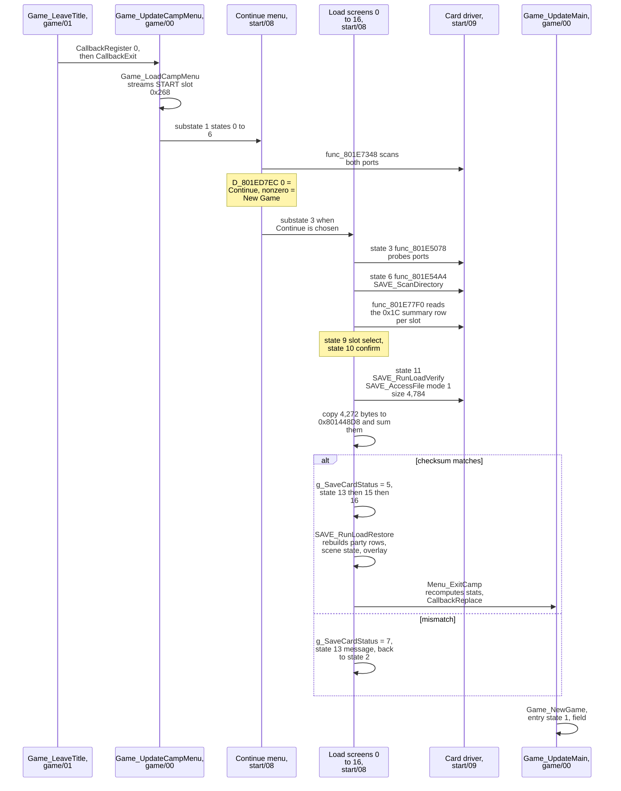

A save is one memory card file of one card block: a 512-byte card header followed by a copy of the 4,272-byte persistent block. A load copies the block back and rebuilds what the block does not hold: the loaded area, the party work rows and the character graphics. This page covers the save and load screens, the card driver, the checks and the rebuild after a load. The byte layout of the file and the checksum steps are in [save format](../../formats/save/).

## The player's view

At a save point the player opens a menu, picks a memory card port and a slot, and confirms; the game writes one file of one card block. Continue on the title screen lists the saved slots the same way, reads the chosen file, checks it and returns to the field. The block is described in [persistent state](../state/#one-persistent-block).

## Images involved

Five images take part: the executable, the resident game program and three overlays. The resident game program only hands control to the overlays.

| Image                                         | Load address | Holds                                   |
| --------------------------------------------- | ------------ | --------------------------------------- |
| `exe/slus_004_22`                             | `0x8014...`  | card events, the persistent block       |
| `emi/etc/game/00`                             | `0x80195800` | hand-off to the screens, `Game_NewGame` |
| `emi/etc/shop/00` (`SHOP.EMI` slot `0x266`)   | `0x801D0C00` | save screens, state gather, checksum    |
| `emi/etc/start/08` (`START.EMI` slot `0x268`) | `0x801D0C00` | load screens, new-game defaults         |
| `emi/etc/start/09`                            | `0x801EEC00` | card driver, save-icon pixels           |

`SHOP.EMI` and `START.EMI` both carry the driver ([icons](../../formats/save/#icons)). The window at `0x801EEC00` is shared with battle effect modules, so the driver works only while a save or load screen owns it ([memory](../../concepts/memory/)).

The save staging buffer `g_SaveBuffer (emi/etc/shop/00@0x800C1A00)` is the payload half of the 8,192-byte frame at `0x800C1800`. That address is the boss-module window. A boss load overwrites it; both screens refill it before use `[inferred]`.

## Saving

The save screen opens from the field, runs inside the main loop, and returns to the field.

```mermaid
sequenceDiagram
    participant Ev as Scene event<br/>10, game/00
    participant Main as g_GameStates<br/>7, game/00
    participant Sav as Save machine,<br/>shop/00
    participant Drv as Card driver,<br/>start/09
    participant Bios as PsyQ card<br/>calls
    participant Card as Memory card

    Ev->>Main: D_8014865C = -2,<br/>g_GameEntryState = 7
    Main->>Main: Game_LoadShopOverlay<br/>EMI_LoadArchive<br/>SHOP
    Main->>Sav: func_80199398 runs<br/>Shop_DispatchStep each<br/>frame
    Sav->>Drv: state 2 func_801D47AC<br/>SAVE_AccessFile 0 per<br/>port
    Drv->>Bios: _card_info and<br/>_card_load
    Bios->>Card: probe
    Sav->>Drv: state 5 func_801D4BBC<br/>SAVE_ScanDirectory
    Drv->>Bios: firstfile and nextfile
    Sav->>Drv: func_801D7208<br/>SAVE_AccessFile read<br/>0x1C at 0xEA0
    Note over Sav: state 8 slot select,<br/>state 9 or 13 confirm
    alt overwrite, state 10<br/>func_801D51B8
        Sav->>Drv: SAVE_AccessFile mode 1<br/>size 1
    else new file, state 14<br/>func_801D5894
        Sav->>Drv: SAVE_AccessFile mode<br/>0x200 creates one<br/>block
    end
    Sav->>Sav: SAVE_BuildSlotImage<br/>gathers block, header,<br/>checksum
    Sav->>Drv: SAVE_AccessFile mode 2<br/>size 4,784
    Drv->>Bios: open, lseek, write,<br/>close
    Bios->>Card: write 4,864 bytes
    Sav->>Sav: g_SaveCardStatus = 8<br/>or 10, func_801D6CE4<br/>updates the row
    Sav-->>Main: state 0x12<br/>func_801D5D98 leaves,<br/>Game_ReturnFromShop resumes<br/>the field
```

- Scene event 10 is `Scene_StartShopSave (emi/etc/game/00@0x801A802C)`, entry 10 of `g_SceneEvents (emi/etc/game/00@0x801C84BC)`. Its cases 6 and 23 set `D_8014865C = -2` and `g_GameEntryState = 7`. The scripts or objects that select event 10 are not traced `[unknown]`.
- `g_GameStates[7]` is `Game_UpdateShop`. It runs `g_GameStateHandlers[g_GameEntrySubstate]`. Substate 0, `Game_LoadShopOverlay (emi/etc/game/00@0x80198270)`, streams the `SHOP` slot `0x266`. Substate 1, `func_80199398`, runs the field frame and `Shop_DispatchStep`. Substate 2, `Game_ReturnFromShop`, reloads the character archive and returns to entry state 2.
- `Shop_DispatchStep` dispatches `D_801E5144` by `D_80148650`. `func_801D0EDC` sets `D_80148650` to `D_80148698 + 2`, which is 3 for the save case. That selects `func_801D39BC`, and entry 3 of its table `D_801E52C4` is `SAVE_DispatchState (emi/etc/shop/00@0x801D46A4)`. It dispatches `D_801E530C` by `D_80148652`.
- The overwrite path first opens the existing file with mode 1 and size 1, a read of the first 128 bytes. Success shows the file exists (`func_801D51B8`).
- The new-file path calls `SAVE_AccessFile` with mode `0x200`. The driver creates the file, closes it, reopens it with mode 1 and issues a zero-length read.

### Building the image

`SAVE_BuildSlotImage (emi/etc/shop/00@0x801D69E0)` runs just before the write. In order:

1. `func_801D7080` builds the title string. `SAVE_BuildFileHeader (emi/etc/start/09@0x801EF27C)` writes the `SC` magic, the icon flag `0x13`, block count 1, the title, the icon palette and three icon frames into the frame at `0x800C1800`.
2. It refreshes the fields in the live block that the save adds: the script variables, the area id, the entry kind and position, the nine button masks, and the slot summary row. The summary row is five name bytes from the first party record, the three field-order portraits (a portrait of kind 4 shows as `0xB` unless the loaded character index is 5 or `0xC`), the first record's level, the play clock, and the result of testing event flag `0x92`.
3. It clears the checksum halfword at block `+0x70` in live RAM, stores `g_GameFlags` as a byte in `D_80145025`, copies the 4,272 bytes from `0x801448D8` into `g_SaveBuffer`, and sums them in 16 bits.
4. It zeroes the rest of the buffer up to payload offset `0x1E00`, stores the sum at frame `+0x270`, and publishes the slot row.

The write size is 4,784 bytes (a 512-byte header plus the 4,272-byte block). `SAVE_TransferFile` rounds it up to 4,864, so the card gets the zeroed bytes from `0x12B0` to `0x12FF`. The staging fill reaches frame offset `0x2000`; the card never receives those bytes. The file layout is in [save format](../../formats/save/#layout).

### Save machine states

`D_801E530C` has 21 states, selected by `D_80148652`.

| State | Function        | Role                                                                          |
| ----: | --------------- | ----------------------------------------------------------------------------- |
|     0 | `func_801D46E0` | draw, advance                                                                 |
|     1 | `func_801D472C` | set the text id `0x17`, go through wait state 19                              |
|     2 | `func_801D47AC` | probe port 0 and port 1; pick the usable one or fail with a message           |
|     3 | `func_801D4970` | slide animation                                                               |
|     4 | `func_801D4A3C` | port select (up, down); confirm goes to 5, cancel to 6                        |
|     5 | `func_801D4BBC` | scan the directory; BOF3 files found go to 6, otherwise status 5 or 4 and 12  |
|     6 | `func_801D4CF0` | slide out                                                                     |
|     7 | `func_801D4DB4` | slide in the slot list                                                        |
|     8 | `func_801D4E74` | slot select; empty row goes to 13 if a block is free, else error 4; used to 9 |
|     9 | `func_801D50C0` | overwrite confirm, then 10                                                    |
|    10 | `func_801D51B8` | overwrite write                                                               |
|    11 | `func_801D5390` | cancel animation                                                              |
|    12 | `func_801D543C` | message for `g_SaveCardStatus`, then the next state by status (see below)     |
|    13 | `func_801D5790` | new-file confirm, then 14                                                     |
|    14 | `func_801D5894` | create and write                                                              |
|    15 | `func_801D5AD0` | unformatted card prompt                                                       |
|    16 | `func_801D5BB0` | format confirm, then 17                                                       |
|    17 | `func_801D5CB0` | format the card                                                               |
|    18 | `func_801D5D98` | leave the machine or ask to continue                                          |
|    19 | `func_801D5E88` | timed wait, then jump to `D_801E6094`                                         |
|    20 | `func_801D6018` | continue prompt                                                               |

State 12 picks its next state from the status. A press of any button, or the timeout for statuses 8 and 10, advances it. Status 5 (no save file) and 9 (format done) clear the slot list to three empty rows with 15 free blocks and go to state 8. Statuses 8 and 10 (saved) go to state 11. Status 2 (new card) goes to state 15. Every other status goes to state 18.

## Loading

The load screen runs only from the start menu, before any game exists.

### The continue menu

The continue menu is camp substate 1 (`D_801ED11C`, 7 states). `func_801E411C` calls `func_801E7348`, which scans each port and returns one status byte per port. A port with a BOF3 file gives 0, a usable card with no BOF3 file gives 1 (3 when all 15 blocks are used), and a missing card gives 2. When either port has a file the menu allows Continue. Otherwise it forces New Game. `D_801ED7EC` is 0 for Continue and nonzero for New Game, and `func_801E45CC` sends the first to substate 3 and the second to substate 2.

### Load screen states

`D_801ED148` has 17 states, selected by `D_801ED860` and run by `func_801E4ED4` as camp substate 3.

| State | Function              | Role                                                 |
| ----: | --------------------- | ---------------------------------------------------- |
|     0 | `func_801E4F10`       | `UI_SetMode(1)`                                      |
|     1 | `func_801E4F50`       | panel slide-in                                       |
|     2 | `func_801E4FFC`       | message wait, then to state 3                        |
|     3 | `func_801E5078`       | probe port 0 and port 1                              |
|     4 | `func_801E524C`       | slide                                                |
|     5 | `func_801E5320`       | port select; confirm goes to 6, cancel to substate 1 |
|     6 | `func_801E54A4`       | scan directory, build rows                           |
|     7 | `func_801E55B8`       | slide                                                |
|     8 | `func_801E5674`       | slide in the slot list                               |
|     9 | `func_801E5738`       | slot select; an empty row plays the error cue        |
|    10 | `func_801E590C`       | confirm                                              |
|    11 | `SAVE_RunLoadVerify`  | read, copy, verify                                   |
|    12 | `func_801E5BCC`       | slide back, to state 2                               |
|    13 | `func_801E5C68`       | message for `g_SaveCardStatus`                       |
|    14 | `func_801E5E30`       | timed wait, then `D_801ED800`                        |
|    15 | `func_801E5F34`       | `UI_SetMode(0)`, 30-frame wait                       |
|    16 | `SAVE_RunLoadRestore` | rebuild and hand over                                |

After a good read, state 13 shows its message for up to 60 frames or until a button press. State 15 then waits 30 frames.

### Hand-off after the file is read

`SAVE_RunLoadRestore (emi/etc/start/08@0x801E5FD4)` runs these steps in order:

1. Restore the nine button masks from the block into `g_InputMasks`.
2. Set `g_PartySize` from the field order array (`Party_CountOrder(0)`).
3. Stream the `PLP` and `PL` character archives for `g_EmiLoadedCharacterIndex`.
4. `Party_BuildBattlers(0)`: build the party rows in `g_BattlePartyBattlers` from the loaded records.
5. Copy the first 16 block bytes into `g_SceneState` and point `g_SceneFlags` at the scenario's flag word.
6. Restore the four script variable bytes.
7. `Scene_LoadOverlay`: stream the scenario overlay for `scenario_id`.
8. Set camp substate 4.

`Menu_ExitCamp (emi/etc/start/08@0x801E62A8)` then runs `func_801E7210` and `Char_RebuildStats` for each of the eight records, so all live stats come from base stats and equipment. It calls `CallbackReplace(Game_UpdateMain)`. `Game_UpdateMain` starts at entry state 0, `Game_NewGame`. That function reads the saved area id, position and kind from the block and sets `g_GameAreaId = 0xFFFF`. It calls `Game_RequestAreaChange` to store the entry context and set `g_GameStateIndex = 5`, then advances to entry state 1. See [area](../areas/) for the load that follows.

`SAVE_RunLoadVerify (emi/etc/start/08@0x801E5A00)` also restores `g_GameFlags` from `D_80145025`. On a match it sets stereo or mono sound from the byte at `0x80144951`, a block field (`SsSetStereo` or `SsSetMono`).

## Validation and errors

The checksum steps are in [save format](../../formats/save/#checksum). There is no other check on load: no version field, no per-record check, and no test of the `SC` magic.

The load copies before it verifies: `SAVE_RunLoadVerify` copies the 4,272 bytes into live RAM and restores `g_GameFlags` while it sums them, and a mismatch sets status 7 only after the copy. The live block holds the bad bytes until the next load or a new game overwrites them `[inferred]`.

`g_SaveCardStatus (exe/slus_004_22@0x8018E228)` carries two vocabularies. Values 0 to 4 come from the driver. The screens set the higher values, and their meaning differs by image.

| Value | Driver meaning (`CardEvent`)       | Load screens (`start/08`)       | Save screens (`shop/00`)                   |
| ----: | ---------------------------------- | ------------------------------- | ------------------------------------------ |
|   `0` | event OK                           | usable                          | usable                                     |
|   `1` | timeout                            | message                         | message, no card                           |
|   `2` | new card                           | treated as usable by the probes | routes to the format prompt (states 15-17) |
|   `3` | error                              | message                         | message; after a failed write becomes 6    |
|   `4` | capacity (directory would be full) | message                         | message; also "no free block" at state 8   |
|   `5` | -                                  | file read and verified          | no save file in the slot list              |
|   `6` | -                                  | no BOF3 file on the card        | write failed with error                    |
|   `7` | -                                  | checksum mismatch               | format failed                              |
|   `8` | -                                  | neither port usable             | overwrite saved                            |
|   `9` | -                                  | -                               | format done                                |
|  `10` | -                                  | -                               | new file saved                             |
|  `11` | -                                  | -                               | message; the setter is not found           |

The message for a status is a text resource: `Resolve(status + 0x85)` in the save screens and `Resolve(code + 0xA6)` in the load screens. The strings are `[unknown]`.

What the driver does in `SAVE_AccessFile (emi/etc/start/09@0x801EEC30)`:

- It makes up to 30 attempts at `SAVE_PollCardInfo` and `SAVE_PollSoftwareEvents`. If the status stays pending or timeout, it returns -1.
- On status OK it calls `SAVE_PollCardLoad` (60 frames), then opens and transfers. A `SAVE_PollCardLoad` failure returns -1.
- On status NEW it calls `func_801EF148`, which clears the card (`_card_clear`) and waits for the hardware event, up to 60 tries, then goes on as for OK.
- On status timeout or any other value it returns -1.
- `SAVE_OpenFile (emi/etc/start/09@0x801EF96C)` retries `open` 120 times with one `VSync` between tries. On failure it re-polls the card. When it creates a file, it scans the directory and sets status 4 if the summed file sizes plus one block exceed the capacity bound, else status 3. The test is `total + (blocks << 13) > 0x1E000`, which is 122,880 bytes or 15 blocks.
- `SAVE_TransferFile (emi/etc/start/09@0x801EFB44)` retries a failed `read` or `write` once per `SAVE_PollCardInfo`, up to 60 times, and returns -1 when the card reports a timeout.

How each card state looks to the player:

| Card state       | Save screen                                                | Load screen                  |
| ---------------- | ---------------------------------------------------------- | ---------------------------- |
| No card          | probe reports timeout, message                             | menu reports 2 for that port |
| Unformatted card | prompts, then calls `format("bu00:")` or `format("bu10:")` | no BOF3 file, status 6       |
| Full card        | creation fails with status 4                               | -                            |
| Corrupt file     | -                                                          | checksum mismatch, status 7  |

## Data and limits

Values used by the screens and the driver:

| Item                                 | Meaning                                                                                                                                   |
| ------------------------------------ | ----------------------------------------------------------------------------------------------------------------------------------------- |
| Slots                                | 3 rows, one card block each. The file name is in [save format](../../formats/save/#file-summary).                                         |
| Free blocks `D_801E60FC` (`shop/00`) | 15 minus the blocks all files on the card use. `func_801D6F00` sums each file as size divided by 8,192, plus one if there is a remainder. |
| `g_SaveCardPort`                     | Selected port 0 or 1. The card id passed to PsyQ is `port * 0x10`.                                                                        |
| `D_8018E990`                         | 15-entry directory table, 24 bytes each (name 20 bytes, size). The scan keeps names that match the first 16 characters of the file name.  |
| `g_SaveSlots`                        | Three slot-list rows. Byte `0xFF` marks an empty row.                                                                                     |
| `g_SaveSlotFirst`, `g_SaveSlotCount` | Cursor and count, in both screen images.                                                                                                  |
| `0x800C1800`, `0x800C1A00`           | Staging buffer, header and payload halves.                                                                                                |
| `D_801EEC00`                         | Card-name constants `bu00:`, `bu10:`, `BASLUS` and patterns.                                                                              |

Opening a file for reading sends `open(path, 1)`, writing sends `open(path, 2)`, and creating sends `(blocks << 16) | 0x200`. The mode values follow the PsyQ convention `[inferred]`.

An edited save must keep the checksum rule and a file name that the directory scan lists ([save format](../../formats/save/#file-summary)).

## Open questions

- Which scripts or objects select scene event 10, and whether other callers set `D_8014865C = -2`. Settled by: searching the scenario and area event data for the event byte.
- Any game-over, continue or autosave path to the card. None was found. Settled by: searching for other callers of `SAVE_AccessFile`.
- The setter of save status 11, `D_801E6110` and `D_80143BB4` in state 18, and the strings behind each message. Settled by: reading the writers and decoding the text resources `0x85` and `0xA6` onward.
- Whether a load resumes the save-point event: bytes `0x801448EB` to `0x801448ED` are inside the saved block. Settled by: saving during the event, then tracing `Scene_UpdateEvent` after the load.
- Driver `open`, `format` and `_card_*` semantics `[inferred]`. Settled by: PsyQ documentation or a read of the library.
- Icon pixels and the title text are not decoded. Settled by: decoding the three icon blocks and `D_801E5434` ([save format](../../formats/save/#title)).

## Sources and confidence

- **Confidence:** medium. The flow, the state machines and the card driver are read in the code. The status vocabulary, some setters and the library semantics are `[unknown]` or `[inferred]`.
- **Evidence:** the save machine `SAVE_DispatchState` and `SAVE_BuildSlotImage` in `emi/etc/shop/00`, the load machine `SAVE_RunLoadVerify` and `SAVE_RunLoadRestore` in `emi/etc/start/08`, and the card driver `SAVE_AccessFile`, `SAVE_OpenFile` and `SAVE_TransferFile` in `emi/etc/start/09`.

## Related

- [Persistent state](../state/): what the saved block holds and what the game rebuilds.
- [Memory card save](../../formats/save/): the file layout, the checksum steps and the card calls.
- [Edit saves](../../guides/saves/): how to change a save file by hand.
- [Screens](../screens/): the entry states that the save and load screens run in.
- [Game phases](../phases/): the main loop that the load hands over to.
