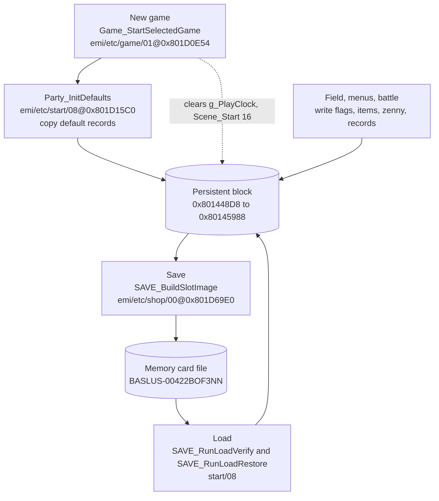
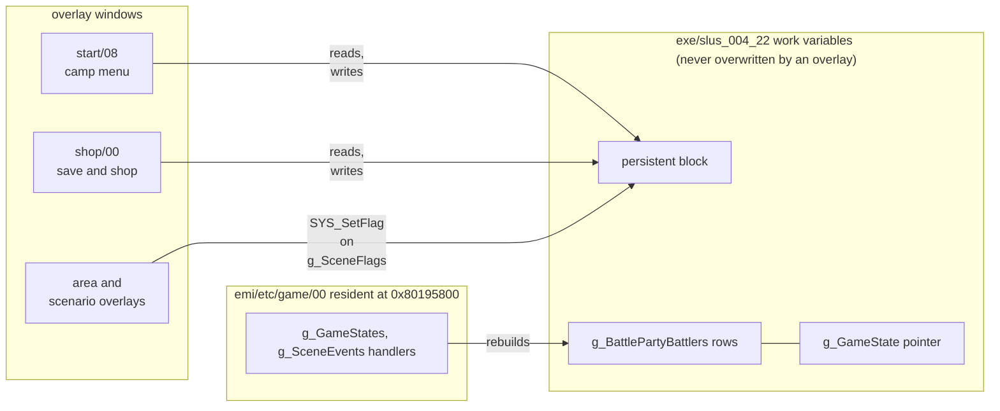

The party, inventory, zenny, story flags, play clock and the player's place in the world live in one 4,272-byte block of RAM at `0x801448D8` that no overlay covers. The block persists across area changes, battles, menus and the save screen. A save copies it to the memory card; a load copies it back and rebuilds all other state from it. This page maps the block, the state kept outside it and the code that writes it. The record field layouts and the save and load flow are on other pages.

## One persistent block

Every long-lived value sits in the block `0x801448D8..0x80145988`. Save and load copy it byte for byte. `SAVE_BuildSlotImage` copies 4,272 bytes from `g_SceneEventFlags - 0x650`, which is `0x801448D8`. `SAVE_RunLoadVerify` copies the same length back.

The block lies in the executable's work-variable range, which no overlay window covers ([memory](../../concepts/memory/)). An overlay swap never moves or clears it.

Offsets in the table are block-relative. The save-file frame adds `0x200`, so frame offset = block offset + `0x200`. [Game records](../../data/records/#save-layout) uses the frame.

The table lists the block in memory order, with the global's name where the block holds one.

| Offset   | Address      |  Size | Type                 | Name                        | Meaning                                                      |
| -------- | ------------ | ----: | -------------------- | --------------------------- | ------------------------------------------------------------ |
| `+0x00`  | `0x801448D8` |    16 | `SceneState`         | -                           | copy of `g_SceneState` (scenario id, step, timer)            |
| `+0x13`  | `0x801448EB` |     3 | `u8[3]`              | `D_801448EB`, `EC`, `ED`    | scene-event state bytes                                      |
| `+0x20`  | `0x801448F8` |     4 | `u8[4]`              | -                           | four script variable bytes from `0x80146864` to `0x80146867` |
| `+0x24`  | `0x801448FC` |     2 | `u16`                | -                           | area id, copied from `g_GameAreaId`                          |
| `+0x27`  | `0x801448FF` |     1 | `u8` `[inferred]`    | -                           | entry kind byte, from `D_80145E98` `[inferred]`              |
| `+0x28`  | `0x80144900` |     8 | `s32[2]`             | -                           | two position words, from `D_80145EC4` and `D_80145EC8`       |
| `+0x79`  | `0x80144951` |     1 | `u8`                 | -                           | stereo or mono sound flag, read by `SAVE_RunLoadVerify`      |
| `+0x7A`  | `0x80144952` |     2 | `u8[2]` `[inferred]` | `D_80144952`, `53`          | window style and palette bytes `[inferred]`                  |
| `+0x90`  | `0x80144968` | 1,312 | `Character[8]`       | `g_Characters`              | 8 records of 164 bytes                                       |
| `+0x5B0` | `0x80144E88` |   160 | `u8[160]`            | `g_SceneFlagWords`          | 20 scenario flag words of 8 bytes                            |
| `+0x650` | `0x80144F28` |    40 | `u8[40]`             | `g_SceneEventFlags`         | event flag bits                                              |
| `+0x678` | `0x80144F50` |     4 | `u32`                | `g_Zenny`                   | the party's money                                            |
| `+0x682` | `0x80144F5A` | 3 + 3 | `u8[3]` each         | `D_80144F5A`, `D_80144F5D`  | field order, then battle order                               |
| `+0x6E8` | `0x80144FC0` |     4 | `GameClock`          | `g_PlayClock`               | hours, minutes, seconds, thirtieths                          |
| `+0x70C` | `0x80144FE4` |    32 | `u8[32]`             | `g_FishingBestCatch`        | best catch per fish                                          |
| `+0x74C` | `0x80145024` |     1 | `u8`                 | `g_EmiLoadedCharacterIndex` | the loaded character archive                                 |
| `+0x74D` | `0x80145025` |     1 | `u8`                 | -                           | low byte of `g_GameFlags`                                    |
| `+0x774` | `0x8014504C` |   512 | `u8[4][128]`         | `g_InventoryIds`            | 4 categories of 128 id bytes                                 |
| `+0x974` | `0x8014524C` |   512 | `u8[4][128]`         | `g_InventoryCounts`         | matching quantities                                          |
| `+0xB74` | `0x8014544C` |    32 | `u8[32]`             | `g_VitalItemIds`            | vital item ids                                               |
| `+0xCA0` | `0x80145578` |    28 | `u8[28]`             | -                           | slot summary: name, party portraits, level, clock            |
| `+0xCBC` | `0x80145594` |    18 | `u16[9]`             | -                           | nine button mask halfwords (`g_InputMasks` copy)             |
| `+0xCF0` | `0x801455C8` |   480 | `FairyJob[60]`       | `g_FairyJobs`               | 60 rows of 8 bytes                                           |

The block also holds records this table does not split: the dragon genes at `0x80145548`, the masters at `0x8014554C`, the fairy village rooms at `0x801457A8` and the two countdown timers at `0x80145554` and `0x80145558` ([clock](../../data/field/#inventory-money-and-time)), per [game records](../../data/records/#save-layout). The code that fills the genes, masters and rooms is not traced `[inferred]`.

Notes on the table:

- The slot summary is written by `SAVE_BuildSlotImage (emi/etc/shop/00@0x801D69E0)` just before each save and read back by the slot lists. [Saving](../saving/#building-the-image) lists its fields.
- `SAVE_RunLoadRestore` restores the button masks from `0x80145594` into `g_InputMasks`.
- `g_SceneFlags` is a pointer into `g_SceneFlagWords`, `scenario_id * 8` bytes in. `Scene_Start (emi/etc/game/00@0x801A7704)` sets it, and `SAVE_RunLoadRestore` rebuilds it after a load.
- Only the low byte of `g_GameFlags` (a `u16` at `0x80146258`) is saved, through `D_80145025`.

### Not persistent

These values live outside the block. The game rebuilds or resets each one.

| Address                    | Type             | Name                                      | Meaning                                                           |
| -------------------------- | ---------------- | ----------------------------------------- | ----------------------------------------------------------------- |
| `0x80146250`               | `PartyMember*`   | `g_GameState`                             | pointer into `g_BattlePartyBattlers` rows, set per mode           |
| `0x80145E90`               | `PartyMember[3]` | `g_BattlePartyBattlers`                   | per-party work rows of 320 bytes, rebuilt from `g_Characters`     |
| `0x80143BB0`               | `u8`             | `g_GameStateIndex`                        | request code for the next field step, reset on entry              |
| `0x80143B90`, `0x80143B92` | `u16` each       | `g_GameEntryState`, `g_GameEntrySubstate` | menu and main-loop step selectors                                 |
| `0x8014625A`               | `u16`            | `g_AreaWalkFlags`                         | outside the block; `Game_NewGame` sets the entry bits             |
| `0x80146254`               | `u8`             | `g_PartySize`                             | party size, recomputed from the order array by `Party_CountOrder` |
| overlay windows            | -                | area, scene and actor tables              | reloaded with the area and scenario overlays `[inferred]`         |

`g_GameState` is not game progress. `func_801E3EC4 (emi/etc/start/08@0x801E3EC4)` points it at a `g_BattlePartyBattlers` row for the camp menu, and `Party_BuildBattlers (emi/etc/game/00@0x801C1400)` points it at one row per party member for the field.

## How the block changes

Four things write the block: a new game, the field and its menus, a save, and a load.

`Game_StartSelectedGame` stops the sound effects, sets sound layout 0, clears the play clock, calls `Scene_Start(16)` and registers `Game_UpdateMain`. `Party_InitDefaults` supplies the default party records. It runs as state 0 of camp substate 2, which the New Game choice selects ([saving](../saving/#the-continue-menu)). For records 0 to 6 it copies `D_801EB514[i]` and sets base, current and record willpower to `(level << 4) / D_801EBA34[i][0] + D_801EBA34[i][1]`. It copies `D_801EB990` into the record that `D_80181B1A` names.

## Overlays and the block

Game progress lives in the block or in the executable's work variables. An overlay's own variables, such as the load screen's `D_801ED860`, are lost when the overlay is replaced. Scenario overlays write flags through `g_SceneFlags` `[inferred]`. The writers of the block are `SAVE_RunLoadRestore`, `SAVE_BuildSlotImage` and `Scene_Start`.

## What the game rebuilds

| Trigger                       | What is rebuilt                                                                                  | Function (image@address)                              |
| ----------------------------- | ------------------------------------------------------------------------------------------------ | ----------------------------------------------------- |
| Field entry after boot / load | `g_BattlePartyBattlers` rows from `g_Characters` and the field order; `g_PartySize`              | `Party_BuildBattlers (emi/etc/game/00@0x801C1400)`    |
| Field entry after boot / load | `g_GameAreaId` set to `0xFFFF`, then the area load; entry context and position from the block    | `Game_NewGame (emi/etc/game/00@0x801970EC)`           |
| Field entry                   | `g_GameStateIndex = 5`, so the next field step is the entry step                                 | `Game_RequestAreaChange (emi/etc/game/00@0x8019FA28)` |
| Load                          | live stats for all 8 records: base `+0x3C` block copied over `+0x1C`, then fatigue and equipment | `Char_RebuildStats (exe/slus_004_22@0x80164A44)`      |
| Load                          | character code and graphics archives for `g_EmiLoadedCharacterIndex`                             | `SAVE_RunLoadRestore (emi/etc/start/08@0x801E5FD4)`   |
| Load                          | scenario overlay for `g_SceneState.scenario_id`                                                  | `Scene_LoadOverlay` via `SAVE_RunLoadRestore`         |
| Entering the save screen      | nothing; the shop overlay streams in and the field frame keeps running under it                  | `Game_LoadShopOverlay (emi/etc/game/00@0x80198270)`   |

`Game_NewGame` also clears the battle options and encounter bytes, sets the pending-entry bit in `g_AreaWalkFlags`, and, when the play clock is nonzero, saves the current music id as the area music request before it clears `g_SndBgmId` ([audio](../audio/#music)).

## Party records and lists

### Party records

`g_Characters` holds eight 164-byte records. The field layout is in [game records](../../data/records/). Two details come from the code:

- `Party_AddMember (exe/slus_004_22@0x801667A4)` maps the character id through `g_CharSlot` to a record and sets bits `0x01` and `0x02` of its flag byte `unk_07`. When fewer than three members are in the field it appends the id to both order arrays. When the party is full it replaces the first field-order member whose record has bit `0x02` clear and who is also in the battle order, in both arrays, and returns 0 if none qualifies. The meaning of the two bits is not traced `[unknown]`.
- `Char_RebuildStats` treats `+0x3C` as base stats and `+0x1C` as live stats. A load recomputes all live stats, so any stale live value in a save is overwritten. It then lowers max HP by `(base_hp * fatigue + 5) / 10`, caps current HP to the new max, and applies inoculation resistances and per-character chance tuning.

### Order arrays

`D_80144F5A` holds the field order and `D_80144F5D` the battle order, three bytes each, with `0xFF` as an empty entry. `Party_CountOrder` counts the leading non-255 entries of either array (`mode` selects the array, `mode * 3` bytes in), and `Party_AddMember` fills both.

### Inventory

There are four categories (item, weapon, armor, accessory), each with 128 id bytes and 128 quantity bytes. `Party_CountItem (exe/slus_004_22@0x8016628C)` reads the ids and counts through two pointer tables, `D_801C893C` and `D_801C8950`, which live in `emi/etc/game/00`. The executable thus depends on the resident game image to count items. With mode 0 it returns the inventory quantity. With another mode it counts the item among the equipment of live records that have flag bit `0x01` set, and for accessories adds the fishing rod and lures.

### Zenny

`Party_AddZenny (exe/slus_004_22@0x8016666C)` adds to `g_Zenny` and clamps at 9,999,999, returning 0 when it clamps. When its second argument is zero it also adds to `D_80145030`, a second running total whose use is not traced `[unknown]`.

## Data and limits

| Limit              | Value                                                      |
| ------------------ | ---------------------------------------------------------- |
| Block size         | 4,272 bytes at `0x801448D8`                                |
| Party records      | 8, of 164 bytes                                            |
| Party in the field | 3 (field and battle order arrays of 3 bytes)               |
| Zenny              | at most 9,999,999                                          |
| Inventory          | 4 categories of 128 stacks                                 |
| Scenario flags     | 20 words of 8 bytes; `Scene_Start` clears the low 32 flags |
| Event flag bits    | 40 bytes, 320 bits                                         |

An edit keeps the block size and the checksum rule ([save format](../../formats/save/#checksum)). The block has no version field; a load cannot detect a changed field meaning.

## Open questions

- The entry values at `D_80145E98`, `D_80145EC4` and `D_80145EC8` rest on their offsets in the first party row (`+8`, `+0x34`, `+0x38`) and the names in `Game_NewGame` (`context_kind`, `context_a`, `context_b`) `[inferred]`. Settled by: tracing the writers of those cells in the area code.
- Whether a load resumes the save-point event, since the scene-event bytes at `0x801448EB` to `0x801448ED` are inside the block. Settled by: saving during the event and tracing the first frames after the load.
- The block content between `0x80144F60` and `0x80144FC0`, between `0x80144FC4` and `0x80144FE4`, and between `0x80145025` and `0x8014504C`. Settled by: finding the readers and writers of those addresses.
- `D_80145030`, the second zenny total, has no reader. Settled by: searching every image for loads from `0x80145030`.
- Which scenario overlays write which flag bits. Settled by: decoding the flag opcodes of each scenario overlay.
- Whether the new-game name entry reaches `Party_InitDefaults` before the first field frame. Settled by: tracing camp substate 2 to `Game_StartSelectedGame`.

## Sources and confidence

- **Confidence:** medium. The block bounds, the copy in both directions and the named globals are read in the code. Several fields rest on names or offsets alone, and three ranges of the block are unexplained.
- **Evidence:** the save and load copies in `SAVE_BuildSlotImage` and `SAVE_RunLoadVerify`, the rebuild in `SAVE_RunLoadRestore`, `Menu_ExitCamp`, `Game_NewGame` and `Party_BuildBattlers`, the new-game path in `Game_StartSelectedGame` and `Party_InitDefaults`, and the party, inventory and zenny functions (`Party_AddMember`, `Party_CountItem`, `Party_AddZenny`, `Char_RebuildStats`).

## Related

- [Saving and loading](../saving/): the screens, card driver and checks around the block.
- [Game records](../../data/records/#save-layout): the field layouts inside the block, in save-file offsets.
- [Memory card save](../../formats/save/): the file around the block and its checksum.
- [Memory map](../../concepts/memory/): why no overlay covers the block.
- [Scenario engine](../scenario/): the scenario state and flag words in the block.
