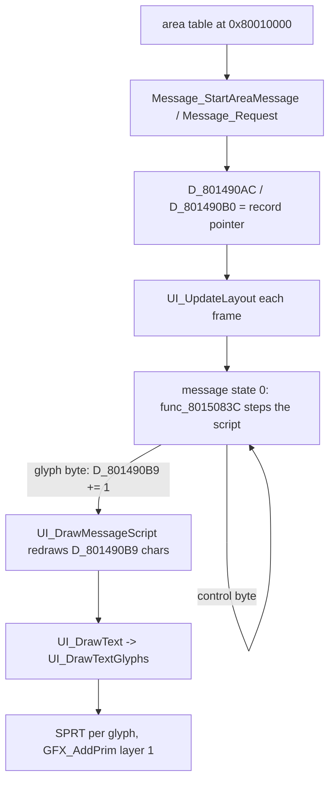
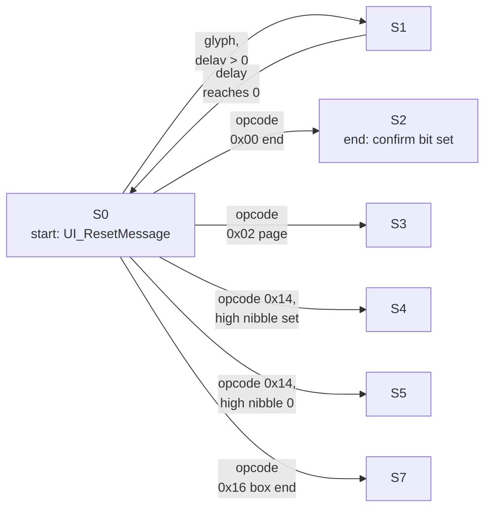

All conversation, menu and number text goes through one text engine in the resident executable. The engine turns a message record from the area's [message table](../../formats/area/) into a box at the bottom of the screen, text drawn one character at a time, a button-wait marker, an optional choice list and screen fades. It draws through the primitive queue ([rendering](../rendering/)). This page covers the message state machine, the window panels, the text drawers and the full-screen fades. The byte encoding and control codes are in [game text](../../data/text/); the overlay that opens each full-screen mode is in [screens](../screens/). Functions are in the main executable `exe/slus_004_22` unless stated.

## Terms

| Term          | Meaning                                                                                                   |
| ------------- | --------------------------------------------------------------------------------------------------------- |
| Message       | One script of text bytes in a message table. The engine draws it a character at a time.                   |
| Channel       | The window script record at `g_UiWindowChannel` (`0x801490A4`): flags, delay timer, script cursors.       |
| Message state | The byte `D_801490A0.state_00` (0 to 7) that selects the engine's current step.                           |
| Panel         | A window frame task in `g_MenuPanelTasks`; see [scheduler](../../concepts/scheduler/#work-record-tables). |
| Local mode    | One of 21 screen effects started by `UI_SetMode` (a fade or wipe).                                        |

## The string path

A string reaches the screen in five steps.

1. **Table in RAM.** The EMI loader copies an area archive's message table to `0x80010000` ([loading](../../concepts/loading/)). `Message_StartAreaMessage` and `Message_StartRequest` read that address as the table.
2. **Request.** Game code calls `Message_StartAreaMessage (exe/slus_004_22@0x80150224)` with a message index, or `Message_Request (exe/slus_004_22@0x80150284)` with a resource id. The first reads the `u16` at `0x80010000 + index * 2` and adds `0x80010000`. The second calls `Message_GetText (exe/slus_004_22@0x801502D0)`, which uses the table at `0x8001A000`: `(id >> 12) & 0xC` selects a base word, then a `u16` offset table follows. Both store the record pointer in `D_801490AC` and `D_801490B0`, store the request in `g_MessageRequest`, and call `UI_ResetMessage`.
3. **Engine.** `UI_UpdateLayout (exe/slus_004_22@0x801503E0)` runs once per frame while the panel is open. It dispatches the message state (8 states) and the selection state (6 states), then redraws the message.
4. **Glyph.** `UI_DrawMessageScript (exe/slus_004_22@0x80150470)` walks the script from the start each frame and draws `D_801490B9` characters, one `UI_DrawText` call per character at 8 pixels advance. The script step `func_8015083C` adds one to `D_801490B9` per character. The whole message is redrawn each frame, so this counter produces the typewriter effect.
5. **Sprite.** `UI_DrawTextGlyphs` builds one `SPRT` per glyph and calls `GFX_AddPrim` on layer 1 ([rendering](../rendering/)).

Control codes that insert text (`{GOTO}`, `{INSERT}`, `{VAR}`, `{LINK}`, [text codes](../../data/text/)) are followed by a character budget in `UI_DrawMessageScript`. Party-record names are 6 characters, read from `0x80144968 + slot * 0xA4`. A variable string is 33 steps, read from `0x801490D8 + n * 32`. A link through the message table's own sub-table is 17 characters. After the budget the cursor returns to the byte after the code.

## Message state machine

`Message_DispatchState` copies the table `D_80149A5C` to the stack and calls the handler for `D_801490A0.state_00`. `Message_DispatchChoiceMode` does the same for the selection state `D_801490A2` with `D_80149AB4`. Each handler either runs the script or waits for the player.

| State | Handler              | Role                                                                                             |
| ----: | -------------------- | ------------------------------------------------------------------------------------------------ |
|     0 | `func_8015083C`      | Run the script until a glyph, a page, a choice, the end or a box end.                            |
|     1 | `UI_TickChoiceTimer` | Count the per-character delay `D_801490A6` down. At zero, return to state 0.                     |
|     2 | `func_80150E48`      | Message end. Step 0 waits for a button (`func_80150E98`), step 1 sets confirm (`func_80150F08`). |
|     3 | `func_80150F3C`      | Page wait. Step 0 draws the wait marker and waits for a button, step 1 is `func_8015102C`.       |
|     4 | `func_801510DC`      | Choice list, 8 steps by `g_UiWindowStep`. Per-step roles `[unknown]`.                            |
|     5 | `func_80151538`      | Choice list variant, 6 steps by `g_UiWindowStep`. Per-step roles `[unknown]`.                    |
|     6 | `func_80151820`      | Clears the state when the owner mode byte is 2.                                                  |
|     7 | `func_80151844`      | Box end, 2 steps by `g_UiWindowStep`.                                                            |

The diagram shows only the transitions out of state 0, from the `switch` in `func_8015083C` and the table `D_80149A5C`. The exits of states 2 to 7 are `[inferred]`: the handlers change the owner mode byte `D_80148333` and bits of `g_UiWindowChannel` that other code reads.

**Typewriter speed.** After each glyph, `func_8015083C` loads the delay from the byte table at `D_8017F5B4`, row `D_80144950` (a signed byte; the option that sets it is `[unknown]`). Byte 0 applies when a pad button is held (`g_InputMasks & g_InputHeld`), byte 1 otherwise. A zero delay keeps state 0. Any other value goes to state 1 for that many frames. `FRONTEND_FLAG_FORCE_STEP` forces a delay of 3. The channel flag `FRONTEND_FLAG_NO_INPUT_WAIT` (toggled by opcodes `0x10` and `0x11`) makes the script run without waiting.

**Choice.** The `{CHOICE}` code (`0x14`) stores the count (`operand & 0xF`, minus one) and the layout nibble, then enters state 4 or 5. The pick is kept in `D_801490C7`. `UI_HandleChoiceInput` moves it on repeated direction input, wrapping at zero. The pick selects the next message through a dozen small functions (`func_80152370`, `Message_SetAnswerMessage5` to `Message_SetAnswerMessage15`). Each stores entry `D_801490C7` of a row of tables at `0x8017F628..0x8017F664` into `g_MessageRequest`. The next message starts at the `u16` of the message table at `0x80010000 + g_MessageRequest * 2` (`Message_StartRequest`).

## Windows and panels

The text box is the panel in `g_MenuPanelTasks` slot 0. `UI_ResetMessage (exe/slus_004_22@0x80150304)` calls `Menu_OpenPanelTask(0, 0)`, which sets the slot active with handler index 0, and sets the slot's mode byte to 2. Handler 0 is `func_80158F80`. It picks one of three sub-kinds from the byte `+2` through `D_80149B30`: `func_80158FE0`, `func_801598F4` or `func_80159A20`. `func_80158FE0` runs the five panel states of `D_80149B3C`, indexed by the byte `+3`: `func_80159050`, `func_8015920C`, `func_80159510`, `func_80159580`, `Menu_ClosePanel`. The panel task machine itself (22 slots, 9 handlers, three passes) is in [scheduler](../../concepts/scheduler/#work-record-tables).

A box opens by growing from a point to its full size, stays, then shrinks:

| Piece            | What the code does                                                                                                                                                              |
| ---------------- | ------------------------------------------------------------------------------------------------------------------------------------------------------------------------------- |
| State 0, set up  | `func_80159050` picks size 200 by 54 (`0xC8`, `0x36`), or 120 by 54 when the request flag `0x40` is set. It sets the start position and per-frame steps of a fifth of the size. |
| State 1, growing | `func_8015920C` adds the step each frame, snaps to the origin table, then draws the frame with `func_80159FA0`.                                                                 |
| State 2, open    | `func_80159510`, the step between growing and shrinking. Its body is `[unknown]`.                                                                                               |
| State 3, closing | `func_80159580` shrinks the box the same way and calls `UI_UpdateLayout` while the sub-kind is 0.                                                                               |
| Frame            | `func_80159FA0` draws a gray (`0x78`) four-point outline and `UI_DrawLine` draws the inner line, both on layer 1.                                                               |
| Text origin      | `UI_UpdateLayout` sets it to `(D_80148334 >> 4) + 10`, `(D_80148336 >> 4) + 6` before each redraw.                                                                              |
| Position         | `g_MenuPanelOrigins (exe/slus_004_22@0x8017F90C)`, 32 bytes: two sets of 8 (x, y) byte pairs, selected by `D_801490CE`.                                                         |

The panel fill and the other panel handlers are not in the resident image. The table `g_MenuPanels` (the executable's constant data at `0x80149B0C`) holds `func_80158F80` followed by eight fixed addresses: `0x801D2F9C`, `0x80199558`, `0x801E9074`, `0x801EFD98`, `0x800B0180`, `0x801E8D14`, `0x801E27BC` and `0x800B2088`. They point into overlay windows ([memory](../../concepts/memory/)). A panel armed while its overlay is not loaded jumps into other code `[inferred]`; the loader does not check. `0x80199558` is in `emi/etc/game/00` and `0x801E9074` in `emi/battle/battle/03`. The owners of the other six are `[unknown]`.

## Text drawing

Five drawers cover all text. Each builds sprites from one of three glyph sheets and a palette row.

| Drawer                            | Sheet and cell                                                                                             | CLUT                       | Primitive         |
| --------------------------------- | ---------------------------------------------------------------------------------------------------------- | -------------------------- | ----------------- |
| `UI_DrawTextGlyphs`               | 31 columns, cell 8 wide, 12 high, `u = ((c - 0x30) % 31) * 8`, `v = ((c - 0x30) / 31) * 12 + 0x48 + shade` | `0x7800 \| (flags & 0xF)`  | `SPRT` (`0x14`)   |
| `UI_DrawTextGlyphs`, code `{NUM}` | 21 columns of 12, `u = ((n + 0x5B) % 21) * 12`, `v = shade + ((n + 0x5B) / 21) * 12`                       | same                       | `SPRT`            |
| `UI_DrawAsciiString`              | Same 31-column sheet as the first row.                                                                     | `0x7800 \| (flags & 0x3F)` | `SPRT` (`0x14`)   |
| `UI_DrawTextString`               | 31 columns, or 32 columns of 8 by 8 for `0x15`: `u = ((n + 0x40) % 32) * 8`                                | `0x7800 \| (flags & 0xF)`  | `SPRT`            |
| `UI_DrawGlyphString`              | 32 columns of 8 by 8 from `0x20`: `u = ((c - 0x20) % 32) * 8`, `v = ((c - 0x20) / 32) * 8`                 | `0x7800 \| (clut & 0x3F)`  | `SPRT_8` (`0x10`) |

`UI_DrawTextGlyphs` handles control bytes and glyphs for message text. `UI_DrawTextString` draws name-style strings (control bytes `0x01`, `0xFF`, `0x15`). `UI_DrawAsciiString` draws ASCII as 8 by 12 sprites, and `UI_DrawGlyphString` as 8 by 8 sprites.

All of them first call `func_8014FC00(0)`, which emits a draw-mode packet with texture page `0x2F` (column 15, 4 bits per pixel) on layer 1, so the glyph sheets live in that page. The `flags` byte holds the palette in its low nibble and a row style in its high nibble. The high nibble indexes a pair of bytes in `g_NumberRowShades` or `g_TextRowShades` that offset `v` and trim the cell height. Glyph colors are the 16 cells of stage palette row 0 (`0x7800 | n` is VRAM row 480, column `n * 16`); see [rendering](../rendering/#textures-tims-and-palettes).

`UI_DrawText (exe/slus_004_22@0x8014F800)` seeds the cursor: `D_80145ACA` (x), `D_80145ACC` (y) and `D_80145ACE` (line start x). A newline moves y by 12, or by 14 in the message engine (`UI_DrawMessageScript`). Formatted numbers go through `g_UiFormatBuffer` (`0x80145AD4`) with `sprintf`, then `UI_DrawGlyphString`; the `sprintf` call sites are not listed.

## Screen effects

`UI_SetMode (exe/slus_004_22@0x8014ECAC)` starts one of 21 effects; [scheduler](../../concepts/scheduler/#local-ui-modes) has the dispatch. Each table entry is a small function that calls `GFX_RunBlackFade` (a full-screen fade) or `GFX_RunWhiteFade` (a variant) with a step, a semi-transparency flag and a layer.

| Modes (table index) | Call                                            | Effect                             |
| ------------------- | ----------------------------------------------- | ---------------------------------- |
| 0, 1                | `GFX_RunBlackFade(+0x800 / -0x800, 1, 0)`       | Fade, 16 frames.                   |
| 2, 3                | `(+0x2000 / -0x2000, 1, 0)`                     | Fast fade, 4 frames.               |
| 4, 5                | `(+0x400 / -0x400, 1, 0)`                       | Slow fade, 32 frames.              |
| 6, 7                | `(+0x800 / -0x800, 1, 2)`                       | Fade on layer 2.                   |
| 8, 9                | `GFX_RunWhiteFade(+0x800 / -0x800, 1, 0)`       | Variant fade.                      |
| 10, 11, 17, 18, 20  | Loops that also change `g_AreaCameraAngle`      | Camera-spin wipes.                 |
| 12                  | Sets `g_AreaViewOffsetZ = 0x5DC`, fade `-0x800` | Fade with a camera distance reset. |
| 13, 14, 15, 16      | `+0x200 / -0x200` with `F514` or `F5F0`         | Slow fades, 64 frames.             |
| 19                  | `GFX_RunBlackFade(0x100, 1, 0)`                 | Very slow fade, 128 frames.        |

The fade body `GFX_UpdateScreenFade` draws a 320 by 240 `TILE` with gray level `position >> 7`, semi-transparent with draw mode `GetTPage(1, abr, 0x140, 0)`, and adds the step to a 16-bit level each frame until the sign bit flips. The frame count is `0x8000 / step`. The thread then calls `CallbackExit`, so every effect ends its slot. That `abr = 2` is a subtractive blend, a fade to black, is PlayStation GPU behavior rather than game data `[inferred]`. The camera behavior of the modes that change the camera is `[unknown]`.

`g_UiWindowEffectBusy` (`0x80143C40`) is the flag other code tests before it starts input or a new effect. The readers are `UI_SetMode` and the title code (`UI_WaitTitleInput` at `0x801D0F00`, `UI_UpdateChoicePrompt` at `0x801D0FB8`, `UI_DrawChoicePrompt` at `0x801D11E4`, all `emi/etc/game/01`). No writer is in the resident code. The overlay functions `func_801D74D4`, `Game_LoadAbilityMenu` and `func_801985C8` touch it, but who sets it is `[unknown]`.

## State variables

The engine's state in RAM:

| Address      | Type             | Name                | Meaning                                                                            |
| ------------ | ---------------- | ------------------- | ---------------------------------------------------------------------------------- |
| `0x801490A0` | `u8` [inferred]  | `D_801490A0`        | Message state byte (`state_00`).                                                   |
| `0x801490A1` | `u8`             | `g_UiWindowStep`    | Step index inside a state's sub-table.                                             |
| `0x801490A2` | `u8`             | `D_801490A2`        | Selection state.                                                                   |
| `0x801490A4` | `u16`            | `g_UiWindowChannel` | Channel flags: timer, confirm, selection, request, no-wait, advance, latch, force. |
| `0x801490A8` | `u16`            | `g_MessageRequest`  | Message index; `0xFFFF` means none.                                                |
| `0x801490AC` | `u8*` [inferred] | `D_801490AC`        | Script start pointer.                                                              |
| `0x801490B0` | `u8*`            | `D_801490B0`        | Current record pointer.                                                            |
| `0x801490B9` | `u8`             | `D_801490B9`        | Characters shown.                                                                  |
| `0x801490C7` | `s8`             | `D_801490C7`        | The player's choice.                                                               |
| `0x801490D8` | `u8[][32]`       | `g_TextVariables`   | 32-byte variable strings.                                                          |

## Data and limits

Limits of the text engine and what a replacement asset must respect:

| Limit                       | Value                                                                                            | Source                                                         | Asset must stay within                                                  |
| --------------------------- | ------------------------------------------------------------------------------------------------ | -------------------------------------------------------------- | ----------------------------------------------------------------------- |
| Characters per frame budget | Bounded by the primitive arena ([rendering](../rendering/#data-and-limits))                      | `GFX_AddPrim`                                                  | Text beyond the arena is dropped, not truncated by the engine.          |
| Name insert                 | 6 characters                                                                                     | `UI_DrawMessageScript`                                         | Party names fit 6 glyphs when inserted into a message.                  |
| Variable string             | 32 bytes per entry; the budget is 33 steps because the cursor steps past the operand first       | `g_TextVariables[][0x20]`                                      | Variable text stays under 32 bytes.                                     |
| Table link                  | 17 characters                                                                                    | `UI_DrawMessageScript`                                         | A linked message shows at most 17 characters.                           |
| Message table offsets       | `u16` offsets from `0x80010000`                                                                  | `Message_StartAreaMessage`                                     | A table is under 64 KiB; the record pointer is `0x80010000 + u16`.      |
| Resource groups             | 4 (id bits 14 and 15)                                                                            | `Message_GetText` mask `0xC`                                   | Resource ids use groups 0 to 3, index below `0x4000`.                   |
| Window size                 | 200 by 54 or 120 by 54 pixels                                                                    | `func_80159050`                                                | Message text fits the box: glyphs advance 8 pixels, a newline moves 14. |
| Window positions            | 8 per set, 2 sets                                                                                | `g_MenuPanelOrigins`, `D_801490CE`                             | Position index below 8.                                                 |
| Glyph sheet                 | 31 columns of 8 by 12 cells at texture page `0x2F`; 32 columns of 8 by 8; 21 columns of 12 by 12 | `UI_DrawTextGlyphs`, `UI_DrawTextString`, `UI_DrawGlyphString` | A replacement font keeps the cell grid and page.                        |
| Palette for text            | 16 cells (columns 0 to 15) of stage row 0                                                        | CLUT `0x7800 \| n`                                             | Text colors sit in the first 16 cells of arena row 0.                   |

## Open questions

| Question                                                                 | What would settle it                                                                      |
| ------------------------------------------------------------------------ | ----------------------------------------------------------------------------------------- |
| Per-step roles of message states 4, 5 and 7                              | Read the 8, 6 and 2 step functions and the shop and start-menu callers.                   |
| Source of `D_80144950` (message speed) and the row count of `D_8017F5B4` | Search writers of `D_80144950` in the options menu.                                       |
| Who writes `g_UiWindowEffectBusy`                                        | Read `func_801D74D4`, `Game_LoadAbilityMenu`, `func_801985C8`.                            |
| Overlay owners of six `g_MenuPanels` handlers                            | Map each address to its overlay window and archive.                                       |
| Panel fill drawing and the pass-order meaning of modes 0, 1, 2           | Read `func_80158FE0`, `func_801598F4`, `func_80159A20`.                                   |
| Battle messages (`g_BattleMessageState`) use a separate path             | Read the `emi/battle/battle/03` message functions.                                        |
| Camera-spin effects (modes 10 to 20)                                     | Read `func_8014EF80`, `func_8014F024`, `func_8014F24C`, `func_8014F2F0`, `func_8014F460`. |

## Sources and confidence

- **Confidence:** medium. The string path, the message state dispatch, the typewriter delay, the drawers and the fade bodies are read in the code. The roles of states 4, 5 and 7, the panel handler owners and the camera-spin effects are not.
- **Evidence:** `UI_UpdateLayout`, `UI_DrawMessageScript`, `UI_DrawTextGlyphs`, `UI_SetMode` and the panel functions in `exe/slus_004_22`, the message-state and panel tables read from RAM, and the title and overlay functions that read `g_UiWindowEffectBusy`.

## Related

- [Game text](../../data/text/): the byte encoding and control codes that the engine interprets.
- [Screens](../screens/): the full-screen modes that draw panels and text through this engine.
- [Rendering](../rendering/): the primitive queue, glyph pages and palettes that the drawers use.
- [Scheduler and tasks](../../concepts/scheduler/): the panel task machine and the screen-effect dispatch.
- [Edit text and dialogue](../../guides/text/): what to keep when you change messages.
